# PlantãoSeguro

**A IA recomenda, o humano decide.** Plataforma que ajuda hospitais a cobrir plantões médicos mais rápido e com mais segurança, com recomendação explicável, contestável e auditável, desenhada para as regras do CFM de 2026.

Projeto final da disciplina **Hands On – Aplicação de IA nos negócios** (pós-graduação, Mackenzie), Prof. Fabio Versolatto.

> **Status (30/10/2026):** Entrega 1 (descoberta) realizada; **Entrega 2 pronta**: dados sintéticos, análise, solução de IA e uma **PoC mínima executável** (recomendação e explicação, por linha de comando), com o documento em [PDF de 6 páginas](docs/entrega-2/Entrega2-PlantaoSeguro.pdf) e o [guia de postagem](docs/entrega-2/LEIAME.md). Interface, API e n8n estão **adiados** ([ADR 0004](docs/adr/0004-prototipo-adiado.md) e [0005](docs/adr/0005-gp-poc-minima-e-especificacao.md)); o LLM do produto é o **Gemini** ([ADR 0003](docs/adr/0003-llm-do-produto-gemini.md)), ainda **não exercitado** com chave.
> Projeto acadêmico: todos os dados da demonstração serão sintéticos e nenhum documento gerado tem validade médica ou legal.

## A ideia em um parágrafo

Fazer o que a Flexzo (Reino Unido e EUA) faz, com rede de profissionais verificados, matching e previsão de escassez, e acrescentar o que o Brasil exige em 2026: recomendação explicável e contestável, auditoria de equidade, controle de jornada e aderência às Resoluções CFM 2.454, 2.460 e 2.462. O hospital descreve a vaga em texto livre, a IA extrai os campos, regras em código filtram quem é elegível, um modelo ranqueia, a IA explica o motivo de cada recomendação, e o coordenador decide.

```mermaid
flowchart LR
    A["1. Vaga publicada<br/>em texto livre"] --> B["2. Demanda (LLM)<br/>extrai os campos"]
    B --> C["3. Filtro (código)<br/>CRM, jornada, raio"]
    C --> D["4. Ranking<br/>chance de aceitar"]
    D --> E["5. Explicação<br/>motivos do ranking"]
    E --> F["6. Coordenador<br/>decide e confirma"]
    F --> G["7. Oferta (n8n)<br/>cascata de ofertas"]
    G --> H["8. Aceite<br/>check-in e pagamento"]
    AUD["Toda recomendação, explicação e contestação<br/>fica na trilha de auditoria"]
    H -.-> AUD
    classDef humano fill:#dbeafe,stroke:#1d4ed8,stroke-width:2px
    classDef trilha fill:#f3f4f6,stroke:#6b7280,stroke-dasharray:4 4
    class F humano
    class AUD trilha
```



A IA atua nas etapas 2, 4 e 5; filtro, prazos e registros ficam em código, e a decisão final é do coordenador.

## Conformidade por desenho

| Norma ou tema | Resposta do desenho |
| --- | --- |
| Res. CFM 2.454/2026 (IA na medicina) | Ficha de risco, explicação por recomendação, botão de contestar, confirmação humana e trilha de auditoria |
| Res. CFM 2.460/2026 (vantagens econômicas) | Assinatura fixa do hospital, sem comissão; nenhum pagamento influencia o ranking (teste automatizado). **Requer parecer jurídico** |
| Res. CFM 2.462/2026 (pagamento de médicos) | Tabela de pagamentos com prazos e alertas de atraso; a plataforma não custodia dinheiro |
| Pejotização (STF, Tema 1.389) | Plataforma neutra quanto ao tipo de contrato; não impõe horários nem penalidades |
| Jornada | Política configurável por hospital (padrão: 24 h contínuas e 11 h de descanso) |
| LGPD | Minimização de dados, relatório de impacto e revisão humana das decisões automatizadas |

Os detalhes, as fontes e os pontos que ainda precisam de validação estão na [Entrega 1](docs/01-entrega-1-descoberta.md), seção 13.

## Como rodar a PoC

Precisa só do Python 3.12 e do `make` (no Windows, `make PYTHON="py -3.12" ...` se preciso). Sem Docker, banco ou chave de API.

```
make poc      # gera os dados, treina e avalia, roda a demonstração, o exemplo trabalhado e a análise
make test     # testes automatizados
make entrega  # PDF da Entrega 2 (precisa de Edge ou Chrome)
```

A demonstração recebe uma vaga em texto livre, mostra os campos extraídos, o top 5 com o motivo de cada um, os excluídos com a regra que barrou, registra a aprovação e verifica a trilha de auditoria. Tudo é simulação com dados sintéticos. Detalhes na [ficha do componente](services/matching-api/README.md) e no [exemplo trabalhado](docs/exemplo-trabalhado.md).

## Stack da PoC e stack prevista

**PoC (hoje):** Python 3.12 (só biblioteca padrão), pytest, ruff, GitHub Actions. **Prevista:** Next.js, Tailwind e shadcn/ui (PWA) · FastAPI (API de matching) · n8n em modo fila (Redis + Postgres próprio) · Supabase (Postgres, Auth, RLS, Realtime) · Gemini (3.5 Flash-Lite e 3.8 Flash) com saída estruturada · scikit-learn e LightGBM (ranking) · Fairlearn (equidade) · Langfuse (observabilidade de IA) · Docker Compose e Traefik em VPS Hostinger no Brasil · GitHub Actions.

Custo estimado do mês da apresentação: US$ 34 a US$ 41 (VPS e Supabase lidos em 20/10/2026; Gemini em 28/10/2026; conferir antes de contratar). Veja [Arquitetura e ferramentas](docs/02-arquitetura-e-ferramentas.md).

## Documentos

| Documento | Conteúdo |
| --- | --- |
| [docs/01-entrega-1-descoberta.md](docs/01-entrega-1-descoberta.md) | **Entrega 1 realizada** (documento de 8 páginas): problema, público, evidências, concorrência, oportunidade de IA, proposta, jornada, indicadores, riscos e conformidade, dados, gestão do projeto, frase-síntese e referências |
| [docs/02-arquitetura-e-ferramentas.md](docs/02-arquitetura-e-ferramentas.md) | Arquitetura em camadas, decisões, ferramentas por etapa, modelo de dados, controles de segurança e conformidade, custo, plano de construção e riscos técnicos |
| [docs/diagrams/](docs/diagrams) | Fontes Mermaid dos diagramas (fluxo da recomendação, arquitetura em camadas, cronograma) |
| [docs/03-entrega-2-prova-de-conceito.md](docs/03-entrega-2-prova-de-conceito.md) | **Entrega 2**: dados, análise, solução de IA, PoC, segurança, conformidade e metas. PDF em [docs/entrega-2](docs/entrega-2/LEIAME.md) |
| [docs/solucao-ia.md](docs/solucao-ia.md), [docs/exemplo-trabalhado.md](docs/exemplo-trabalhado.md), [docs/analise](docs/analise/README.md), [docs/resultados](docs/resultados/metricas-ranking.md) | Desenho da solução de IA, o passo a passo de uma vaga com as contas, a análise exploratória e os resultados da avaliação (simulação) |
| [docs/seguranca-ameacas.md](docs/seguranca-ameacas.md), [docs/wireframes](docs/wireframes/README.md), [docs/teste-manual-gemini.md](docs/teste-manual-gemini.md) | Ameaças e ficha de risco, telas desenhadas e o plano de teste manual do Gemini (ainda não executado) |
| [docs/rastreabilidade-professor.md](docs/rastreabilidade-professor.md) | Exigências do professor (feedback da Entrega 1 e slides da Etapa 2), com status e onde cada uma está atendida |
| [docs/adr/](docs/adr) | Decisões: [segmento inicial](docs/adr/0001-segmento-inicial.md), [escopo da PoC](docs/adr/0002-escopo-da-poc.md), [LLM do produto: Gemini](docs/adr/0003-llm-do-produto-gemini.md), [protótipo adiado](docs/adr/0004-prototipo-adiado.md) e [PoC mínima e especificação](docs/adr/0005-gp-poc-minima-e-especificacao.md) |
| [docs/conformidade/](docs/conformidade/README.md) | O que os textos oficiais das Res. CFM 2.454, 2.460 e 2.462 dizem, lidos em 30/10/2026, e o que depende de jurídico (não é parecer jurídico) |
| [docs/plano-etapa-2.md](docs/plano-etapa-2.md) | Plano da Etapa 2: escopo, frentes, cronograma com portões de aprovação, contratos e metas com linha de base (proposta) |
| [docs/CONTRIBUINDO.md](docs/CONTRIBUINDO.md) | Guia de entrada da equipe: ferramentas, primeiro dia, uso do Claude Code, fluxo de Git e documentação obrigatória |
| [docs/templates/ficha-componente.md](docs/templates/ficha-componente.md) | Modelo da ficha de cada componente (como foi feito, ferramentas, justificativas) |
| [docs/dados/dicionario-de-dados.md](docs/dados/dicionario-de-dados.md) | Dicionário de dados v0: contrato de dados das frentes A1 a A4 (tabelas, papéis, variáveis do ranking, premissas do simulador e qualidade) |
| [docs/diario-de-bordo.md](docs/diario-de-bordo.md) | Decisões do dia e uso de IA no planejamento |
| [docs/ferramentas-agentes.md](docs/ferramentas-agentes.md) | Subagentes, skills e integrações usados no projeto |

## Como contribuir (esteira)

Uma branch por tarefa com o prefixo da fase (`f1/dicionario-dados`...), PR para `main` com o [modelo de PR](.github/pull_request_template.md), revisão de outra pessoa e CI verde (segredos, lint e testes, neutralidade econômica e Compose). Sem push direto na `main`. Quem entra na equipe começa pelo [guia de entrada](docs/CONTRIBUINDO.md). Comandos: `make doctor`, `make poc`, `make test`, `make lint`, `make entrega`.

## Cronograma

| Período | Marco |
| --- | --- |
| 20 a 24/10 | Etapa 1: descoberta, **realizada** (Entrega 1 neste repositório) |
| 27 a 31/10 | Etapa 2: dados, análise, solução de IA e PoC mínima, **pronta** (entrega em 31/10) |
| 3 a 7/11 | Etapa 3: validação |
| 10/11 | Aula de storytelling |
| 17/11 | Apresentação final (presencial) |

## Equipe

Victor Jordão, Roberval Silva, Guilherme Tarrago, Sergio Freitas, Lucas Barbosa e Plinio Camilo.

## Avisos

- Os números de mercado da Flexzo são alegações da própria empresa, não auditadas; as metas dos indicadores são hipóteses a validar nas entrevistas.
- Os textos oficiais das Res. CFM 2.454, 2.460 e 2.462 foram lidos em 30/10/2026 ([conformidade](docs/conformidade/README.md)); a 2.462 traz aviso de suspensão judicial e o enquadramento da plataforma depende de jurídico. A Entrega 1, já entregue, não foi alterada e ainda cita a 2.462 como em vigor.
- Este material não é aconselhamento jurídico, médico ou financeiro.
