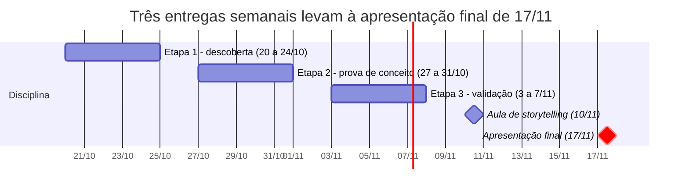

# Entrega 1 — Descoberta | PlantãoSeguro

20/10/2026 · Victor

## 1. Projeto e proposta

O PlantãoSeguro ajuda hospitais a cobrir plantões médicos mais rápido e com mais segurança: a IA recomenda e explica, o coordenador decide, e as regras do CFM ficam embutidas no desenho.

- **Nome (provisório):** PlantãoSeguro. Verificar disponibilidade de marca antes de divulgar.
- **Integrantes:** Victor Jordão, Roberval Silva, Guilherme Tarrago, Sergio Freitas, Lucas Barbosa e Plinio Camilo
- **Disciplina:** Hands On – Aplicação de IA nos negócios (Mackenzie), Prof. Fabio Versolatto.
- **Em uma frase:** fazer o que a Flexzo (Reino Unido e EUA) faz, com rede de profissionais verificados, matching e previsão de escassez, e acrescentar o que o Brasil exige em 2026: recomendação explicável e contestável, auditoria de equidade, controle de jornada e aderência às Resoluções CFM 2.454, 2.460 e 2.462.

## 2. Contexto do negócio

Cobrir plantões virou ao mesmo tempo um problema de coordenação e de conformidade, e 2026 trouxe regras novas para as duas pontas.

- **Oferta de médicos:** o Brasil deve chegar a mais de 635 mil médicos em atividade, 2,98 por mil habitantes. Hipótese a testar: o gargalo está mais na alocação e na coordenação do que na falta absoluta.
- **Intermediação digital:** já atuam apps de vagas e escalas (Revoluna, LinkEscala, MEDSHIFT, Pega Plantão) e a MedToken, que antecipa recebíveis de plantões em 40 hospitais.
- **Regulação em 2026:** a Resolução CFM 2.454 (IA na medicina) vale desde 26/08; a 2.460, contra vantagens econômicas ligadas à contratação de médicos, desde 15/06; e a 2.462 pune pessoas jurídicas que deixam de pagar médicos. O STF ainda não fixou a tese sobre pejotização (Tema 1.389).
- **Referência internacional:** a Flexzo levantou US$ 12 milhões em Series A em março de 2026 e cobra assinatura dos hospitais, sem taxa de colocação.

## 3. Problema

Hospitais e médicos ainda cobrem plantões por canais manuais e opacos, o que atrasa o preenchimento, aumenta o risco assistencial e expõe as partes a riscos jurídicos novos.

**Pergunta central:** como recomendar e escalar médicos para plantões de forma rápida, explicável e conforme às normas, sem substituir a decisão humana?

1. **Vagas descobertas são percebidas tarde**, sem previsão que permita agir com antecedência.
2. **Seleção opaca:** não está claro quem recebe a oferta nem por quê. Com a Resolução 2.460, favorecimento em escala ligado a vantagem econômica passou a ser infração ética.
3. **Fadiga sem controle:** não há limite federal único de jornada; pareceres do CFM recomendam não passar de 24 horas ininterruptas.
4. **Pagamento sem rastro:** médicos relatam não controlar quais plantões fizeram nem quais foram pagos, e a 2.462 criou sanções para o atraso.
5. **Conformidade dispersa:** credenciais, regras de jornada e documentos tendem a ficar em planilhas e conversas (hipótese a validar nas entrevistas).

## 4. Público e usuários afetados

O problema atinge seis grupos; a solução precisa servir primeiro a coordenadores e médicos sem prejudicar os demais.

| Grupo | Papel | Dor principal |
| --- | --- | --- |
| Coordenador de escala / diretor técnico | Usuário primário (hospital) | Preencher vagas rápido, sem lacunas e com segurança |
| Médico plantonista | Usuário primário (rede) | Achar plantões que cabem na rotina, receber no prazo e entender por que não foi chamado |
| Gestão e financeiro do hospital | Comprador | Reduzir custo de intermediação e risco regulatório |
| Pacientes | Beneficiário indireto | Atendimento sem lacunas em plantões essenciais |
| Comissão de IA e compliance do hospital | Usuário secundário | Documentação para classificar o risco da ferramenta (Res. 2.454) |
| CRMs e CFM | Regulador | Cumprimento das resoluções de IA, contratação e pagamento |

## 5. Evidências do problema

Há evidência pública de escalas com lacunas e de pressão regulatória, mas não encontrei dado nacional sobre plantões descobertos; as entrevistas de campo precisam fechar essa lacuna.

- **Canoas (RS), jun/2025:** a Justiça bloqueou R$ 200 mil do município por descumprir ordem de regularizar as escalas de um pronto-socorro. A vistoria do Cremers apontou lacunas em plantões essenciais e médicos com inscrição inativa no CRM.
- **Relato dos fundadores do Pega Plantão:** empresas têm dificuldade para achar profissionais fixos e esporádicos, e os profissionais não controlam quais plantões fizeram nem quais foram pagos.
- **Custo do processo manual:** no Hospital Ernesto Dornelles, montar a escala de cerca de 200 funcionários levava de 2 a 3 dias e caiu para 45 minutos com IA, segundo o hospital.
- **Regulação como sintoma:** a 2.462 nasceu para punir atraso no pagamento de médicos, e a 2.460 para coibir a cobrança de percentual como condição de acesso a plantões.
- **Dados da Flexzo (da própria empresa, não auditados):** 65% ou mais de preenchimento em vagas anunciadas fora da força interna, contra 38% só com o banco interno, e até 85% menos gasto com agências.

**A coletar até a Etapa 2:** 3 a 5 entrevistas com coordenadores de escala e 3 a 5 com médicos plantonistas. Perguntas-chave: quantos plantões ficam descobertos por mês, em quanto tempo se preenche cada um, por quais canais, qual a taxa de falta e como e quando o médico é pago.

## 6. Como o problema é resolvido hoje

Hoje se combinam grupos de mensagem, planilhas e gestoras de equipes médicas, ao lado de apps que já organizam candidatura e escala; a Flexzo mostra o próximo passo, com IA e regras embutidas.

| Solução | O que faz | Lacuna observada nas fontes públicas |
| --- | --- | --- |
| Revoluna | Cadastro, documentos, candidatura, triagem, aprovação e atualização automática da escala, com trilha de auditoria. Declara recomendação inteligente, priorização de candidatos e previsão de picos | Alegação da empresa; não encontrei explicação por recomendação, contestação nem auditoria de viés |
| LinkEscala | Perfil, alertas de vagas, candidatura, chat e lembretes | Sem IA descrita |
| MEDSHIFT (PEBMED) | App gratuito com vagas de plantão e pool de médicos para hospitais | Fonte sem data; confirmar se segue ativo |
| Pega Plantão | Gestão e troca de escalas entre profissionais e instituições | Foco em gestão, sem IA descrita |
| Stargrid | Escalas com IA respeitando normas trabalhistas, em hospitais como o Ernesto Dornelles | Escala de equipe interna, não rede aberta de médicos |
| MedToken | Antecipação de recebíveis de plantões, via gestoras de equipes médicas | Financeiro; não faz matching |
| Flexzo (Reino Unido e EUA) | Mais de 100 mil profissionais verificados, match scoring por IA, float pool, escalas, checagem de licenças em tempo real, assinatura sem taxa de colocação | Não cobre as regras brasileiras (CFM, CREMESP, LGPD) |

## 7. Impactos do problema

O custo de cobrir mal um plantão recai sobre o paciente, o caixa do hospital e o próprio médico.

- **Assistência:** lacunas em plantões essenciais comprometem a segurança do atendimento, como no caso de Canoas.
- **Custo:** dependência de agências e intermediários. A Flexzo afirma reduzir até 85% do gasto com agências em hospitais parceiros.
- **Jurídico e regulatório:** as Resoluções 2.460 e 2.462 e a indefinição do STF sobre pejotização aumentam o risco de quem contrata e de quem intermedeia.
- **Saúde do médico:** o CRM-MG e outros pareceres do CFM recomendam não passar de 24 horas ininterruptas, e o Cremesp veda plantões acima de 24 horas em São Paulo.
- **Financeiro:** atraso no pagamento de médicos deixou de ser só problema contratual e passou a ter sanção administrativa.

## 8. Oportunidade de aplicação de IA

A IA entra onde há texto livre, muitas variáveis e incerteza; regras e prazos ficam em código, onde precisam ser exatos e auditáveis.

| Tarefa | Técnica | Por que essa escolha |
| --- | --- | --- |
| Entender a vaga descrita em texto livre | LLM com saída estruturada | Cada hospital escreve de um jeito |
| Filtrar elegíveis (CRM ativo, especialidade, disponibilidade, raio, jornada e descanso) | Código e SQL | Regra determinística, testável e auditável |
| Ranquear por chance de aceitar e comparecer | Modelo preditivo simples sobre o histórico | Muitas variáveis e incerteza |
| Explicar o motivo de cada recomendação | LLM redige a partir dos fatores do modelo | Clareza para o coordenador, sem inventar motivos |
| Prever vagas com risco de ficar descobertas | Classificação ou série temporal | Sazonalidade e padrões por unidade |
| Auditar concentração e disparidade de ofertas | Métricas de equidade em código | Exigência de mitigação de viés e auditabilidade (Res. 2.454) |

Princípio de projeto: a IA recomenda, o humano decide.

## 9. Proposta inicial da solução

PlantãoSeguro = o que a Flexzo faz + um plus de IA explicável e auditável + conformidade com as resoluções do CFM desde o desenho.

| Camada | O que entrega |
| --- | --- |
| Base: o que a Flexzo faz | Rede de médicos com credenciais verificadas; hospital publica a vaga (banco interno primeiro, rede depois); matching por disponibilidade, local e regras; escala atualizada automaticamente; alertas e check-in; previsão de escassez; assinatura do hospital, sem taxa por contratação |
| Plus de IA | Recomendação explicável (principais fatores por candidato) e contestável pelo médico; previsão de vagas com risco de ficar descobertas, com sugestão de antecedência; auditoria de equidade na distribuição de ofertas; painel de pontualidade de pagamento |
| Conformidade | Classificação de risco e kit de documentos para a Comissão de IA do hospital; política de jornada configurável; nenhum pagamento altera o ranking; plataforma neutra quanto ao tipo de contrato (seção 13) |
| Módulo opcional: área do médico | O médico descreve o que precisa e a IA gera, a partir de um esquema validado, modelos de anamnese e receituário. Na prova de conceito, só com dados fictícios e documentos marcados como simulação |

```mermaid
flowchart LR
    A["1. Vaga publicada<br/>em texto livre"] --> B["2. Demanda (LLM)<br/>extrai os campos"]
    B --> C["3. Filtro (código)<br/>CRM, jornada, raio"]
    C --> D["4. Ranking<br/>chance de aceitar"]
    D --> E["5. Explicação<br/>motivos do ranking"]
    E --> F["6. Coordenador<br/>decide e confirma"]
    F --> G["7. Oferta (n8n)<br/>cascata de ofertas"]
    G --> H["8. Aceite<br/>check-in e pagamento"]
    AUD["Toda recomendação, explicação e contestação<br/>fica na trilha de auditoria"]
    H -.-> AUD
    classDef humano fill:#dbeafe,stroke:#1d4ed8,stroke-width:2px
    classDef trilha fill:#f3f4f6,stroke:#6b7280,stroke-dasharray:4 4
    class F humano
    class AUD trilha
```

*Fluxo da recomendação: 8 etapas, 1 decisão humana.*

A IA atua nas etapas 2, 4 e 5; filtro, prazos e registros ficam em código, e a decisão final é do coordenador.

**Honestidade competitiva:** a Revoluna já declara recomendação e previsão de picos, então ter IA não é diferencial. O diferencial é ser explicável, contestável, auditável e conforme às normas brasileiras.

## 10. Jornada e experiência do usuário

O coordenador resolve a vaga em poucos passos e o médico entende por que recebeu cada oferta.

**Coordenador de escala**

1. Descreve a vaga em texto livre; a plataforma confere os campos extraídos.
2. Vê os candidatos recomendados, cada um com os principais motivos e eventuais alertas de jornada.
3. Confirma ou ajusta; a oferta segue em cascata.
4. Acompanha aceite, check-in e atualização da escala.
5. Registra o pagamento e consulta o histórico.

**Médico plantonista**

1. Cadastra especialidade, CRM, disponibilidade, raio e preferências.
2. Recebe só ofertas relevantes, com o motivo de cada uma.
3. Aceita, faz check-in e acompanha o status do pagamento.
4. Pode contestar uma recomendação ou o seu posicionamento e ver a resposta.

**Dores que a experiência resolve:** vaga descoberta em cima da hora, oferta sem explicação, falta de rastro do que foi pago e jornada sem controle. **Experiência desejada:** rápida, transparente e sem surpresa para os dois lados.

## 11. Benefício esperado

O ganho esperado é preencher plantões mais rápido e com menos risco, com transparência para quem contrata e para quem trabalha. Os números abaixo são hipóteses a validar, não resultados.

- **Hospitais:** menos tempo para cobrir vagas, menos dependência de intermediários e trilha de auditoria pronta para a Comissão de IA. Como referência de mercado, a Flexzo informa 65% de preenchimento na sua rede contra 38% só com banco interno.
- **Médicos:** ofertas aderentes à rotina, motivo de cada oferta, rastro de pagamento e proteção contra jornadas excessivas.
- **Pacientes:** menos lacunas em plantões essenciais.
- **Mercado e regulação:** um exemplo de IA aplicada à gestão em saúde dentro do que o CFM exige, com risco classificado e decisão humana.

## 12. Indicadores de sucesso

O sucesso se mede em velocidade, segurança e justiça da distribuição; as metas abaixo são hipóteses a calibrar com a linha de base das entrevistas.

| Indicador | Como medir | Meta inicial (hipótese) |
| --- | --- | --- |
| Tempo médio até preencher a vaga | Minutos entre publicação e confirmação | Reduzir 50% sobre a linha de base manual |
| Preenchimento com 24 horas ou mais de antecedência | % de vagas | Subir 20 pontos percentuais |
| Recomendações aceitas pelo coordenador | % das recomendações exibidas | 60% ou mais |
| Qualidade da previsão de vagas descobertas | Recall e precisão em teste com histórico | Recall de 0,7 ou mais |
| Violações da política de jornada | Casos sem exceção justificada | Zero |
| Concentração de ofertas | % das ofertas recebidas pelos 10% de médicos mais ofertados; disparidade entre perfis equivalentes | Monitorar e definir teto |
| Pontualidade de pagamento | Dias entre o plantão e o pagamento confirmado | Medir e exibir, sem meta |
| Contestações | Abertas e respondidas no prazo | 100% respondidas |
| Ranking influenciado por pagamento | Casos em auditoria | Zero |

Na prova de conceito os dados são sintéticos; a validação combina simulação, teste com histórico simulado e revisão de especialistas.

## 13. Riscos iniciais e conformidade

O projeto trata dados pessoais, ranqueia pessoas e afeta renda e segurança do paciente; por isso a conformidade entra no desenho, não depois.

**As quatro perguntas de Direito, Ética e Responsabilidade Digital**

- **Existem dados pessoais?** Sim: CRM, documentos, disponibilidade, histórico de aceites e pagamentos.
- **Existe risco de discriminação?** Sim: o ranking pode favorecer ou prejudicar grupos por proxies (região, horários, histórico). Mitigação: atributos protegidos fora do modelo, métricas de disparidade e contestação.
- **A decisão pode afetar pessoas?** Sim: renda dos médicos e segurança do paciente. Mitigação: o coordenador decide e tudo fica registrado.
- **Há questões regulatórias?** Sim, resumidas na matriz abaixo.

| Norma ou tema | O que exige ou o risco | Como o desenho atende |
| --- | --- | --- |
| Res. CFM 2.454/2026 (IA) | Avaliação preliminar de risco (baixo, médio, alto, inaceitável); funções administrativas como agendamento e logística tendem a ser de baixo risco; mitigação de viés, explicabilidade, auditabilidade e contestabilidade; decisão humana | Classificação preliminar como baixo risco, com avaliação de impacto voluntária por afetar direitos dos médicos; ficha de risco e logs para a Comissão de IA do hospital; explicação por recomendação e botão de contestar; coordenador confirma; atributos protegidos fora do modelo |
| Res. CFM 2.460/2026 | Veda vantagem econômica vinculada à contratação, à manutenção de vínculo ou ao favorecimento em escala, inclusive por plataformas digitais; o texto prevê exceções para remuneração de serviços desvinculada de condicionamento à contratação individual | Assinatura fixa do hospital; nada cobrado do médico; sem comissão por contratação; nenhum pagamento altera o ranking (teste automatizado e auditoria); parecer jurídico antes de qualquer piloto |
| Res. CFM 2.462/2026 | Sanções a pessoas jurídicas que não pagam médicos: advertência, multa, suspensão e cancelamento de registro | Registro de prazos combinados e de confirmações; alerta de atraso; painel de pontualidade com direito de resposta do hospital; a plataforma não custodia dinheiro |
| Pejotização e Tema 1.389 do STF | Tese ainda pendente; o plantão exige exame mais rigoroso entre autonomia formal e subordinação | Plataforma neutra quanto ao contrato (CLT, PJ ou autônomo); não impõe horários, metas nem punições; o contrato é entre hospital e médico; parecer jurídico |
| Jornada e segurança do paciente | Sem limite federal único; pareceres do CFM recomendam não passar de 24 horas ininterruptas; Cremesp veda mais de 24 horas em SP; a CLT prevê 11 horas de descanso entre jornadas de empregados | Política configurável com padrão conservador (até 24 horas contínuas e 11 horas de descanso); bloqueio com exceção justificada e registrada por humano |
| LGPD (a validar com jurídico) | Dados pessoais dos médicos; princípios de finalidade, necessidade e transparência; revisão de decisões automatizadas | Minimização, relatório de impacto, explicação e revisão humana das recomendações |
| Módulo opcional do médico | Receita digital exige assinatura ICP-Brasil NGS2; prontuário sem papel exige NGS2; software com finalidade diagnóstica ou terapêutica entra na regulação de software médico da Anvisa | Só demonstração com dados fictícios e documentos marcados como simulação; a IA estrutura modelos e não sugere diagnóstico, conduta nem dose |

**Outros riscos iniciais**

- **Segurança do paciente:** recomendação errada ou credencial falsa. Mitigação: verificação de CRM e revisão humana.
- **Dados:** não há dados reais na prova de conceito; os resultados valem para o cenário simulado.
- **Concorrência:** a Revoluna e outras já atuam; o diferencial precisa ser demonstrável.
- **Excesso de confiança na IA:** o coordenador pode aceitar sem revisar. Mitigação: motivos e alertas visíveis e registro das decisões.
- **Escopo e prazo:** quatro semanas até a apresentação; o módulo do médico fica como extensão.

## 14. Dados potencialmente necessários

A prova de conceito roda com dados sintéticos, e nenhum dado real de médico ou paciente entra no projeto.

| Dado | Uso | Origem na prova de conceito |
| --- | --- | --- |
| Vagas: especialidade, local, horário, valor, urgência | Entrada do matching e da previsão | Gerado, com parâmetros ajustados pelas entrevistas |
| Perfis de médicos: CRM, especialidade, disponibilidade, raio, preferências | Filtro e ranking | Gerado; CRM simulado, sem consulta a registro real |
| Histórico de ofertas, aceites e comparecimento | Treino do modelo de ranking | Gerado com padrões plausíveis |
| Check-ins e pagamentos (prazo combinado e efetivo) | Painel de pontualidade | Gerado |
| Calendário: feriados e sazonalidade | Previsão de vagas descobertas | Calendário público |
| Estabelecimentos e localização | Distância e raio | Locais fictícios |

Atributos protegidos (gênero, idade, raça, origem) ficam fora do modelo, e a auditoria procura proxies. Dados reais só entrariam em piloto com termo de uso, base legal e relatório de impacto, fora do escopo desta disciplina.

## 15. Gestão do projeto: escopo, stakeholders e plano

O escopo cabe em quatro semanas se o núcleo for o matching explicável e o restante ficar como extensão.

| Dentro do escopo | Fora do escopo |
| --- | --- |
| Cadastro de hospital e médico; vaga em texto livre; filtro por regras; ranking explicável; cascata de ofertas; painel de previsão e de equidade; trilha de auditoria | Prescrição com validade legal, prontuário, diagnóstico, custódia de pagamentos, integração com registros reais de CRM |

**Stakeholders:** os seis grupos da seção 4. **Equipe:** [preencher papéis do grupo]. **Arquitetura prevista:** n8n para orquestração e cascata, Supabase (Postgres, Realtime e RLS) para dados e trilha, LLM com saída estruturada e hospedagem em VPS.

**Riscos de projeto:** o escopo crescer para prontuário; dados sintéticos pouco realistas; demonstração ao vivo sem internet. Mitigações: módulo do médico só como extensão, parâmetros calibrados nas entrevistas e plano B com respostas pré-carregadas.

**Plano até a apresentação:** a linha do tempo abaixo mostra as entregas e as aulas.

*Plano até 17/11: 3 entregas, 1 aula de storytelling, 1 apresentação.*

Datas do cronograma da disciplina; a Etapa 1 é entregue em 24/10 e a apresentação final é presencial.

## 16. Disciplinas, frase-síntese e referências

**Cobertura forte (as seis do módulo)**

| **Disciplina** | **Onde aparece no projeto** | **Para evidenciar nas próximas entregas** |
| --- | --- | --- |
| Data Science e Big Data | Ranking sobre histórico de aceites e comparecimento, previsão de vagas descobertas, dados sintéticos, métricas de equidade | Documentar como os dados sintéticos foram gerados e medir a previsão em histórico simulado (recall e precisão) |
| Cybersecurity | Dados pessoais de médicos, trilha de auditoria, isolamento entre hospitais | RLS por hospital no Supabase, token nos webhooks, teste de prompt injection no texto da vaga, VPS atrás de HTTPS |
| IA & User Experience | Jornadas do coordenador e do médico, explicação da recomendação, botão de contestar | Protótipo clicável e um teste rápido de usabilidade com 3 a 5 pessoas |
| IA para Negócios | Problema, benchmark com a Flexzo, assinatura sem comissão, indicadores | Caso de negócio simples com os números das entrevistas (custo de vaga descoberta versus assinatura) |
| Gestão de Projetos com IA | Escopo dentro e fora, stakeholders, cronograma, riscos | Usar IA no próprio planejamento (backlog e riscos) e registrar isso |
| Direito, Ética e Responsabilidade Digital com IA | Matriz de conformidade (CFM 2.454, 2.460, 2.462, STF, LGPD), viés, decisão humana | Resumo de avaliação de impacto algorítmico e ficha de risco como anexo |

**Cobertura boa**

| **Disciplina** | **Onde aparece** | **Para evidenciar** |
| --- | --- | --- |
| Hands-On na Aplicação de IA nos Negócios | É esta disciplina: todo o trabalho | Nada extra |
| Hands-On em IA Aplicadas | PoC com LLM de saída estruturada, modelo preditivo e n8n | Demo ponta a ponta funcionando |
| Ferramentas Tecnológicas para IA | n8n, Supabase, LLM, VPS | Tabela curta justificando cada ferramenta e seu custo |
| Excelência Operacional com IA | Tempo até preencher a vaga, taxa de preenchimento, fim do retrabalho de escala | Mapa do processo atual versus com a plataforma, com os tempos das entrevistas |
| Inovação e Empreendedorismo | Diferencial contra concorrentes, modelo de assinatura, validação por entrevistas | Proposta de valor e plano de validação |
| Transformação Digital & Business Agility | Digitalização da gestão de escalas e mudança no processo do hospital | Roadmap de adoção em fases (piloto numa unidade) e gestão de mudança do coordenador |

**Queremos utilizar IA para** recomendar, de forma explicável e dentro das normas do CFM, os médicos mais adequados a cada plantão e prever as vagas com risco de ficar descobertas, **a fim de** reduzir o tempo e a dependência de intermediários para cobrir escalas sem comprometer a segurança do paciente nem os direitos dos médicos, **beneficiando** hospitais, coordenadores de escala e médicos plantonistas, **medindo o sucesso por meio** do tempo médio até preencher a vaga, da taxa de preenchimento com antecedência e da parcela de recomendações aceitas sem violar a política de jornada.

**Referências** (acessadas em 20/10/2026; várias são notícias e análises de escritórios, então confirmar o texto oficial das normas antes de citar na apresentação)

1. Revoluna: [Aplicativo de startup conecta médicos a vagas de plantão](https://www.tupi.fm/mundo-corporativo/aplicativo-de-startup-conecta-medicos-a-vagas-de-plantao/)
2. Pega Plantão: [Startupi](https://startupi.com.br/gestao-de-escalas-medicas-eis-o-pega-plantao-selecionado-do-startup-brasil/)
3. LinkEscala: [App Store](https://apps.apple.com/bb/app/linkescala/id6504500161)
4. MEDSHIFT: [Afya](https://portal.afya.com.br/saude/um-novo-jeito-para-conseguir-plantoes)
5. MedToken: [Startups.com.br](https://startups.com.br/negocios/medtoken-prepara-oferta-publica-de-tokens-lastreados-em-plantoes-medicos/)
6. Stargrid e Hospital Ernesto Dornelles: [Baguete](https://baguete.com.br/public/noticias/hospital-ernesto-dornelles-gere-escalas-com-stargrid)
7. Flexzo: [site oficial (EUA)](https://www.flexzo.ai/us/)
8. Flexzo, Series A: [UKTN](https://www.uktech.news/ai/agentic-healthcare-platform-flexzo-ai-raises-9m-20260320) e [Vestbee](https://vestbee.com/insights/articles/flexzo-ai-secures-12-m)
9. Canoas (RS): [Sul21](https://sul21.com.br/?p=267886)
10. Res. CFM 2.454/2026: [Intramed](https://www.intramed.net/content/nova-normativa-do-cfm-regula-a-inteligencia-artificial-para-medicos) e [ES Hoje](https://eshoje.com.br/tecnologia/2026/09/ia-na-medicina-novas-regras-criam-obrigacoes-para-clinicas-e-mudam-relacao-com-pacientes/)
11. Res. CFM 2.460/2026: [texto no portal do CFM](https://portal.cfm.org.br/wp-content/uploads/2026/06/2460_2026.pdf) e [notícia do CFM](https://portal.cfm.org.br/noticias/cfm-proibe-cashback-e-vantagens-economicas-vinculadas-a-contratacao-de-medicos)
12. Res. CFM 2.462/2026: [texto no portal do CFM](https://sistemas.cfm.org.br/normas/arquivos/resolucoes/BR/2026/2462_2026.pdf) e [KLA Advogados](https://www.mondaq.com/brazil/healthcare/1807092/cfm-establishes-new-penalties-for-non-payment-of-physicians)
13. Pejotização e Tema 1.389: [Migalhas](https://www.migalhas.com.br/depeso/459577/contratar-medico-como-pj-pode-gerar-vinculo-empregaticio) e [Medicina S/A](https://medicinasa.com.br/?p=168434)
14. Jornada de plantão: [parecer do CFM](https://sistemas.cfm.org.br/normas/arquivos/pareceres/MG/2017/237_2017.pdf) e [Afya Educação Médica](https://educacaomedica.afya.com.br/blog/cnpj-para-medico-plantonista)
15. Módulo do médico: [Res. CFM 2.299/2021](https://www.mattosfilho.com.br/unico/cfm-emissao-documentos-eletronicos/), [Res. CFM 1.821/2007](https://www.unimed.coop.br/site/web/centrooeste/qualifica%C3%A7%C3%A3o-da-rede-prestadora) e [Anvisa, software como dispositivo médico](https://www.regdesk.co/blog/anvisa-guidance-on-software-as-a-medical-device-overview/)
