# Entrega 1 — Descoberta | PlantãoSeguro

20/10/2026 · Victor

## 1. Projeto e proposta

O PlantãoSeguro ajuda hospitais a cobrir plantões médicos mais rápido e com mais segurança: a IA recomenda e explica, o coordenador decide, e as regras do CFM ficam embutidas no desenho.

- **Nome (provisório):** PlantãoSeguro.
- **Integrantes:** Victor Jordão, Roberval Silva, Guilherme Tarrago, Sergio Freitas, Lucas Barbosa e Plinio Camilo
- **Disciplina:** Hands On – Aplicação de IA nos negócios (Mackenzie), Prof. Fabio Versolatto.

## 2. Contexto do negócio

- **Oferta:** o Brasil deve chegar a mais de 635 mil médicos (2,98 por mil habitantes); hipótese: o gargalo está mais na coordenação do que na falta absoluta.
- **Regulação em 2026:** a Res. CFM 2.454 (IA) vale desde 26/08, a 2.460 (vantagens econômicas ligadas à contratação) desde 15/06 e a 2.462 pune quem deixa de pagar médicos; o STF ainda não fixou a tese sobre pejotização (Tema 1.389).

## 3. Problema

Hospitais e médicos ainda cobrem plantões por canais manuais e opacos, o que atrasa o preenchimento, aumenta o risco assistencial e expõe as partes a riscos jurídicos novos. **Pergunta central:** como recomendar e escalar médicos de forma rápida, explicável e conforme às normas, sem substituir a decisão humana?

1. **Vagas descobertas percebidas tarde**, sem previsão que permita agir com antecedência.
2. **Seleção opaca:** não se sabe quem recebe a oferta nem por quê; com a Res. 2.460, favorecer em escala por vantagem econômica virou infração ética.
3. **Fadiga sem controle:** não há limite federal único de jornada; o CFM recomenda até 24 horas ininterruptas.
4. **Pagamento sem rastro:** médicos relatam não saber o que fizeram nem o que foi pago; a 2.462 criou sanções para o atraso.

## 4. Público e usuários afetados

- **Coordenador de escala (usuário primário):** preencher vagas rápido, sem lacunas e com segurança.
- **Médico plantonista (usuário primário):** achar plantões que cabem na rotina, receber no prazo e entender por que não foi chamado.
- **Gestão e financeiro do hospital (comprador):** reduzir custo de intermediação e risco regulatório.
- **Pacientes, Comissão de IA do hospital e CRMs/CFM:** atendimento sem lacunas, documentação para classificar o risco (Res. 2.454) e cumprimento das resoluções.

## 5. Evidências do problema

Há evidência pública de escalas com lacunas e de pressão regulatória, mas não foi encontrado dado nacional sobre plantões descobertos; as entrevistas precisam fechar essa lacuna.

- **Canoas (RS), jun/2025:** a Justiça bloqueou R$ 200 mil do município por não regularizar as escalas de um pronto-socorro (lacunas em plantões essenciais, segundo o Cremers).
- **Processo manual:** no Hospital Ernesto Dornelles, montar a escala de cerca de 200 funcionários levava de 2 a 3 dias e caiu para 45 minutos com IA, segundo o hospital.
- **Flexzo (dados da empresa, não auditados):** 65% ou mais de preenchimento fora da força interna, contra 38% só com o banco interno; até 85% menos gasto com agências.
- **A coletar até a Etapa 2:** 3 a 5 entrevistas com coordenadores de escala e 3 a 5 com plantonistas (plantões descobertos por mês, tempo de preenchimento, taxa de falta e prazo de pagamento).

## 6. Como o problema é resolvido hoje

Hoje se combinam grupos de mensagem, planilhas e gestoras de equipes médicas, ao lado de apps de vagas e escalas; a Flexzo mostra o próximo passo.

- **Revoluna:** candidatura, triagem e escala automática com trilha de auditoria; declara recomendação e previsão de picos. *Lacuna:* alegação da empresa, sem explicação por recomendação nem contestação.
- **LinkEscala, MEDSHIFT, Pega Plantão, Stargrid e MedToken:** vagas, alertas e gestão de escalas (Stargrid: escalas com IA para equipe interna; MedToken: antecipação de recebíveis). *Lacuna:* sem IA descrita, sem rede aberta de médicos ou apenas financeiro.
- **Flexzo (Reino Unido e EUA):** mais de 100 mil profissionais verificados, match scoring por IA, float pool e assinatura sem taxa de colocação. *Lacuna:* não cobre as regras brasileiras (CFM, CREMESP, LGPD).

## 7. Impactos do problema

- **Assistência e saúde do médico:** lacunas em plantões essenciais comprometem o atendimento (Canoas); jornadas acima de 24 horas contrariam pareceres do CFM e o Cremesp (SP).
- **Custo e risco jurídico:** dependência de agências e intermediários; as Resoluções 2.460 e 2.462 e a indefinição do STF sobre pejotização elevam o risco de quem contrata e de quem intermedeia, e o atraso no pagamento passou a ter sanção.

## 8. Oportunidade de aplicação de IA

A IA entra onde há texto livre e incerteza; regras e prazos ficam em código, exatos e auditáveis.

- **LLM com saída estruturada:** entende a vaga descrita em texto livre e redige a explicação de cada recomendação a partir dos fatores do modelo, sem inventar motivos.
- **Código e SQL:** filtra elegíveis (CRM ativo, especialidade, disponibilidade, raio, jornada e descanso), de forma determinística e auditável.
- **Modelo preditivo simples:** ranqueia por chance de aceitar e comparecer; classificação ou série temporal prevê vagas descobertas.
- **Métricas de equidade em código:** auditam concentração e disparidade de ofertas (Res. 2.454).

## 9. Proposta inicial da solução

PlantãoSeguro = o que a Flexzo faz + um plus de IA explicável e auditável + conformidade com as resoluções do CFM desde o desenho. Princípio: a IA recomenda, o humano decide.

- **Base (como a Flexzo):** rede de médicos com credenciais verificadas, vaga publicada pelo hospital, matching por disponibilidade, local e regras, alertas e check-in, assinatura sem taxa por contratação.
- **Plus de IA:** recomendação explicável e contestável; previsão de vagas com risco de ficar descobertas; auditoria de equidade das ofertas; painel de pontualidade de pagamento.
- **Conformidade:** ficha de risco e kit para a Comissão de IA; jornada configurável; nenhum pagamento altera o ranking; plataforma neutra quanto ao contrato (seção 13).
- **Módulo opcional (área do médico):** modelos de anamnese e receituário gerados por IA, só com dados fictícios e marcados como simulação; documentos reais exigiriam assinatura ICP-Brasil NGS2 e, para software diagnóstico ou terapêutico, a Anvisa.

```mermaid
flowchart LR
    A["1. Vaga publicada<br/>em texto livre"] --> B["2. Demanda (LLM)<br/>extrai os campos"]
    B --> C["3. Filtro (código)<br/>CRM, jornada, raio"]
    C --> D["4. Ranking<br/>chance de aceitar"]
    D --> E["5. Explicação<br/>motivos do ranking"]
    E --> F["6. Coordenador<br/>decide e confirma"]
    F --> G["7. Oferta (n8n)<br/>cascata de ofertas"]
    G --> H["8. Aceite<br/>check-in e pagamento"]
    AUD["Toda recomendação, explicação e contestação<br/>fica na trilha de auditoria"]
    H -.-> AUD
    classDef humano fill:#dbeafe,stroke:#1d4ed8,stroke-width:2px
    classDef trilha fill:#f3f4f6,stroke:#6b7280,stroke-dasharray:4 4
    class F humano
    class AUD trilha
```

*Fluxo da recomendação: 8 etapas, 1 decisão humana.*

A IA atua nas etapas 2, 4 e 5; filtro, prazos e registros ficam em código, e a decisão final é do coordenador.

**Honestidade competitiva:** a Revoluna já declara recomendação e previsão de picos, então ter IA não é diferencial. O diferencial é ser explicável, contestável, auditável e conforme às normas brasileiras.

## 10. Jornada e experiência do usuário

**Coordenador:**

1. descreve a vaga em texto livre e confere os campos extraídos;
2. vê os candidatos recomendados, com motivos e alertas de jornada;
3. confirma, e a oferta segue em cascata;
4. acompanha aceite, check-in e pagamento.

**Médico:**

1. cadastra especialidade, CRM, disponibilidade e raio;
2. recebe só ofertas relevantes, com o motivo de cada uma;
3. aceita, faz check-in e acompanha o pagamento;
4. pode contestar uma recomendação e ver a resposta.

**Dores resolvidas:** vaga descoberta em cima da hora, oferta sem explicação, falta de rastro do pagamento e jornada sem controle. **Experiência desejada:** rápida, transparente e sem surpresa.

## 11. Benefício esperado

Hipóteses a validar, não resultados: **hospitais** cobrem vagas mais rápido, dependem menos de intermediários e têm trilha de auditoria para a Comissão de IA; **médicos** recebem ofertas aderentes à rotina, com motivo, rastro de pagamento e proteção contra jornadas excessivas; **pacientes** sofrem menos lacunas em plantões essenciais.

## 12. Indicadores de sucesso

Metas iniciais, hipóteses a calibrar com a linha de base das entrevistas:

- **Tempo médio até preencher a vaga** (minutos entre publicação e confirmação): reduzir 50% sobre a linha de base manual.
- **Preenchimento com 24 horas ou mais de antecedência** (% de vagas): subir 20 pontos percentuais.
- **Recomendações aceitas pelo coordenador** (% das exibidas): 60% ou mais.
- **Previsão de vagas descobertas** (recall e precisão em histórico simulado): recall de 0,7 ou mais.
- **Violações da política de jornada e ranking influenciado por pagamento** (casos sem exceção justificada; casos em auditoria): zero.
- **Concentração de ofertas** (% recebido pelos 10% de médicos mais ofertados): monitorar e definir teto.

Na prova de conceito os dados são sintéticos: a validação combina simulação, histórico simulado e revisão de especialistas, e acompanha também a pontualidade de pagamento e as contestações no prazo.

## 13. Riscos iniciais e conformidade

O projeto trata dados pessoais, ranqueia pessoas e afeta renda e segurança do paciente; por isso a conformidade entra no desenho. As quatro perguntas de Direito, Ética e Responsabilidade Digital:

- **Dados pessoais?** Sim: CRM, documentos, disponibilidade, aceites e pagamentos; LGPD (validar com jurídico) com minimização, relatório de impacto e revisão humana de decisões automatizadas.
- **Discriminação?** Sim: proxies (região, horários, histórico) podem prejudicar grupos; atributos protegidos ficam fora do modelo, com métricas de disparidade e contestação.
- **Decisão que afeta pessoas?** Sim: renda dos médicos e segurança do paciente; o coordenador decide e tudo fica registrado.
- **Questões regulatórias?** Sim, na matriz abaixo.

| Norma ou tema | O que exige ou o risco | Como o desenho atende |
| --- | --- | --- |
| Res. CFM 2.454/2026 (IA) | Avaliação de risco, mitigação de viés, explicabilidade, contestabilidade e decisão humana | Baixo risco (preliminar); ficha de risco e logs; explicação, botão de contestar e confirmação do coordenador |
| Res. CFM 2.460/2026 | Veda vantagem econômica ligada à contratação ou ao favorecimento em escala, inclusive por plataformas | Assinatura fixa, nada cobrado do médico, pagamento fora do ranking (teste automatizado); parecer jurídico antes de piloto |
| Res. CFM 2.462/2026 | Sanções a quem não paga médicos | Prazos e confirmações registrados, alerta de atraso; sem custódia de dinheiro |
| Pejotização (STF, Tema 1.389) | Tese pendente | Neutra quanto ao contrato; sem horários, metas nem punições impostos |
| Jornada | Sem limite federal único; CFM recomenda até 24 h; Cremesp veda mais de 24 h em SP | Política configurável (24 h contínuas, 11 h de descanso); exceção justificada por humano |

**Outros riscos:** recomendação errada ou credencial falsa (verificação de CRM e revisão humana) e excesso de confiança na IA (motivos e alertas visíveis, decisões registradas).

## 14. Dados potencialmente necessários

A prova de conceito usa só dados sintéticos: vagas e perfis (CRM simulado, especialidade, disponibilidade, raio), histórico de ofertas, aceites, comparecimento e pagamentos com padrões plausíveis ajustados pelas entrevistas, calendário público e locais fictícios. Atributos protegidos (gênero, idade, raça, origem) ficam fora do modelo e a auditoria procura proxies; dados reais só entrariam em piloto com termo de uso, base legal e relatório de impacto.

## 15. Gestão do projeto: escopo, stakeholders e plano

- **Escopo:** dentro, cadastro de hospital e médico, vaga em texto livre, filtro por regras, ranking explicável, cascata de ofertas, painel de previsão e equidade e trilha de auditoria; fora, prescrição com validade legal, prontuário, diagnóstico e custódia de pagamentos.
- **Stakeholders e equipe:** os seis grupos da seção 4; equipe: [preencher papéis do grupo]. Arquitetura: n8n, Supabase, LLM e VPS (documento de arquitetura).
- **Plano e riscos:** Etapa 1 em 24/10, prova de conceito em 31/10, validação em 07/11 e apresentação em 17/11; riscos: escopo crescer para prontuário, dados sintéticos pouco realistas e demonstração ao vivo sem internet.

## 16. Disciplinas, frase-síntese e referências

**Disciplinas aplicadas:** IA para Negócios, IA & User Experience, Gestão de Projetos com IA e Direito, Ética e Responsabilidade Digital com IA; a prova de conceito acrescenta Data Science, Cybersecurity e Ferramentas Tecnológicas para IA.

**Queremos utilizar IA para** recomendar, de forma explicável e dentro das normas do CFM, os médicos mais adequados a cada plantão e prever as vagas com risco de ficar descobertas, **a fim de** reduzir o tempo e a dependência de intermediários para cobrir escalas sem comprometer a segurança do paciente nem os direitos dos médicos, **beneficiando** hospitais, coordenadores de escala e médicos plantonistas, **medindo o sucesso por meio** do tempo médio até preencher a vaga, da taxa de preenchimento com antecedência e da parcela de recomendações aceitas sem violar a política de jornada.

**Referências**

1. Apps de vagas e escalas: [Revoluna (Tupi)](https://www.tupi.fm/mundo-corporativo/aplicativo-de-startup-conecta-medicos-a-vagas-de-plantao/), [Pega Plantão (Startupi)](https://startupi.com.br/gestao-de-escalas-medicas-eis-o-pega-plantao-selecionado-do-startup-brasil/), [LinkEscala (App Store)](https://apps.apple.com/bb/app/linkescala/id6504500161), [MEDSHIFT (Afya)](https://portal.afya.com.br/saude/um-novo-jeito-para-conseguir-plantoes) e [MedToken (Startups.com.br)](https://startups.com.br/negocios/medtoken-prepara-oferta-publica-de-tokens-lastreados-em-plantoes-medicos/)
2. Stargrid e Hospital Ernesto Dornelles: [Baguete](https://baguete.com.br/public/noticias/hospital-ernesto-dornelles-gere-escalas-com-stargrid)
3. Flexzo: [site oficial (EUA)](https://www.flexzo.ai/us/); Series A em [UKTN](https://www.uktech.news/ai/agentic-healthcare-platform-flexzo-ai-raises-9m-20260320) e [Vestbee](https://vestbee.com/insights/articles/flexzo-ai-secures-12-m)
4. Canoas (RS): [Sul21](https://sul21.com.br/?p=267886)
5. Res. CFM 2.454/2026: [Intramed](https://www.intramed.net/content/nova-normativa-do-cfm-regula-a-inteligencia-artificial-para-medicos) e [ES Hoje](https://eshoje.com.br/tecnologia/2026/09/ia-na-medicina-novas-regras-criam-obrigacoes-para-clinicas-e-mudam-relacao-com-pacientes/)
6. Res. CFM 2.460/2026: [texto no portal do CFM](https://portal.cfm.org.br/wp-content/uploads/2026/06/2460_2026.pdf) e [notícia do CFM](https://portal.cfm.org.br/noticias/cfm-proibe-cashback-e-vantagens-economicas-vinculadas-a-contratacao-de-medicos)
7. Res. CFM 2.462/2026: [texto no portal do CFM](https://sistemas.cfm.org.br/normas/arquivos/resolucoes/BR/2026/2462_2026.pdf) e [KLA Advogados](https://www.mondaq.com/brazil/healthcare/1807092/cfm-establishes-new-penalties-for-non-payment-of-physicians)
8. Pejotização e Tema 1.389: [Migalhas](https://www.migalhas.com.br/depeso/459577/contratar-medico-como-pj-pode-gerar-vinculo-empregaticio) e [Medicina S/A](https://medicinasa.com.br/?p=168434)
9. Jornada de plantão: [parecer do CFM](https://sistemas.cfm.org.br/normas/arquivos/pareceres/MG/2017/237_2017.pdf) e [Afya Educação Médica](https://educacaomedica.afya.com.br/blog/cnpj-para-medico-plantonista)
10. Módulo do médico: [Res. CFM 2.299/2021](https://www.mattosfilho.com.br/unico/cfm-emissao-documentos-eletronicos/), [Res. CFM 1.821/2007](https://www.unimed.coop.br/site/web/centrooeste/qualifica%C3%A7%C3%A3o-da-rede-prestadora) e [Anvisa, software como dispositivo médico](https://www.regdesk.co/blog/anvisa-guidance-on-software-as-a-medical-device-overview/)
