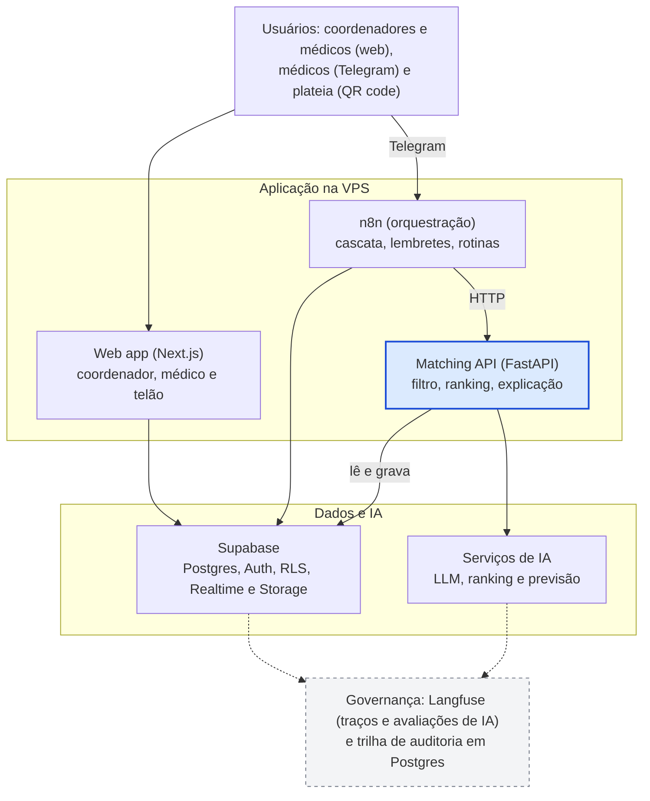

# Arquitetura e ferramentas | PlantãoSeguro

20/10/2026 · Victor

> **Atualizado em 28/10/2026:** o LLM do produto passou de Claude para **Gemini** ([ADR 0003](adr/0003-llm-do-produto-gemini.md)) e a construção do protótipo foi **adiada** ([ADR 0004](adr/0004-prototipo-adiado.md)). O restante deste documento descreve a arquitetura-alvo.

## Visão geral

A arquitetura tem quatro camadas: usuários, aplicação na VPS, dados e IA, e uma camada de governança que atravessa todas as outras.

*Arquitetura em camadas: 4 camadas, 1 serviço central de regras.*

Uma vaga entra pelo web app ou pelo Telegram, o n8n chama a API de matching, que consulta o Supabase e os modelos de IA, e cada passo vai para a trilha de auditoria.

## Decisões de arquitetura

O que precisa ser exato e testável fica em código, o n8n só orquestra e o Supabase guarda e isola os dados.

1. **O n8n orquestra, não decide.** Esperas, cascata de ofertas, lembretes e rotinas agendadas são o forte do n8n. O filtro de jornada e o ranking ficam numa API em Python, com testes automatizados e versão, chamada por HTTP.
2. **n8n em modo fila desde o início.** O processo principal recebe gatilhos e webhooks e passa as execuções ao Redis, e os workers as executam; o modo fila exige Redis e um banco de dados, e [o SQLite não é suportado nesse modo](https://docs.n8n.io/deploy/host-n8n/configure-n8n/scaling/enable-queue-mode/). Use um Postgres próprio do n8n na VPS, separado do Supabase.
3. **Supabase como fonte da verdade.** A RLS isola os hospitais, o Realtime alimenta o telão e a Auth cria as sessões da plateia, inclusive com [login anônimo, que o plano gratuito inclui](https://supabase.com/pricing). A chave de serviço só existe no servidor.
4. **LLM só onde há texto livre e sem ferramentas.** Extração da vaga e redação da explicação, com saída em JSON Schema validada em código. O texto da vaga é tratado como dado hostil.
5. **Ranking com baseline e modelo.** Com dados sintéticos, o modelo aprende as regras do próprio simulador; por isso compare sempre com um baseline heurístico e não apresente a acurácia como evidência real.
6. **Telegram na prova de conceito, WhatsApp no roadmap.** O WhatsApp [cobra por mensagem de template entregue](https://developers.facebook.com/documentation/business-messaging/whatsapp/pricing) e exige conta Meta verificada e número dedicado; [um guia de mercado](https://qualimero.com/en/blog/whatsapp-business) fala em 2 a 5 dias úteis de verificação, e vale confirmar com a Meta.

## Ferramentas por etapa

Cada etapa do fluxo tem uma ferramenta principal e uma alternativa; a escolha prioriza o que o grupo já usa (n8n, Supabase, VPS) e o que dá para testar e auditar.

| Etapa | Recomendação | Alternativa | Observação |
| --- | --- | --- | --- |
| Interface (coordenador, médico e telão) | Next.js, Tailwind e shadcn/ui, como PWA | Vite com React | A plateia entra por QR code, sem instalar nada |
| Login e perfis | Supabase Auth, com login anônimo e persona para a plateia | Magic link por e-mail | O JWT carrega hospital e papel, que a RLS usa |
| Entrada da vaga | Formulário no web app que chama um webhook do n8n | Telegram | Texto livre, com campos opcionais |
| Extração dos campos | Gemini 3.5 Flash-Lite (SDK `google-genai`) com saída estruturada (JSON Schema) e validação com Pydantic | Gemini 3.8 Flash nos casos ambíguos | Nome, CRM e telefone nunca vão ao modelo; na demo, camada paga (ADR 0003) |
| Filtro de regras | Funções SQL no Postgres e política por hospital em tabela | Regras em Python | Determinístico, testável e auditável |
| Ranking | Regressão logística e LightGBM (scikit-learn), mais baseline heurístico | CatBoost | Versione o modelo e guarde as métricas |
| Explicação | LLM redige a partir dos fatores do modelo | Template fixo se a API falhar | Recebe só os fatores, então não inventa motivos |
| Decisão humana | Tela de aprovação no web app, com registro em audit_log | Nenhuma | Sem o clique do coordenador não sai oferta |
| Oferta em cascata | n8n (esperas, laços, webhooks) e bot do Telegram | WhatsApp Cloud API, no roadmap | Telegram dispensa verificação de empresa na PoC |
| Check-in e pagamento | n8n, tabela de pagamentos no Postgres e lembretes | Nenhuma | Registra prazos; não custodia dinheiro |
| Previsão de vagas | LightGBM ou statsforecast, agendado pelo n8n ou pg_cron | Prophet | Rodada diária que alerta o coordenador |
| Equidade | Fairlearn e métricas próprias de concentração | AIF360 | Relatório semanal salvo em tabela |
| Observabilidade da IA | Langfuse Cloud, só com dados sintéticos | Phoenix; Langfuse self-host depois | [Self-host exige Postgres, ClickHouse, Redis e S3](https://langfuse.com/self-hosting.md) |
| Erros e disponibilidade | Sentry e Uptime Kuma | Grafana | A Hostinger tem template do Uptime Kuma |
| Dados sintéticos | Python com Faker e simulador próprio | SDV | Parâmetros calibrados nas entrevistas |
| Infra e deploy | Docker Compose e Traefik na Hostinger KVM 2, GitHub Actions por SSH e Supabase CLI para migrações | Railway ou Render | A Hostinger tem template Docker com Traefik |
| Testes | pytest, Playwright, k6 e testes de injeção de prompt | Nenhuma | Carga: 100 vagas simultâneas |

Ferramentas sem link são escolhas de engenharia minhas, não afirmações verificadas em fonte; confirmem versões e licenças na hora da instalação.

## Modelo de dados

O banco guarda cada decisão com sua explicação e sua versão de modelo, e a RLS separa o que cada hospital e cada médico enxerga.

| Tabela | O que guarda | Quem lê (RLS) |
| --- | --- | --- |
| organizations, units | Hospitais e unidades | Usuários da própria organização |
| profiles | Usuário, papel (coordenador, médico, admin) e organização | Cada pessoa lê o próprio perfil |
| doctors, doctor_availability | Especialidades, raio, preferências, CRM simulado e janelas de disponibilidade | O médico edita o próprio; o coordenador vê só candidatos elegíveis para a própria vaga |
| shifts | Vaga: unidade, especialidade, início, fim, valor, urgência e status | Coordenadores da organização dona |
| policy_config | Limites por hospital: horas contínuas e descanso mínimo | Administradores da organização |
| recommendations, explanations | Posição, pontuação, versão do modelo, fatores e texto da explicação | O coordenador da vaga e o médico recomendado |
| offers, assignments | Oferta (enviada, expira, status) e confirmação pelo coordenador | As partes envolvidas |
| checkins, payments | Presença; prazo combinado, data de pagamento e status | O médico e o hospital envolvidos |
| contestations | Contestação do médico e resposta | O médico autor e o coordenador |
| audit_log | Quem fez o quê, quando e com qual versão de modelo | Só inserção; sem UPDATE nem DELETE |
| model_registry, fairness_reports | Versões, métricas, classe de risco e relatórios de equidade | Administradores |

A API de matching e o n8n usam a chave de serviço, só no servidor; o navegador usa apenas a chave pública, sempre sob RLS. Os campos de pagamento ficam fora da lista de variáveis do ranking, e um teste automatizado barra qualquer inclusão.

## Segurança e conformidade na arquitetura

Cada resolução e cada risco de segurança vira um controle técnico que pode ser testado e mostrado na apresentação.

| Controle | Como aparece na arquitetura | Ligado a |
| --- | --- | --- |
| Isolamento entre hospitais | RLS por organização com dados no JWT; chave de serviço só no servidor | LGPD e Cybersecurity |
| Entrada hostil | Texto da vaga e relato do médico passam por validação de esquema; o LLM não recebe ferramentas nem segredos | Cybersecurity (injeção de prompt) |
| Dados pessoais fora do modelo | Só IDs pseudônimos e atributos necessários vão ao LLM; nome, CRM e telefone ficam no banco | LGPD e Res. CFM 2.454 |
| Decisão humana | Sem o clique do coordenador não há oferta; tudo vai para o audit_log | Res. CFM 2.454 |
| Explicabilidade e contestação | Tabela explanations e botão de contestar, com resposta registrada | Res. CFM 2.454 |
| Neutralidade econômica | Lista fixa de variáveis do ranking, sem campos de pagamento, com teste automático na integração contínua | Res. CFM 2.460 |
| Rastro de pagamentos | Prazos combinados e confirmações na tabela payments, com alertas de atraso | Res. CFM 2.462 |
| Política de jornada | policy_config e função SQL que bloqueia ofertas fora do limite, com exceção justificada por humano | Segurança do paciente |
| Segredos e acesso ao n8n | Segredos em variáveis do Docker; editor do n8n fora da internet pública (VPN ou lista de IPs); segredo nos webhooks; limite de requisições no Traefik | Cybersecurity |
| Backups | [Backup semanal gratuito da Hostinger](https://www.hostinger.com/vps-hosting), cópia do Postgres do n8n fora da VPS e [backups diários de 7 dias no Supabase Pro](https://supabase.com/pricing) | Continuidade |

## Infraestrutura e custo

O mês da apresentação custa entre US$ 34 e US$ 41 (VPS, Supabase Pro e LLM), e o resto é gratuito. Preços de VPS e Supabase lidos nas páginas oficiais em 20/10/2026 e os do Gemini em 28/10/2026, em dólar e sem impostos.

| Item | Escolha | Custo | O que observar |
| --- | --- | --- | --- |
| VPS | [Hostinger KVM 2](https://www.hostinger.com/vps-hosting): 2 vCPU, 8 GB de RAM, 100 GB NVMe | US$ 8,79 por mês no preço promocional, pago adiantado; renova a US$ 14,99 por mês | A própria página indica o KVM 2 para apps de médio porte como o n8n. Há [datacenter no Brasil](https://www.hostinger.com/support/1583267-where-are-hostinger-servers-located/), e a localização fica fixa após a configuração, então escolha o Brasil na compra |
| n8n | Community, auto-hospedado | US$ 0 | A [licença](https://docs.n8n.io/n8n-community-license/community-license/license-faq.md) cobre uso interno do negócio; se virar produto vendido a hospitais, falar antes com a n8n |
| Supabase | Free para desenvolver; Pro no mês da apresentação | US$ 0 e US$ 25 por mês | No [plano Free](https://supabase.com/pricing) o projeto pausa após 1 semana sem atividade e o Realtime aceita 200 conexões simultâneas; o Pro aceita 500 e inclui US$ 10 de crédito, que cobrem uma instância Micro |
| LLM | [Gemini 3.5 Flash-Lite](https://ai.google.dev/gemini-api/docs/models) para extração e explicação; [Gemini 3.8 Flash](https://ai.google.dev/gemini-api/docs/pricing) nos casos ambíguos (ADR 0003) | Flash-Lite a US$ 0,30 de entrada e US$ 2,50 de saída por milhão de tokens; 3.8 Flash a US$ 0,75 e US$ 3,75 até 31/12/2026 (depois US$ 1,50 e US$ 7,50) | Estimativa: 200 chamadas de 2.000 tokens de entrada e 500 de saída custam cerca de US$ 0,37 com o Flash-Lite e US$ 0,68 com o 3.8 Flash (premissa minha; a saída inclui tokens de raciocínio e pode ser maior). A camada gratuita existe, mas o Google usa o conteúdo para melhorar produtos: usar a paga na demo |
| Observabilidade de IA | Langfuse Cloud | Plano gratuito | Confirmar os limites do plano gratuito na criação da conta |
| Mensagens | Bot do Telegram | Sem custo por mensagem | O WhatsApp cobra por template entregue |

O total de US$ 34 a US$ 41 soma VPS (promocional ou na renovação), Supabase Pro e 200 chamadas do Gemini 3.8 Flash (cerca de US$ 0,68); com o Flash-Lite o LLM praticamente some da conta. Se a plateia passar de umas 150 pessoas conectadas ao telão, o Pro deixa de ser opcional por causa do limite de conexões do Realtime.

## Plano de construção até a Etapa 2

A Etapa 2 (31/10) pede um fluxo de ponta a ponta funcionando; o que não cabe nela vai para a Etapa 3 ou para o ensaio.

| Período | Marco | O que construir |
| --- | --- | --- |
| 20 a 24/10 | Base e Entrega 1 | VPS com Docker Compose e Traefik; projeto Supabase com esquema, RLS e Auth; gerador de dados sintéticos; repositório com integração contínua mínima |
| 27 a 31/10 | Entrega 2: dados, análise, solução de IA e PoC | Dados sintéticos e análise; desenho da solução de IA, segurança e conformidade; documento da Etapa 2. **Protótipo adiado** (ADR 0004): API de matching, fluxos do n8n, telas, telão e bot do Telegram só entram quando o Victor aprovar o portão G-P ([plano](plano-etapa-2.md)) |
| 3 a 7/11 | Entrega 3: validação | Previsão de vagas; relatório de equidade; kit para a Comissão de IA; testes de regras, de injeção de prompt e de carga; medição dos indicadores |
| 8 a 17/11 | Ensaio e apresentação | Ensaio completo; plano B com respostas pré-carregadas; Supabase Pro ativo; congelar o código em 13/11 (sugestão minha) |

## Decisões em aberto e riscos técnicos

Cinco decisões precisam do grupo até a Etapa 2, e quatro riscos pedem plano B desde já.

**Decisões para o grupo**

- **Quanto vai no n8n:** proposta de só orquestração; revisar depois do primeiro fluxo de ponta a ponta.
- **Login da plateia:** sessão anônima com persona sorteada é mais rápido, mas exige limite de requisições contra abuso.
- **Plano do Supabase:** definir o tamanho da plateia; acima de umas 150 pessoas conectadas ao telão, usar o Pro.
- **Região do Supabase:** confirmar São Paulo na criação do projeto, porque a região não se troca depois sem migrar.
- **Licença do n8n:** se o produto for oferecido a hospitais, [confirmar a arquitetura com a n8n](https://docs.n8n.io/n8n-community-license/community-license/license-faq.md) antes de qualquer piloto.

**Riscos técnicos**

- **Dados sintéticos e circularidade:** o modelo de ranking pode apenas reaprender o simulador. Mitigação: baseline heurístico, revisão de especialistas e linguagem cuidadosa na apresentação.
- **Latência do LLM:** extração e explicação somam segundos por vaga. Mitigação: medir no ensaio e manter o template fixo como alternativa.
- **Dependência de APIs externas:** LLM e Telegram podem falhar na hora. Mitigação: respostas pré-carregadas e vídeo gravado.
- **Dados reais e LLM:** com dados reais, só com base legal, termo de uso e acordo de tratamento de dados com o provedor; na prova de conceito, nada real.
- **Camada gratuita do Gemini:** o Google usa o conteúdo para melhorar produtos e revisores humanos podem lê-lo; a plateia digita texto livre na demo. Mitigação: camada paga na demo, aviso "não digite dados reais" na tela e só dados sintéticos nos testes (ADR 0003).

## Fontes consultadas

Páginas abertas em 20/10/2026; preços e limites mudam, então conferir antes de contratar.

- [Hostinger: planos de VPS e preços](https://www.hostinger.com/vps-hosting)
- [Hostinger: localização dos servidores](https://www.hostinger.com/support/1583267-where-are-hostinger-servers-located/)
- [Supabase: preços e limites](https://supabase.com/pricing)
- [Gemini API: modelos](https://ai.google.dev/gemini-api/docs/models), [preços](https://ai.google.dev/gemini-api/docs/pricing), [saída estruturada](https://ai.google.dev/gemini-api/docs/structured-output), [termos de uso dos dados](https://ai.google.dev/gemini-api/terms) e [SDKs](https://ai.google.dev/gemini-api/docs/libraries) (lidos em 28/10/2026)
- [n8n: modo fila](https://docs.n8n.io/deploy/host-n8n/configure-n8n/scaling/enable-queue-mode/)
- [n8n: FAQ da licença](https://docs.n8n.io/n8n-community-license/community-license/license-faq.md)
- [Langfuse: auto-hospedagem](https://langfuse.com/self-hosting.md)
- [Meta: preços do WhatsApp Business Platform](https://developers.facebook.com/documentation/business-messaging/whatsapp/pricing)
- [Guia de WhatsApp Business (verificação e número dedicado)](https://qualimero.com/en/blog/whatsapp-business)
