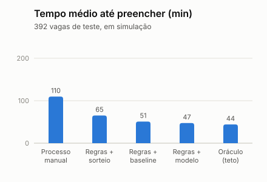
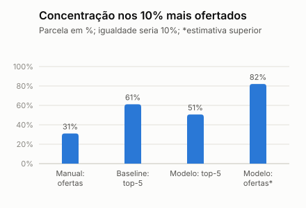

# PlantãoSeguro: Entrega 2 (dados, análise, solução de IA e prova de conceito)

**Disciplina:** Hands On – Aplicação de IA nos negócios (Mackenzie), Prof. Fabio Versolatto. **Grupo:** Victor Jordão, Roberval Silva, Guilherme Tarrago, Sergio Freitas, Lucas Barbosa e Plinio Camilo. **Entrega:** 31/10/2026, versão 2 (revisada depois de conferir o feedback da Entrega 1). **Código, dados e documentos:** [github.com/vhjordao/handson_plantaoseg](https://github.com/vhjordao/handson_plantaoseg).

> [!NOTE]
> **Resumo.** Hospitais ainda cobrem plantões por canais manuais e opacos. O PlantãoSeguro lê o pedido da vaga em texto livre e devolve os médicos elegíveis, ordenados e com o motivo de cada um: **a IA recomenda, o humano decide**. Esta entrega traz uma **prova de conceito que roda** (Python, linha de comando, 176 testes automáticos e CI verde) sobre **dados sintéticos** de um pronto-socorro de hospitais privados. Em simulação, o fluxo recomendado preenche a vaga em menos da metade do tempo e não viola a jornada, mas **concentra as ofertas em poucos médicos**, e esse é o principal risco a tratar. O Gemini está desenhado e protegido por testes, mas **não foi exercitado contra o serviço real**.

<!-- kpis -->
| Resultado | Indicador | Leitura (simulação) |
| --- | --- | --- |
| 47 min | tempo médio até preencher a vaga | processo manual: 110 min (57% a menos); a meta da Entrega 1 era 50% |
| 71,2% | chance de sucesso no top-5 | baseline heurístico: 67,7%; oráculo: 75,8% |
| 0 | violações de jornada nas recomendações | processo manual: 1,3% dos aceites |
| 50,7% | lugares do top-5 ocupados pelos 10% mais recomendados | processo manual: 31,1%; piora, risco a mitigar |

**Frase-síntese:** queremos utilizar IA para recomendar e explicar quais médicos chamar para cada plantão de pronto-socorro, a fim de reduzir o tempo de cobertura sem violar a jornada nem as regras do CFM, beneficiando coordenadores de escala e médicos de hospitais privados, medindo o sucesso pelo tempo até preencher a vaga, pela qualidade do ranking contra um baseline, pelas violações de jornada (meta zero) e pela concentração das ofertas.

## 1. O problema, o segmento e o que mudou desde a Entrega 1

A Entrega 1 mostrou que plantões são cobertos por canais manuais e opacos, o que atrasa o preenchimento, aumenta o risco assistencial e expõe as partes a riscos jurídicos novos. Quatro dores guiam esta entrega, e cada parte da solução responde a uma delas:

<!-- keep -->
| Dor da Entrega 1 | O que a PoC faz | Evidência (simulação) | Situação |
| --- | --- | --- | --- |
| 1. Vaga descoberta, percebida tarde | Lê o pedido, filtra e ranqueia em segundos; prever vagas em risco fica para depois | Tempo médio até preencher: 110 para 47 min; ofertas por vaga: 3,31 para 1,32 | Recomendação construída; previsão é evolução futura |
| 2. Seleção opaca | Motivo por candidato, regra que barrou cada excluído, trilha com hash e pagamento fora do ranking | Testes de explicação, auditoria e neutralidade econômica (na CI) | Construído |
| 3. Fadiga sem controle | Filtro de jornada (24 h contínuas, 11 h de descanso) e alerta de carga | Violações: 0, contra 1,3% dos aceites no processo manual | Construído |
| 4. Pagamento sem rastro | Fora do núcleo; o rastro de pagamentos é evolução futura (e a Res. CFM 2.462 está suspensa) | n/d | Não construído |

**Segmento (ADR 0001).** Pronto-socorro de hospitais privados, plantão noturno de 12 h e de fim de semana, clínica médica e pediatria. Um recorte só mantém os indicadores comparáveis (todos valem para o mesmo tipo de vaga) e o simulador simples; ampliar é mudar um parâmetro. Que noite e fim de semana sejam mais difíceis de cobrir é uma **hipótese**: não há dado nacional, e as entrevistas vão testá-la. Diagnóstico, prontuário e receita com validade legal ficam **fora** do escopo.

### Como respondemos ao feedback da Entrega 1

<!-- keep -->
| Pedido do professor | O que fizemos | Onde |
| --- | --- | --- |
| Definir o segmento inicial | O recorte acima, com a hipótese marcada como tal | Seção 1 |
| Separar o essencial do complementar | Núcleo: recomendação de elegíveis e explicação. Cascata, contestação, check-in, pagamento e previsão de vagas ficam como evolução futura | Seção 5 |
| Justificar as metas com linha de base e ajustá-las aos dados | As seis metas da Entrega 1 ganharam linha de base (o processo manual simulado) e resultado do fluxo recomendado; as que os dados não permitem medir dizem por quê | Seção 7 |
| Conferir os textos oficiais vigentes e o que depende de análise jurídica | Três resoluções do CFM lidas em 30/10, com vigência, obrigações para a plataforma e sete pendências para o jurídico; duas correções à Entrega 1 | Seção 6 |

## 2. Dados

**Origem e por quê.** Ainda não há dado real nem entrevistas, e o repositório é público. Por isso criamos um **mundo simulado**: três hospitais privados fictícios de uma rede, 300 médicos e 12 meses (de 01/10/2025 a 30/09/2026) de vagas e de ofertas feitas por um "processo manual", em que a coordenação sorteia quem chamar sem checar disponibilidade nem jornada. O recorte desse mundo (pronto-socorro de hospitais privados, plantão noturno e de fim de semana) foi **sugestão do Victor**; o gerador foi construído em conjunto com o Claude Code. Nome, CRM e telefone são fictícios e marcados `SIM`.

| Tabela | Linhas | Conteúdo | Em produção viria de |
| --- | ---: | --- | --- |
| Médicos | 300 | Especialidade, raio, preferência de período, zona | Cadastro e credenciamento do hospital |
| Janelas de disponibilidade | 3.391 | Janelas livres e dias bloqueados | Informadas pelo médico |
| Vagas | 2.448 | Noturnas todos os dias; diurnas só no fim de semana | Pedido da coordenação |
| Ofertas | 7.555 | Quem foi chamado, resposta e comparecimento | A própria plataforma e o check-in |
| Pedidos em texto livre | 400 | 5 estilos, com gabarito; 15% adversariais | Texto digitado pela coordenação |
| Valor do plantão | 2.448 | Tabela **separada**, fora do ranking | Financeiro do hospital |

**Variáveis.** O [dicionário de dados](dados/dicionario-de-dados.md) (v0.2) dá a cada coluna um **papel**: variável do ranking, auditoria de viés (gênero, faixa etária e zona), restrito econômico, dado pessoal simulado ou gabarito do simulador. O ranking usa **sete variáveis**, todas calculadas só com o que já era conhecido antes de cada oferta:

| Variável | O que mede | Por que entra |
| --- | --- | --- |
| Especialidade | 1 se é a principal, 0,5 se só a secundária coincide | É o que a vaga exige |
| Distância | km em linha reta até o hospital | Quem mora longe recusa mais: aceite de 39,9% até 5 km e de 17,4% a 20 km ou mais |
| Cobertura da vaga | Horas da vaga cobertas pela disponibilidade | Maior correlação com o sucesso (0,370) |
| Taxa de aceite (90 dias) | Aceites sobre ofertas com resultado conhecido | Histórico recente de resposta |
| Taxa de comparecimento (90 dias) | Comparecimentos sobre plantões aceitos | Confiabilidade para o plantão acontecer |
| Horas desde o último plantão | Folga até a vaga, limitada a 7 dias | O descanso pesa: aceite de 22,3% quando o plantão é colado a outro e de 42,4% com 72 h ou mais |
| Preferência de período | 1 se a preferência do médico coincide com a vaga | Em vaga noturna, aceite de 37,0% quando coincide e de 18,1% quando não |

**Tratamento e qualidade.** O futuro não vaza: cada variável usa só o que era conhecido antes da oferta (testado). O gerador aplica **8 regras de qualidade** (integridade, domínios, datas, unicidade, coerência, sobreposição, ausência de dado real e cobertura do segmento), com **zero violações** ([relatório](dados/relatorio-de-qualidade.md)). A mesma semente gera os mesmos arquivos: a CI, em Linux, reproduziu os checksums da máquina do autor, em Windows.

**Limites.** Os parâmetros do simulador são premissas do grupo, sem fonte externa; só se observa a resposta de quem foi chamado (viés de seleção); e o tempo até preencher a vaga é simulado: serve para comparar métodos, não como linha de base real. No processo manual simulado há 3,09 ofertas por vaga, 30,8% de aceite, 4,8% de vagas sem cobertura e 1,3% de aceites que violam a jornada.

## 3. Análise dos dados

A [análise exploratória](analise/README.md) confere se o simulador se comporta como as premissas dizem e mostra onde mora o risco do ranking. Como os dados são sintéticos, ela não descobre fatos do mundo real.


- **O aceite cai com a distância:** 39,9% de 0 a 5 km e 17,4% a 20 km ou mais. Em vaga noturna, quando a preferência de período coincide o aceite vai a 37,0%, contra 18,1% quando não coincide.
- **Descanso:** 22,3% de aceite quando o plantão é colado a outro e 42,4% com 72 a 167 h livres. Os plantões duram 12 h e começam às 7h ou às 19h, então o intervalo entre dois deles é 0 h (colados) ou de 12 h ou mais: a regra das 11 h de descanso quase nunca é a que barra; o limite de 24 h contínuas, sim.
- **Correlação com o sucesso:** cobertura da vaga (0,370), preferência de período (0,200) e distância (−0,156) lideram. A carga recente tem correlação positiva (0,069), por confundimento (quem é confiável aceita mais), o que motivou tirá-la do ranking.
- **Exposição desigual (o risco do exemplo de recrutamento da aula: reproduzir o viés do histórico):** a zona central tem 31,3% dos médicos e recebe 55,7% das ofertas; leste e oeste recebem 0,40 e 0,32 do esperado. Entre 35 e 44 anos a razão é 1,49 e, a partir de 55, 0,39; por gênero é praticamente 1. O aceite do grupo quase não varia por gênero (30,2% a 31,4%) e varia por zona (23,1% a 32,5%), porque a distância muda.
- **Texto livre:** a extração por regras acerta 100% dos campos em pedidos formais, abreviados e com erros de digitação; nos 45 pedidos ambíguos nenhum fica completo, 53% dos campos ficam em branco e 4% saem errados. Por isso a extração nunca chuta: o campo em branco vai para o coordenador, que sempre confere. Dos 60 ataques de injeção de prompt, 60 são sinalizados, sem falso positivo em 340 pedidos normais.

### Da análise à decisão

<!-- keep -->
| O que a análise mostrou | O que decidimos |
| --- | --- |
| A carga recente parece "boa" (correlação positiva), mas é confundimento | Saiu do ranking e virou alerta de jornada; o top-5 fica em 71,2% sem ela e em 71,3% com ela |
| A distância explica o aceite e funciona como proxy da zona de residência | Fica no ranking (critério operacional), mas a participação por zona é monitorada; mitigação na Etapa 3 |
| O processo manual ignora disponibilidade e jornada: 1,3% dos aceites violam a jornada | O filtro de regras vem antes do ranking e é determinístico |

## 4. Solução de IA


**Entrada, processamento de IA, saída e usuário.** O coordenador digita a vaga em texto livre; a IA extrai os campos e ele os **confere**; o código filtra os elegíveis e registra a regra que barrou cada excluído; o modelo ranqueia; a explicação sai dos fatores; o coordenador **aprova**; tudo vai para a trilha de auditoria. Detalhes em [docs/solucao-ia.md](solucao-ia.md).

### Por que IA e onde não (Excelência Operacional: regra em código, estimativa em ML, linguagem em NLP)

<!-- keep -->
| Etapa | Técnica | Por quê, e por que não outra | O que medimos (simulação) |
| --- | --- | --- | --- |
| Extração do texto | **NLP** (Gemini) com reserva em regras | Pedidos variam muito; um formulário rígido reduziria a adoção | Regras: 100% em texto formal, abreviado e com erros; Gemini não exercitado |
| Filtro de elegibilidade e jornada | **Código** | Regra exata e auditável; LLM não é determinístico | 0 violações, contra 1,3% no manual; **72% do ganho de tempo** |
| Ranking | **ML**: regressão logística | Combina sinais e é explicável por peso. LightGBM e scikit-learn não foram testados: perderiam a leitura por peso e a PoC roda sem dependências | +3,5 pontos percentuais no top-5 e 7% menos tempo sobre o baseline heurístico |
| Explicação | Texto fixo; o LLM só reescreve | Os fatores já são conhecidos; o LLM não pode inventar motivo | Reescrita que acrescenta algo é descartada (testes) |
| Aprovação | **Humano** | Res. CFM 2.454, Art. 15: a solução não é soberana | Sem clique, sem oferta (testado) |

**Quanto vale cada parte.** O baseline é o que uma coordenação faria "no olho": perto e com a janela cobrindo a vaga. O modelo foi treinado no passado e testado em 392 vagas de agosto e setembro de 2026, com cerca de 50 elegíveis por vaga. O oráculo é o teto (os 5 melhores segundo a verdade do simulador) e o sorteio é o piso; a AUC mede o quanto o ranking separa quem aceita de quem recusa (0,5 é acaso).

| Medida | Baseline | Modelo | Oráculo | Sorteio |
| --- | ---: | ---: | ---: | ---: |
| AUC no teste (ofertas observadas) | 0,702 | 0,762 | n/d | n/d |
| Chance média de sucesso no top-5 (contrafactual) | 67,7% | 71,2% | 75,8% | 52,9% |

O modelo entrega **3,5 pontos percentuais** a mais que o baseline (erro-padrão 0,22) e 94% do oráculo.




À esquerda, de onde vem o ganho de tempo: só o filtro de regras (sorteio entre elegíveis) leva o tempo médio de 110 para 65 min, e o modelo chega a 47 min. **72% do ganho vem de não chamar quem não poderia aceitar**; o ranking por modelo acrescenta um ganho real, mas menor. À direita, o custo: recomendar por ordem concentra as ofertas em poucos médicos (seção 6). A medição usa as premissas de tempo do simulador ([método e limites](resultados/metricas-fluxo.md)).

**LLM (Gemini) e proteção contra injeção de prompt.** O LLM só extrai campos e reescreve a explicação, **sem ferramentas e sem segredos**; nome, CRM e telefone nem existem no prompt. A defesa tem camadas: limpeza da entrada; texto com sinal de ataque **nunca chega ao LLM**; a saída só vale se passar por um **esquema fechado**; a reescrita não pode acrescentar número, fator nem valor. Cobrimos **10 tipos de ataque** (como ignorar regras, vazar segredo, injetar pagamento, forjar campos e extrair dados pessoais). Falha ou ausência do LLM cai nas regras e no texto fixo.

**Ferramentas e custo.** Python 3.12 (só biblioteca padrão), pytest, ruff e GitHub Actions: custo zero e nada a instalar. Gemini `gemini-3.5-flash-lite` e `gemini-3.8-flash`: cerca de US$ 0,37 a US$ 0,68 por 200 chamadas (preços do Google em 28/10/2026). FastAPI, Next.js, n8n e Supabase foram **adiados** ([ADR 0004](adr/0004-prototipo-adiado.md)); o motor foi feito para ser reaproveitado por eles.

## 5. Prova de conceito

A PoC mínima roda por linha de comando, sem tela, banco, n8n nem API ([ADR 0005](adr/0005-gp-poc-minima-e-especificacao.md)). Para rodar:

```
make poc       # dados, modelo, fluxo recomendado, demonstração, exemplo trabalhado e análise
make test      # 176 testes automáticos
make entrega   # este documento, em HTML e PDF
```

No Windows sem `python` no PATH: `make PYTHON="py -3.12" poc`. Saída da demonstração (vaga de pediatria, sexta à noite; as contas estão no [exemplo trabalhado](exemplo-trabalhado.md)):

```
Campos extraídos (fonte: regras): Hospital Modelo Centro | pediatria | sexta 02/10 19h a 03/10 07h | urgência alta
Recomendação logreg-v1 (simulação): 65 elegíveis entre 300 médicos. Top 5:
  1. id f4343f8e  score 0,69  mora a 1,4 km, prefere o período, taxa de aceite estimada de 45%
  4. id d69d231d  score 0,66  ... Atenção (jornada): carga recente alta, 9 plantões em 30 dias
Excluídos pelas regras (235): 131 especialidade diferente | 64 sem disponibilidade
                              25 fora do raio | 15 CRM não ativo
Aprovação (demonstração): 3 aprovados.  Trilha: 9 registros, cadeia de hash íntegra
```

| Construído e executando | Desenhado, não construído |
| --- | --- |
| Gerador de dados e qualidade; filtro de regras e jornada; 7 variáveis sem vazamento; baseline e modelo; avaliação e fluxo recomendado; explicação; extração por regras; guardrails e 10 tipos de ataque; aprovação humana; trilha com hash | Interface (4 telas desenhadas em [wireframes](wireframes/README.md)); oferta em cascata no n8n; contestação do médico; banco e RLS; previsão de vagas; teste do Gemini com chave ([plano](teste-manual-gemini.md)) |

**Evidências.** 176 testes automáticos passam (casos de borda de jornada, 10 tipos de injeção, 12 saídas maliciosas do LLM, verificação da trilha e a matemática da simulação do fluxo), o lint passa e a CI roda a PoC inteira em Linux, em 5 verificações verdes. A trilha de auditoria guarda só IDs pseudônimos e a versão do modelo.

## 6. Segurança, ética e conformidade

### As quatro perguntas de Direito e Ética (as mesmas da Entrega 1, seção 13)

<!-- keep -->
| Pergunta | Resposta |
| --- | --- |
| Há dados pessoais? | Hoje, não: tudo é sintético. Em produção, sim (veja Cybersecurity) |
| Há risco de discriminação? | Sim, por proxy: a distância reflete a zona de residência. Gênero, faixa etária e zona ficam fora do ranking e entram na auditoria de viés (abaixo) |
| A decisão afeta pessoas? | Sim: a renda dos médicos e a cobertura do pronto-socorro. Por isso decide o coordenador, com motivo por recomendação e trilha de auditoria; a contestação do médico está desenhada |
| Há questões regulatórias? | Sim: Res. CFM 2.454, 2.460 e 2.462, resumidas a seguir |

### Cybersecurity (detalhe em [seguranca-ameacas.md](seguranca-ameacas.md))

<!-- keep -->
| Pergunta | Resposta |
| --- | --- |
| Quais dados? | Cadastro, agenda, vagas, ofertas, textos livres, valor do plantão (separado) e trilha |
| Há dados pessoais? | Hoje, **não** (sintéticos). Em produção, sim (CRM, agenda, aceites): LGPD, a validar com jurídico; nome, CRM e telefone nunca vão ao LLM |
| Onde ficam? | Hoje, CSV local e CI; depois, banco em São Paulo; o LLM recebe só o texto da vaga |
| Quem acessa? | Hoje, a equipe; depois, RLS por organização e papel (desenho) |
| Ameaças | Injeção de prompt, saída forjada do LLM, adulteração da trilha, vazamento de dado e de segredo, viés, influência do pagamento |
| Proteções | Esquema fechado, LLM sem ferramentas, hash encadeado, varredura de segredos, lista fechada de variáveis com teste na CI, decisão humana |

### Normas, lidas nos textos oficiais em 30/10/2026 (não é parecer jurídico; [ficha completa](conformidade/README.md))

<!-- keep -->
| Norma | Em vigor? | O que pesa para a plataforma | Como respondemos |
| --- | --- | --- | --- |
| Res. CFM 2.454/2026 (IA) | Sim, desde cerca de 26/08/2026 (180 dias após o DOU de 27/02; Art. 23) | A solução "não é soberana" e a supervisão humana é obrigatória (Art. 15); o hospital classifica o risco em baixo, médio, alto ou inaceitável (Art. 12 e 13; Anexo II) | Aprovação do coordenador, trilha, explicação e relatório de disparidade. **Reavaliamos o risco de baixo (Entrega 1) para médio**: o Anexo II cita agendamento como baixo risco, mas o sistema ranqueia pessoas e apoia decisão operacional importante |
| Res. CFM 2.460/2026 (vantagens econômicas) | Sim, desde 15/06/2026 (Art. 7º) | Veda vantagem econômica ligada à contratação ou ao favorecimento em escala; cita "contribuição para grupo ou plataforma digital" (Art. 2º) e as plataformas (Art. 4º, §2º) | Assinatura fixa paga pelo hospital, sem comissão e sem cobrança ao médico; o pagamento não entra no ranking (teste na CI) |
| Res. CFM 2.462/2026 (inadimplemento) | **Suspensa:** o PDF oficial traz aviso de suspensão judicial integral (processo 1025417-59.2026.4.01.0000) | Sanções a pessoas jurídicas que não pagam plantões | **Correção da Entrega 1**, que a tratava como em vigor: a plataforma não custodia dinheiro, e o rastro de pagamentos passa a ser evolução futura, sem base normativa afirmada |

A 2.454 foi lida em uma cópia em PDF hospedada pela Fiocruz, que avisa não substituir a versão certificada do DOU. **Não lemos** a LGPD, o Tema 1.389 do STF nem normas de jornada: 24 h contínuas e 11 h de descanso são configuração do projeto, não norma verificada. **Pendências para o jurídico:** (1) escopo da 2.454 e quem classifica o risco; (2) risco baixo ou médio; (3) a assinatura fixa frente aos Art. 2º, 4º §2º e 6º da 2.460; (4) situação da suspensão da 2.462 e se a plataforma é "intermediadora"; (5) LGPD: base legal e transferência internacional ao provedor do LLM; (6) vínculo dos médicos em hospital privado (Tema 1.389); (7) limites de jornada.

**Viés e concentração.** Atributos protegidos ficam fora do ranking, mas a distância funciona como proxy da zona: no top-5, médicos de leste e oeste quase não aparecem (razão de 0,01), e 121 de 257 elegíveis nunca são recomendados. A **concentração é o risco mais sério que medimos**: no processo manual simulado, os 10% de médicos mais ofertados recebem 31,1% das ofertas; no top-5 do modelo ocupam 50,7% dos lugares (61,2% no baseline) e, se a cascata seguir a ordem do ranking, a estimativa chega a 82% das ofertas efetivas (valor superior: cada vaga é avaliada isoladamente). Mitigações para a Etapa 3: rodízio entre elegíveis equivalentes, limite de ofertas por médico, menor peso da distância e revisão humana da lista.

## 7. Metas, resultados e limites

As metas da Entrega 1 eram pontos de partida. Cada uma ganhou uma linha de base (o processo manual simulado) e um resultado do fluxo recomendado, medidos nas mesmas 392 vagas de teste ([método](resultados/metricas-fluxo.md) e [ADR 0006](adr/0006-fluxo-recomendado-medido-por-simulacao.md)).

<!-- keep -->
| Meta da Entrega 1 | Linha de base (manual simulado) | Fluxo recomendado (simulação) | Situação |
| --- | --- | --- | --- |
| Tempo médio até preencher: 50% a menos | 110 min (mediana 85) | 47 min (mediana 38): 57% a menos | **Alcançável em simulação**; 72% do ganho vem do filtro de regras; a linha de base real vem das entrevistas |
| Preenchidas com 24 h ou mais de antecedência: +20 pontos | 70,7% (teto: 76,0% das vagas já nascem assim) | 74,8% (+4,1 pontos) | **Não alcançável só com a recomendação**: depende de publicar a vaga antes (previsão de vagas, evolução futura) |
| Recomendações aceitas pelo coordenador: 60% ou mais | n/d | n/d | **Não mensurável agora**: não há coordenador simulado; teste com usuários na Etapa 3 |
| Previsão de vagas descobertas: recall de 0,7 ou mais | n/d | n/d | **Adiada**: pertence ao módulo de previsão, evolução futura (o feedback pediu priorizar recomendação e explicação) |
| Violações de jornada: zero | 1,3% dos aceites (30 de 2.330) | 0 | **Atendida**, por construção do filtro e por testes de borda |
| Ranking influenciado por pagamento: zero | n/d | 0 | **Atendida**: teste na CI |
| Concentração de ofertas: monitorar e definir teto | 31,1% das ofertas nos 10% mais ofertados | 50,7% dos lugares do top-5; até 82% das ofertas efetivas | **Piorou frente ao manual**; teto ainda a definir; mitigar é prioridade da Etapa 3 |

<!-- keep -->
| Indicador novo desta entrega | Como se mede | Baseline | Resultado (simulação) |
| --- | --- | --- | --- |
| Qualidade do ranking | Chance de sucesso no top-5 e AUC, em teste temporal | Baseline heurístico: 67,7%; AUC 0,702 | 71,2% (+3,5 pontos percentuais); AUC 0,762 |
| Fidelidade da explicação | Testes: todo motivo vem do cálculo do modelo; reescrita que acrescenta algo é descartada | n/d | 0 motivos inventados nos testes; a utilidade para o coordenador fica para o teste com usuários |
| Injeção de prompt | 10 tipos de ataque, 60 pedidos | n/d | 60 de 60 sinalizados; 0 falsos positivos em 340 |

**Como ler.** Os resultados são de simulação e valem tanto quanto as premissas do grupo: o processo manual simulado não checa disponibilidade, e um coordenador real pode ser melhor ou pior; só as entrevistas dirão. A meta de reduzir o tempo pela metade fica **alcançável em simulação, a confirmar com dados reais**.

**Limites.** O modelo aprende o simulador; o Gemini não foi exercitado; a regressão logística não foi comparada com outros modelos; a distância cria viés geográfico; a extração por regras é otimista; contestação e avaliação de impacto estão desenhadas, não construídas; a evidência de mercado (Flexzo) é alegação da empresa e o caso público de Canoas não é do segmento privado.

## 8. Próximos passos, autoria e uso de IA

**Etapa 3 (entrega em 07/11).** (1) Entrevistas com 3 a 5 coordenadores e 3 a 5 plantonistas, prometidas na Entrega 1 e ainda não feitas: calibram o simulador e dão a linha de base real do tempo e da antecedência; (2) teste do Gemini com chave, com plano em [teste-manual-gemini.md](teste-manual-gemini.md); (3) mitigar a concentração e o viés de distância; (4) parecer jurídico sobre as sete pendências; (5) previsão de vagas e relatório de equidade; (6) interface do coordenador, API e cascata no n8n, se o grupo aprovar.

**Autoria e uso de IA.** O trabalho foi feito **em conjunto**, em ciclos de proposta, revisão e correção entre o Victor Jordão e o Claude Code (modelo Sonnet 5.5): **nem tudo foi feito pela IA**. A sugestão dos dados partiu do Victor, por exemplo o recorte do mundo simulado (pronto-socorro de hospitais privados, plantão noturno de 12 h e de fim de semana), e as decisões de escopo foram dele, registradas em ADRs (segmento, Gemini como LLM do produto, protótipo adiado, PoC mínima mais material de especificação). O Claude Code ajudou a transformar essas decisões em gerador, código, testes, análises e texto, e o Victor revisou e corrigiu o resultado. O processo também pegou falhas da própria IA, como um motivo "fez 9 plantões" que aparecia a favor do candidato (virou alerta) e uma extração que não reconhecia "ter" como terça-feira. O LLM do produto é o Gemini. Os números deste documento saem de arquivos gerados pelo código, e um teste falha se divergirem.

**Referências.** Res. CFM [2.454/2026 (DOU)](https://www.in.gov.br/web/dou/-/resolucao-cfm-n-2.454-de-11-de-fevereiro-de-2026-689247948), [2.460/2026](https://portal.cfm.org.br/wp-content/uploads/2026/06/2460_2026.pdf) e [2.462/2026](https://sistemas.cfm.org.br/normas/arquivos/resolucoes/BR/2026/2462_2026.pdf); Gemini: [modelos](https://ai.google.dev/gemini-api/docs/models), [preços](https://ai.google.dev/gemini-api/docs/pricing) e [termos](https://ai.google.dev/gemini-api/terms); [Entrega 1](01-entrega-1-descoberta.md).
