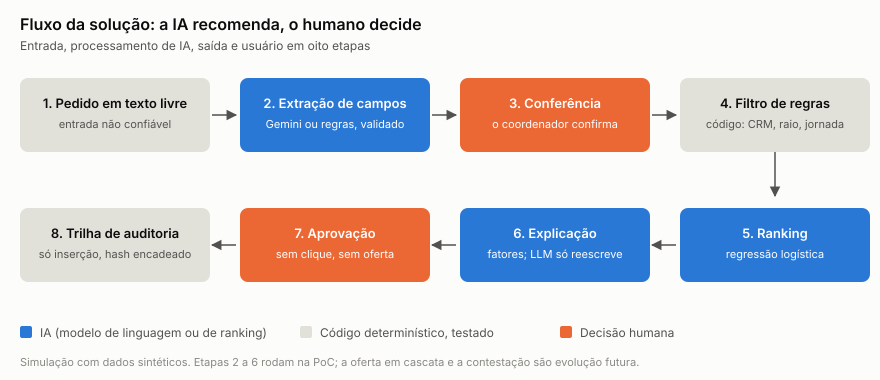
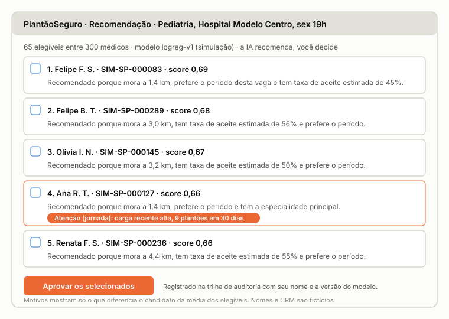

# PlantãoSeguro: Entrega 2 (dados, análise, solução de IA e prova de conceito)

**Disciplina:** Hands On – Aplicação de IA nos negócios (Mackenzie), Prof. Fabio Versolatto. **Grupo:** Victor Jordão, Roberval Silva, Guilherme Tarrago, Sergio Freitas, Lucas Barbosa e Plinio Camilo. **Entrega:** 31/10/2026. **Código e documentos:** [github.com/vhjordao/handson_plantaoseg](https://github.com/vhjordao/handson_plantaoseg).

> **Leitura honesta.** Os dados são **sintéticos** e os resultados são **simulação**: o modelo aprende o simulador que gerou os dados, então os números servem para comparar métodos entre si e não provam desempenho no mundo real. O Gemini está desenhado e protegido por testes, mas **não foi exercitado contra o serviço real**.

## 1. O problema e o segmento

Hospitais ainda cobrem plantões por canais manuais e opacos, o que atrasa a cobertura, aumenta o risco assistencial e expõe as partes a riscos jurídicos novos. O PlantãoSeguro recomenda, de forma **explicável, contestável e auditável**, quais médicos chamar para cada vaga. **A IA recomenda, o humano decide.**

O que mudou desde a Entrega 1, atendendo ao feedback do professor:

- **Segmento definido:** pronto-socorro de hospitais privados, plantão noturno de 12 h e de fim de semana, clínica médica e pediatria ([ADR 0001](adr/0001-segmento-inicial.md)).
- **Núcleo da PoC:** recomendação de médicos elegíveis e explicação das recomendações; os demais módulos são evolução futura ([ADR 0002](adr/0002-escopo-da-poc.md)).
- **Metas com linha de base:** o modelo é medido contra um baseline heurístico (seção 7).
- **Normas conferidas nos textos oficiais** (seção 6), o que corrigiu duas afirmações da Entrega 1.
- **LLM do produto:** Gemini ([ADR 0003](adr/0003-llm-do-produto-gemini.md)).

**Frase-síntese:** queremos utilizar IA para recomendar e explicar quais médicos chamar para cada plantão de pronto-socorro, a fim de reduzir o tempo de cobertura sem violar a jornada nem as regras do CFM, beneficiando coordenadores de escala e médicos de hospitais privados, medindo o sucesso pela qualidade do ranking contra um baseline, pelas violações de jornada (meta zero) e pela concentração das ofertas.

## 2. Dados

**Origem e por quê.** Ainda não há dado real nem entrevistas. Por isso criamos um mundo simulado de três hospitais privados fictícios de uma rede, com 300 médicos e 12 meses de vagas e de ofertas feitas por um "processo manual" (a coordenação chama médicos em cascata, sem checar a jornada). Isso permite construir e medir o motor sem expor ninguém. Nome, CRM e telefone são fictícios e marcados `SIM`.

| Tabela | Linhas | Conteúdo |
| --- | ---: | --- |
| Médicos | 300 | Especialidade, raio, preferência, zona, disponibilidade semanal |
| Janelas de disponibilidade | 3.391 | Janelas livres e dias bloqueados |
| Vagas | 2.448 | Noturnas todos os dias; diurnas só no fim de semana |
| Ofertas | 7.555 | Quem foi chamado, resposta e comparecimento |
| Pedidos em texto livre | 400 | 5 estilos, com gabarito; 15% adversariais |
| Valor do plantão | 2.448 | Tabela **separada**, fora do ranking |

**Variáveis e dicionário.** O [dicionário de dados](dados/dicionario-de-dados.md) (v0.2) dá a cada coluna um **papel** que manda no que ela pode fazer: variável do ranking, auditoria de viés (gênero, faixa etária e zona), restrito econômico, dado pessoal simulado ou gabarito do simulador. O ranking usa **7 variáveis** (especialidade, distância, cobertura da vaga, taxas de aceite e de comparecimento em 90 dias, horas desde o último plantão e preferência de período). Carga recente e exposição são calculadas mas ficam **fora** do ranking.

**Tratamento e qualidade.** As variáveis usam só o que já era conhecido antes de cada oferta (testado: o futuro não vaza). O gerador aplica **8 regras de qualidade** (integridade, domínios, datas, unicidade, coerência, sobreposição, ausência de dado real, cobertura do segmento) com **zero violações** ([relatório](dados/relatorio-de-qualidade.md)). A mesma semente gera os mesmos arquivos: a CI em Linux reproduziu os checksums da máquina do autor em Windows.

**Limites.** Os parâmetros são premissas do grupo, sem fonte externa; só se observa a resposta de quem foi chamado (viés de seleção); o tempo até preencher a vaga é simulado e não serve de linha de base real. A simulação produziu 3,09 ofertas por vaga, 30,8% de aceite, 4,8% de vagas sem cobertura e 1,3% de aceites que violam a jornada.

## 3. Análise dos dados

A [análise exploratória](analise/README.md) mostra o que o simulador contém e onde mora o risco.


- **O aceite cai com a distância:** 39,9% a 0 a 5 km e 17,4% a 20 km ou mais. Quando a preferência de período coincide, o aceite vai a 37,0% (vaga noturna) contra 18,1% quando não coincide.
- **Descanso:** 22,3% de aceite quando o plantão é colado a outro e 42,4% com 72 a 167 h livres. Plantões de 12 h em horários fixos nunca deixam um intervalo menor que 11 h, então essa regra quase não aparece nos dados; o limite de 24 h contínuas, sim.
- **Correlação com o sucesso:** cobertura da vaga (0,370), preferência de período (0,200) e distância (-0,156) lideram. A carga recente tem correlação positiva (0,069), por confundimento (quem é confiável aceita mais), o que motivou tirá-la do ranking.


- **Exposição desigual (o risco do exemplo de recrutamento):** a zona central tem 31,3% dos médicos e recebe 55,7% das ofertas; leste e oeste recebem 0,40 e 0,32 do esperado. Entre 35 e 44 anos a razão é 1,49 e, a partir de 55, 0,39. Por gênero, a razão é praticamente 1. O aceite por grupo é parecido por gênero (30,2% a 31,4%) e varia por zona (23,1% a 32,5%) porque a distância muda.
- **Texto livre:** a extração por regras acerta 100% dos campos em pedidos formais, abreviados e com erros de digitação; nos 45 pedidos ambíguos nenhum fica completo, 53% dos campos ficam em branco para o coordenador e 4% saem errados. Dos 60 ataques de injeção de prompt, 60 são sinalizados, sem falso positivo em 340 pedidos normais.

## 4. Solução de IA



**Entrada, processamento de IA, saída e usuário.** O coordenador digita a vaga em texto livre; a IA extrai os campos e ele os **confere**; o código filtra os elegíveis e a regra que barrou cada excluído; o modelo ranqueia; a explicação sai dos fatores; o coordenador **aprova**; tudo vai para a trilha de auditoria. Detalhes em [docs/solucao-ia.md](solucao-ia.md).

**Por que IA e onde não** (Excelência Operacional: automatizar regra, usar ML para estimativa, NLP para linguagem):

| Etapa | Técnica | Por quê, e por que não outra |
| --- | --- | --- |
| Extração do texto | **NLP** (Gemini) com fallback em regras | Pedidos variam muito; formulário rígido reduziria a adoção |
| Filtro de elegibilidade e jornada | **Código** | Regra exata e auditável; LLM não é determinístico |
| Ranking | **ML**: regressão logística | Combina sinais; é explicável por peso. LightGBM e scikit-learn não mostraram ganho necessário |
| Explicação | Texto fixo; LLM só reescreve | Os fatores já são conhecidos; o LLM não pode inventar motivo |
| Aprovação | **Humano** | Res. CFM 2.454, Art. 15: a solução não é soberana |

**Ranking e resultado (simulação).** O baseline é o que uma coordenação faria no olho: perto e com a janela cobrindo a vaga. O modelo foi treinado no passado e testado em 392 vagas de agosto e setembro de 2026, com cerca de 50 elegíveis por vaga.

| Medida | Baseline | Modelo | Oráculo | Sorteio |
| --- | ---: | ---: | ---: | ---: |
| AUC no teste (ofertas observadas) | 0,702 | 0,762 | n/d | n/d |
| Chance média de sucesso no top-5 (contrafactual) | 67,7% | 71,2% | 75,8% | 52,9% |

O modelo entrega **3,5 pontos percentuais** a mais que o baseline (erro-padrão 0,22) e 94% do oráculo. A avaliação contrafactual só é possível porque o simulador conhece a chance verdadeira de cada médico. Um experimento mostrou que **tirar a carga recente do ranking não custa nada** (71,2% com e sem ela), enquanto evita recomendar o mais sobrecarregado; ela virou **alerta de jornada**.

**LLM (Gemini) e proteção contra injeção de prompt.** O LLM só extrai campos e reescreve a explicação, **sem ferramentas e sem segredos**; nome, CRM e telefone nem existem no prompt. A defesa tem camadas: limpeza da entrada; texto com sinal de ataque **nunca chega ao LLM**; a saída só vale se passar por um **esquema fechado**; a reescrita não pode acrescentar número, fator nem valor. Cobrimos **10 tipos de ataque** (ignorar regras, vazar segredo, injetar pagamento, forjar campos, texto gigante, caracteres de controle, troca de idioma, papel falso, extração de dados pessoais e vazamento do prompt). Falha ou ausência do LLM cai nas regras e no texto fixo.

**Ferramentas e custo.** Python 3.12 (só biblioteca padrão), pytest, ruff e GitHub Actions: custo zero e nada a instalar. Gemini `gemini-3.5-flash-lite` e `gemini-3.8-flash`: cerca de US$ 0,37 a US$ 0,68 por 200 chamadas (preços do Google em 28/10/2026). FastAPI, Next.js, n8n e Supabase foram **adiados** ([ADR 0004](adr/0004-prototipo-adiado.md)); o motor foi feito para ser reaproveitado por eles.

## 5. Prova de conceito

A PoC mínima roda por linha de comando, sem tela, banco, n8n nem API ([ADR 0005](adr/0005-gp-poc-minima-e-especificacao.md)). `make poc` gera os dados, treina e avalia o modelo, roda a demonstração, o exemplo trabalhado e a análise. Saída da demonstração (vaga de pediatria, sexta à noite; ver o [exemplo trabalhado](exemplo-trabalhado.md) com as contas):

```
Campos extraídos (fonte: regras): Hospital Modelo Centro | pediatria | sexta 02/10 19h a 03/10 07h | urgência alta
Recomendação logreg-v1 (simulação): 65 elegíveis entre 300 médicos. Top 5:
  1. id f4343f8e  score 0,69  mora a 1,4 km, prefere o período, taxa de aceite estimada de 45%
  4. id d69d231d  score 0,66  ... Atenção (jornada): carga recente alta, 9 plantões em 30 dias
Excluídos pelas regras (235): 131 especialidade diferente | 64 sem disponibilidade
                              25 fora do raio | 15 CRM não ativo
Aprovação (demonstração): 3 aprovados.  Trilha: 9 registros, cadeia de hash íntegra
```

| Construído e executando | Desenhado, não construído |
| --- | --- |
| Gerador de dados e qualidade; filtro de regras e jornada; 7 variáveis sem vazamento; baseline e modelo; avaliação; explicação; extração por regras; guardrails e 10 tipos de ataque; aprovação humana; trilha com hash | Interface (4 telas em [wireframes](wireframes/README.md)); oferta em cascata no n8n; contestação do médico; banco e RLS; previsão de vagas; teste do Gemini com chave ([plano](teste-manual-gemini.md)) |

**Evidências.** Todos os testes automatizados passam (inclusive casos de borda de jornada, 10 tipos de injeção, 12 saídas maliciosas do LLM e a verificação da trilha), o lint passa e a CI roda a PoC inteira em Linux em 5 verificações verdes. A trilha de auditoria guarda só IDs pseudônimos e a versão do modelo.



## 6. Segurança, ética e conformidade

**Cybersecurity** (detalhe em [seguranca-ameacas.md](seguranca-ameacas.md)):

| Pergunta | Resposta |
| --- | --- |
| Quais dados? | Cadastro, agenda, vagas, ofertas, textos livres, valor do plantão (separado) e trilha |
| Há dados pessoais? | Hoje, **não** (sintéticos). Em produção, sim: LGPD, a validar com jurídico |
| Onde ficam? | Hoje, CSV local e CI; depois, banco em São Paulo; o LLM recebe só o texto da vaga |
| Quem acessa? | Hoje, a equipe; depois, RLS por organização e papel (desenho) |
| Ameaças | Injeção de prompt, saída forjada do LLM, adulteração da trilha, vazamento de dado e de segredo, viés, influência do pagamento |
| Proteções | Esquema fechado, LLM sem ferramentas, hash encadeado, varredura de segredos, lista fechada de variáveis com teste na CI, decisão humana |

**Normas, lidas nos textos oficiais em 30/10/2026** ([conformidade](conformidade/README.md); **não é parecer jurídico**):

- **Res. CFM 2.454/2026 (IA):** a solução "não é soberana" e a supervisão humana é obrigatória (Art. 15); instituições classificam o risco em baixo, médio, alto ou inaceitável (Art. 12 e 13). **Reavaliamos o risco de baixo (Entrega 1) para médio**: o Anexo II cita agendamento como baixo risco, mas o sistema ranqueia pessoas e apoia decisão operacional importante. A classificação formal é do hospital.
- **Res. CFM 2.460/2026 (vantagens econômicas):** o Art. 2º cita "contribuição para grupo ou plataforma digital" e o Art. 4º, §2º, as plataformas. Nosso desenho cobra **assinatura fixa do hospital**, sem comissão e sem cobrança ao médico, e o pagamento não entra no ranking (teste na CI). O enquadramento é questão jurídica.
- **Res. CFM 2.462/2026 (inadimplemento):** o PDF oficial traz aviso de **suspensão judicial integral**. A Entrega 1 a tratava como em vigor; corrigimos, e o rastro de pagamentos passa a ser evolução futura sem base normativa afirmada.

**Viés (exigência do exemplo de recrutamento).** Atributos protegidos ficam fora do ranking, mas a distância funciona como proxy da zona: no top-5, médicos de leste e oeste quase não aparecem (razão de 0,01). Os 10% mais recomendados ocupam 50,7% dos lugares do modelo (61,2% no baseline) e 121 de 257 elegíveis nunca são recomendados. Mitigações a estudar: limitar o peso da distância, rodízio entre elegíveis equivalentes e revisão humana da lista.

## 7. Metas, resultados e limites

| Indicador | Como se mede | Linha de base | Resultado (simulação) |
| --- | --- | --- | --- |
| Qualidade do ranking | Chance de sucesso no top-5 e AUC, teste temporal | Baseline heurístico | +3,5 pontos percentuais; AUC 0,762 contra 0,702 |
| Violação de jornada nas recomendações | Testes do filtro | n/d | 0 |
| Ranking influenciado por pagamento | Teste na CI | n/d | 0 |
| Concentração de ofertas | Parcela do top-5 dos 10% mais recomendados | Baseline: 61,2% | 50,7% (referência igualitária: 10%) |
| Injeção de prompt | 10 tipos, 60 pedidos | n/d | 60 de 60 sinalizados |
| Tempo de preenchimento (meta de reduzir 50%) | **Não mensurável** em dados sintéticos | Entrevistas (Etapa 3) | Hipótese a validar |
| Recall de 0,7 | Pertence à previsão de vagas (Etapa 3) | n/d | Reformulada |

**Limites.** O modelo aprende o simulador; o Gemini não foi exercitado; a distância cria viés geográfico; a extração por regras é otimista (textos de modelo); contestação e avaliação de impacto estão desenhadas, não construídas; 24 h contínuas e 11 h de descanso são configuração do projeto, não norma verificada; a evidência de mercado (Flexzo) é alegação da empresa e o caso público de Canoas não é do segmento privado.

## 8. Próximos passos e uso de IA

**Etapa 3:** entrevistas para calibrar o simulador e medir a linha de base real; teste do Gemini com chave; API e tela do coordenador; cascata no n8n; contestação; previsão de vagas e relatório de equidade; mitigar o viés de distância; parecer jurídico sobre classificação de risco, 2.460 e 2.462.

**Uso de IA no desenvolvimento.** O código, os testes e os documentos foram escritos com o Claude Code (modelo Sonnet 5.5) sob decisões do grupo, registradas em ADRs, e o produto usa o Gemini. O processo corrigiu falhas da própria IA: um motivo "fez 9 plantões" que aparecia a favor do candidato (virou alerta), um gerador de textos que errava o período e uma extração que não reconhecia "ter" como terça-feira. Os números deste documento saem dos arquivos gerados e um teste falha se divergirem.

**Referências.** [Entrega 1](01-entrega-1-descoberta.md); [Res. CFM 2.454/2026 no Diário Oficial](https://www.in.gov.br/web/dou/-/resolucao-cfm-n-2.454-de-11-de-fevereiro-de-2026-689247948); [Res. CFM 2.460/2026](https://portal.cfm.org.br/wp-content/uploads/2026/06/2460_2026.pdf); [Res. CFM 2.462/2026](https://sistemas.cfm.org.br/normas/arquivos/resolucoes/BR/2026/2462_2026.pdf); documentação do Gemini: [modelos](https://ai.google.dev/gemini-api/docs/models), [preços](https://ai.google.dev/gemini-api/docs/pricing) e [termos](https://ai.google.dev/gemini-api/terms).
