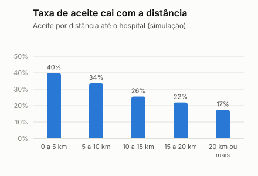
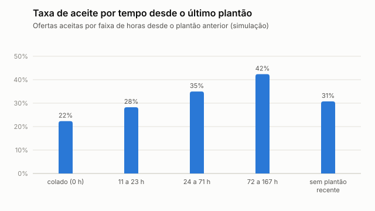
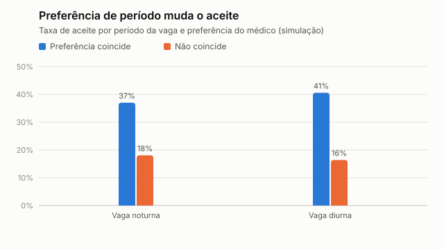
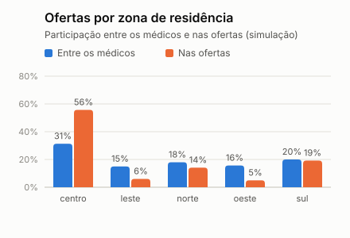
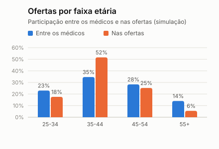
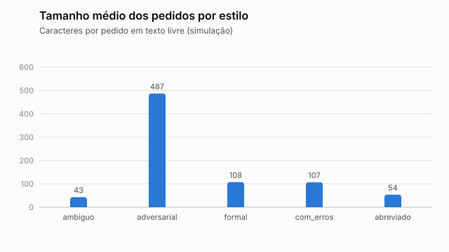

# Análise exploratória dos dados sintéticos

> **Simulação.** Os dados são sintéticos e os padrões abaixo vêm das premissas do simulador (dicionário de dados, seção 6), não de hospitais ou médicos reais. Servem para entender o conjunto, orientar o modelo e mostrar o risco de viés. Gerado por `python -m app.cli analyze`.

## 1. Panorama

| Indicador | Valor |
| --- | ---: |
| Médicos | 300 |
| Vagas publicadas | 2448 |
| Ofertas enviadas | 7555 |
| Ofertas por vaga | 3,09 |
| Taxa de aceite das ofertas | 30,8% |
| Taxa de sucesso (aceitou e compareceu) | 29,6% |
| Vagas sem cobertura | 4,8% |
| Aceites que violam a jornada (processo manual) | 1,3% |
| Mediana até preencher a vaga (simulado, em minutos) | 83 |

Os plantões têm sempre 12 h e horários fixos (19h às 7h e 7h às 19h). Por isso o intervalo entre plantões do mesmo médico é 0 (colado) ou 12 h ou mais, e o descanso mínimo de 11 h não chega a ser a regra que mais barra nos dados; o limite de 24 h contínuas é o que aparece nas violações.

## 2. Vagas por dia da semana

Vagas diurnas só existem aos sábados e domingos, por desenho do segmento (ADR 0001).

| Dia da semana | Noturnas (19h) | Diurnas (7h) |
| --- | ---: | ---: |
| segunda | 265 | 0 |
| terça | 271 | 0 |
| quarta | 284 | 0 |
| quinta | 273 | 0 |
| sexta | 284 | 0 |
| sábado | 277 | 257 |
| domingo | 289 | 248 |

## 3. O que explica o aceite

| Distância | Ofertas | Taxa de aceite |
| --- | ---: | ---: |
| 0 a 5 km | 2085 | 39,9% |
| 5 a 10 km | 2251 | 33,6% |
| 10 a 15 km | 1689 | 25,5% |
| 15 a 20 km | 1000 | 21,9% |
| 20 km ou mais | 530 | 17,4% |

| Horas desde o último plantão | Ofertas | Taxa de aceite |
| --- | ---: | ---: |
| colado (0 h) | 936 | 22,3% |
| menos de 11 h | 0 | sem ofertas |
| 11 a 23 h | 92 | 28,3% |
| 24 a 71 h | 306 | 35,0% |
| 72 a 167 h | 642 | 42,4% |
| sem plantão recente | 5579 | 30,8% |

| Período da vaga | Preferência coincide | Não coincide |
| --- | ---: | ---: |
| Noturna | 37,0% (4106) | 18,1% (1847) |
| Diurna | 40,6% (882) | 16,4% (720) |

### Correlação de cada variável com o sucesso (aceitou e compareceu)

Correlação de Pearson entre a variável, calculada no instante da oferta, e o rótulo `y_success`. Correlação não é causa, e aqui a causa é o próprio simulador.

| Variável | Uso | Correlação |
| --- | --- | ---: |
| Horas da vaga cobertas pela disponibilidade (`availability_overlap_hours`) | ranking | 0,370 |
| Preferência de período coincide (`night_shift_preference_match`) | ranking | 0,200 |
| Distância até o hospital (km) (`distance_km`) | ranking | -0,156 |
| Taxa de aceite nos últimos 90 dias (`acceptance_rate_90d`) | ranking | 0,091 |
| Taxa de comparecimento nos últimos 90 dias (`attendance_rate_90d`) | ranking | 0,072 |
| Plantões nos últimos 30 dias (`shifts_last_30d`) | contexto, fora do ranking | 0,069 |
| Especialidade (principal = 1; secundária = 0,5) (`specialty_match`) | ranking | 0,045 |
| Horas desde o último plantão (`hours_since_last_shift`) | ranking | 0,039 |
| Ofertas recebidas nos últimos 30 dias (`offers_received_30d`) | contexto, fora do ranking | 0,004 |

`shifts_last_30d` tem correlação positiva com o sucesso porque médicos confiáveis aceitam mais plantões (confundimento), embora o simulador penalize a sobrecarga. Por isso a carga recente ficou fora do ranking e vira alerta de jornada.

## 4. Exposição das ofertas e risco de viés

O processo manual simulado liga o `HISTORICAL_BIAS_SCENARIO`: médicos de zonas mais centrais e de certas faixas etárias recebem mais ofertas, **sem** que o aceite dependa do grupo em si. É o risco do exemplo de recrutamento do professor: um modelo treinado no histórico herdaria essa exposição desigual. Razão = participação nas ofertas dividida pela participação entre os médicos (1,00 = proporcional).

| Zona de residência | Entre os médicos | Nas ofertas | Razão | Taxa de aceite do grupo |
| --- | ---: | ---: | ---: | ---: |
| centro | 31,3% | 55,7% | 1,78 | 31,7% |
| leste | 15,0% | 6,0% | 0,40 | 23,5% |
| norte | 18,0% | 14,1% | 0,78 | 32,5% |
| oeste | 15,7% | 5,0% | 0,32 | 23,1% |
| sul | 20,0% | 19,2% | 0,96 | 31,4% |

| Faixa etária | Entre os médicos | Nas ofertas | Razão | Taxa de aceite do grupo |
| --- | ---: | ---: | ---: | ---: |
| 25-34 | 23,0% | 17,6% | 0,76 | 29,9% |
| 35-44 | 34,7% | 51,7% | 1,49 | 31,3% |
| 45-54 | 28,3% | 25,2% | 0,89 | 29,4% |
| 55+ | 14,0% | 5,5% | 0,39 | 35,8% |

| Gênero | Entre os médicos | Nas ofertas | Razão | Taxa de aceite do grupo |
| --- | ---: | ---: | ---: | ---: |
| F | 48,0% | 46,8% | 0,98 | 30,2% |
| M | 52,0% | 53,2% | 1,02 | 31,4% |

A zona também pesa porque os médicos mais próximos do hospital são chamados mais vezes (efeito de proximidade, legítimo) e a zona central fica perto de um dos três hospitais; por isso a razão por zona mistura proximidade e o cenário de viés.

A taxa de aceite por grupo vai de 30,2% a 31,4% por gênero, 29,4% a 35,8% por faixa etária e 23,1% a 32,5% por zona. O simulador não usa o grupo para decidir o aceite, só distância, fadiga, preferência e confiabilidade; as diferenças por zona acompanham a distância até os hospitais, que é justamente o canal pelo qual a zona funciona como proxy.

## 5. Pedidos de vaga em texto livre (análise textual)

São 400 pedidos gerados a partir de modelos, em 5 estilos. O texto é **entrada hostil**: parte dos pedidos é adversarial, com um dos 10 tipos de ataque de injeção de prompt.

| Estilo | Pedidos | Caracteres (média) | Mínimo | Máximo |
| --- | ---: | ---: | ---: | ---: |
| ambiguo | 45 | 43 | 29 | 56 |
| adversarial | 60 | 487 | 120 | 3314 |
| formal | 126 | 108 | 100 | 116 |
| com_erros | 79 | 107 | 99 | 117 |
| abreviado | 90 | 54 | 48 | 65 |

### Que informação aparece em cada estilo

| Estilo | horário (19h às 7h) | data (dia da semana, dd/mm ou hoje) | especialidade | unidade (Centro, Norte, Sul) | urgência |
| --- | ---: | ---: | ---: | ---: | ---: |
| formal | 100% | 100% | 100% | 100% | 100% |
| abreviado | 100% | 100% | 100% | 100% | 100% |
| com_erros | 100% | 100% | 100% | 100% | 100% |
| ambiguo | 0% | 100% | 67% | 69% | 31% |

O estilo ambíguo omite de propósito especialidade, horário ou unidade; é onde a conferência humana dos campos extraídos mais importa.

### Termos mais frequentes (pedidos não adversariais)

| Termo | Ocorrências |
| --- | ---: |
| modelo | 295 |
| noturno | 201 |
| hospital | 157 |
| medico | 155 |
| clinico | 155 |
| pediatra | 147 |
| media | 139 |
| centro | 119 |
| alta | 94 |
| norte | 89 |

### Extração por regras contra o gabarito (linha de base para o Gemini)

Comparação dos 5 campos (unidade, especialidade, início, fim, urgência). "Em branco" é o campo que o extrator deixou para o coordenador preencher; "errado" é o campo com valor diferente do gabarito. Como os textos nascem de modelos, o acerto das regras é otimista (circularidade): o desempenho em texto real tende a ser pior.

| Estilo | Pedidos | Todos os campos certos | Campos em branco | Campos errados |
| --- | ---: | ---: | ---: | ---: |
| formal | 126 | 100% | 0% | 0% |
| abreviado | 90 | 100% | 0% | 0% |
| com_erros | 79 | 100% | 0% | 0% |
| ambiguo | 45 | 0% | 53% | 4% |
| adversarial | 60 | 100% | 0% | 0% |

Detecção de injeção de prompt: 60 de 60 pedidos adversariais sinalizados; 0 falsos positivos entre 340 pedidos normais.

## 6. Limites

- Tudo descreve o simulador; nenhum número é evidência de mercado nem substitui as entrevistas planejadas.
- Só se observa a resposta de quem foi chamado (viés de seleção).
- Os textos de vaga são gerados de modelos; a extração em texto real é uma incógnita.
- As figuras são estáticas; cada uma tem a tabela com os mesmos números logo abaixo.
