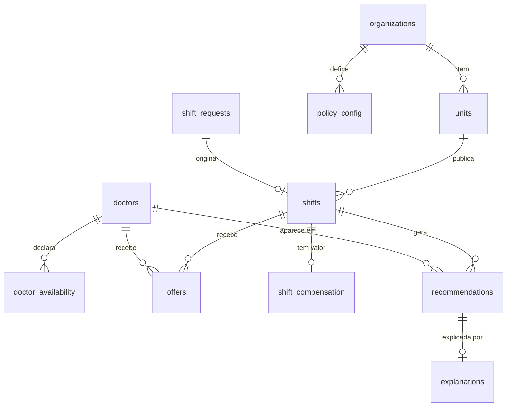

# Dicionário de dados v0

- **Versão:** v0.1, de 30/10/2026 (v0 de 28/10/2026). **Status:** proposta para o portão **G1** (aprovação do Victor).
- **Natureza:** documento de desenho, sem SQL e sem código. É o **contrato de dados** entre as frentes: A1 gera, A2 analisa, A3 modela o ranking, A4 desenha o uso do Gemini e A5 avalia privacidade e viés.
- **Segmento:** pronto-socorro de hospitais privados, plantão noturno de 12 h e fim de semana, clínica médica e pediatria ([ADR 0001](../adr/0001-segmento-inicial.md)).
- **Regra de ouro:** **todos os dados são sintéticos.** Nome, CRM e telefone são fictícios e marcados como simulação; nada tem validade médica ou legal.

## 1. Como usar este documento

1. A1 implementa o gerador para produzir exatamente estas tabelas e colunas; qualquer mudança vira uma nova versão deste dicionário (v1, v2...) no mesmo PR.
2. A2, A3 e A4 escrevem contra estes nomes, antes de os dados existirem; A1 entrega cedo uma **amostra pequena** (até 50 linhas por tabela) para todos testarem.
3. A5 usa a coluna **Papel** para decidir o que pode ir ao LLM, ao ranking e à análise de viés.

## 2. Convenções

**Tipos lógicos:** `uuid`, `text`, `int`, `numeric`, `bool`, `date`, `time`, `timestamptz` (data e hora com fuso), `enum` (valores fixos listados), `jsonb` (objeto estruturado) e `text[]` (lista de textos). Nulo só onde a coluna diz "pode ser nula".

**Papéis**, que mandam no que cada coluna pode fazer:

| Papel | Significado | Pode entrar no ranking? | Pode ir ao LLM? |
| --- | --- | --- | --- |
| `chave` | Identificador ou chave estrangeira | Não | Só IDs pseudônimos |
| `atributo` | Característica do médico, da vaga ou da unidade | Só se estiver na lista da seção 6 | Só se necessário e sem dado pessoal |
| `feature` | Variável permitida no ranking (lista fechada na seção 6) | **Sim** | Só como fator para a explicação |
| `auditoria` | Atributo protegido ou proxy dele (gênero, faixa etária, zona de residência) | **Nunca** | **Nunca** |
| `restrito-econômico` | Pagamento, valor e remuneração | **Nunca** (Res. CFM 2.460/2026, validar com jurídico) | **Nunca** |
| `pii-sim` | Dado pessoal simulado (nome, CRM, telefone) | Nunca | **Nunca** |
| `rótulo` | Resultado observado, usado como alvo do modelo | Nunca como entrada | Não |
| `texto-livre` | Texto digitado por humano; **entrada hostil** | Não | Sim, tratado como não confiável |
| `gabarito` | Verdade simulada para avaliar a extração do LLM | Não | **Nunca** (só no avaliador) |
| `sistema` | Gerado na execução do sistema (existe só se houver PoC) | Não | Conforme a tabela |
| `meta` | Controle (datas, flags do gerador) | Não | Não |

## 3. Visão geral das tabelas

| Tabela | O que guarda | Quem gera | Quem consome |
| --- | --- | --- | --- |
| `organizations`, `units` | Rede e hospitais privados fictícios | A1 | Todas |
| `doctors`, `doctor_availability` | Médicos simulados e janelas de disponibilidade | A1 | A2, A3 |
| `shifts` | Vagas de plantão (histórico) | A1 | A2, A3 |
| `shift_requests` | Pedidos de vaga em texto livre, com gabarito | A1 | A2, A4 |
| `offers` | Histórico de ofertas, respostas e comparecimento | A1 | A2, A3 |
| `policy_config` | Regras de jornada e parâmetros por organização | A1 | A3 |
| `shift_compensation` | Valor simulado do plantão, **separado** de tudo | A1 (opcional) | Só o teste de neutralidade |
| `recommendations`, `recommendation_exclusions`, `explanations`, `audit_log`, `model_registry` | Saídas do sistema | PoC (se aprovada) | A3, A4, A5 |
| `payments`, `checkins`, `contestations`, `fairness_reports` | Evolução futura (ADR 0002) | Ninguém agora | Ninguém agora |

## 4. Tabelas

### 4.1 `organizations`

| Coluna | Tipo | Papel | Descrição e domínio |
| --- | --- | --- | --- |
| `id` | uuid | chave | |
| `name` | text | atributo | Nome fictício da rede de hospitais privados (por exemplo, "Rede Hospitalar Modelo") |
| `kind` | enum | atributo | `rede_hospitais_privados`; `controle_rls` (organização-controle para o teste de isolamento; só se houver PoC) |
| `created_at` | timestamptz | meta | |

### 4.2 `units`

| Coluna | Tipo | Papel | Descrição e domínio |
| --- | --- | --- | --- |
| `id` | uuid | chave | |
| `organization_id` | uuid | chave | Rede dona da unidade |
| `name` | text | atributo | Nome fictício do hospital privado: "Hospital Modelo Centro", "Hospital Modelo Norte", "Hospital Modelo Sul". Aparece nos textos das vagas |
| `kind` | enum | atributo | `PS` (pronto-socorro do hospital; todas as vagas do segmento são do PS) |
| `ownership` | enum | atributo | `privado` (único valor nesta versão; permite ampliar o segmento depois) |
| `zone` | text | atributo | Zona da cidade fictícia: `centro`, `norte`, `sul`, `leste`, `oeste` |
| `lat`, `lon` | numeric | atributo | Coordenadas **fictícias** numa cidade imaginária; nunca endereço real |

### 4.3 `doctors`

| Coluna | Tipo | Papel | Descrição e domínio |
| --- | --- | --- | --- |
| `id` | uuid | chave | É o **ID pseudônimo**: o único identificador do médico que pode aparecer em payload de LLM |
| `name_sim` | text | pii-sim | Nome fictício gerado ao acaso; coincidência com pessoa real não tem significado |
| `crm_sim` | text | pii-sim | Formato `SIM-SP-000123`; o prefixo `SIM` impede confusão com CRM real; único |
| `phone_sim` | text | pii-sim | Formato `+55 00 00000-0000`, com DDD fictício `00` |
| `crm_status` | enum | atributo | `active`, `suspended`, `expired`. Só `active` é elegível |
| `specialty` | enum | atributo | `clinica_medica`, `pediatria` |
| `secondary_specialty` | enum | atributo | Pode ser nula. Mesmo domínio de `specialty` |
| `home_lat`, `home_lon` | numeric | atributo | Residência fictícia, usada **só** para calcular `distance_km`; não vai ao LLM nem a outros usuários |
| `max_radius_km` | numeric | atributo | Raio máximo que o médico aceita se deslocar |
| `preferred_period` | enum | atributo | `night`, `day`, `weekend`, `any` |
| `home_zone` | text | auditoria | Zona de residência; **proxy geográfico** que pode correlacionar com condição socioeconômica |
| `gender` | enum | auditoria | `F`, `M` (categorias simplificadas da simulação) |
| `age_band` | enum | auditoria | `25-34`, `35-44`, `45-54`, `55+` |
| `registered_at` | timestamptz | meta | |

Raça e origem **não** entram nesta versão por escopo da PoC (a Entrega 1 as lista como atributos protegidos); podem entrar numa v1 se a análise de viés pedir.

### 4.4 `doctor_availability`

| Coluna | Tipo | Papel | Descrição e domínio |
| --- | --- | --- | --- |
| `id` | uuid | chave | |
| `doctor_id` | uuid | chave | |
| `kind` | enum | atributo | `available` (janela livre) ou `blocked` (exceção em que não pode) |
| `weekday` | int | atributo | 0 = segunda a 6 = domingo; pode ser nula se for exceção por data |
| `on_date` | date | atributo | Pode ser nula; usada nas exceções por data. **Exatamente um** entre `weekday` e `on_date` é preenchido |
| `start_time`, `end_time` | time | atributo | Se `end_time` < `start_time`, a janela cruza a meia-noite (por exemplo, 19:00 a 07:00) |
| `valid_from` | date | meta | |
| `valid_to` | date | meta | Pode ser nula (sem fim) |

### 4.5 `shifts`

| Coluna | Tipo | Papel | Descrição e domínio |
| --- | --- | --- | --- |
| `id` | uuid | chave | |
| `unit_id` | uuid | chave | |
| `source_request_id` | uuid | chave | Pode ser nula. Pedido em texto livre que originou a vaga |
| `specialty` | enum | atributo | `clinica_medica`, `pediatria` |
| `starts_at`, `ends_at` | timestamptz | atributo | `ends_at` > `starts_at`; duração típica de 12 h |
| `period` | enum | atributo | `night` (19h às 7h), `day` (7h às 19h); derivada |
| `is_weekend` | bool | atributo | Derivada de `starts_at` |
| `urgency` | enum | atributo | `low`, `medium`, `high` |
| `status` | enum | atributo | `open`, `offered`, `filled`, `uncovered`, `cancelled` |
| `published_at` | timestamptz | meta | |
| `filled_at` | timestamptz | meta | Pode ser nula. `filled_at - published_at` é o tempo até preencher **no processo simulado**, não evidência |

`shifts` **não tem nenhum campo de valor ou pagamento**; isso fica em `shift_compensation` (seção 4.9).

### 4.6 `shift_requests`

Pedidos em texto livre, base da análise textual (A2) e da avaliação da extração com o Gemini (A4).

| Coluna | Tipo | Papel | Descrição e domínio |
| --- | --- | --- | --- |
| `id` | uuid | chave | |
| `unit_id` | uuid | chave | |
| `coordinator_pseudo_id` | uuid | chave | Coordenador fictício |
| `created_at` | timestamptz | meta | "Hoje" do pedido: resolve datas relativas como "sexta" |
| `raw_text` | text | texto-livre | Português do Brasil, até 500 caracteres, com variações. **Entrada hostil** |
| `style` | enum | meta | `formal`, `abreviado`, `com_erros`, `ambiguo`, `adversarial` |
| `gt_unit_id` | uuid | gabarito | Unidade correta |
| `gt_specialty` | enum | gabarito | Especialidade correta |
| `gt_starts_at`, `gt_ends_at` | timestamptz | gabarito | Início e fim corretos |
| `gt_urgency` | enum | gabarito | Urgência correta |
| `is_adversarial` | bool | meta | Verdadeiro nos casos de injeção de prompt |
| `attack_type` | enum | meta | Pode ser nula. Domínio inicial (a A4 pode ampliar): `ignore_rules`, `leak_secret`, `inject_payment`, `forge_fields`, `oversize`, `control_chars`, `language_switch`, `role_play`, `pii_exfiltration`, `prompt_leak` |

Exemplo (fictício): "Preciso de um pediatra para o plantão noturno de sexta, 19h às 7h, PS do Hospital Modelo Centro, urgência alta."

### 4.7 `offers`

Cada linha é uma oferta feita a um médico para uma vaga. No histórico, as ofertas vêm do **processo manual simulado**.

| Coluna | Tipo | Papel | Descrição e domínio |
| --- | --- | --- | --- |
| `id` | uuid | chave | |
| `shift_id`, `doctor_id` | uuid | chave | Par único |
| `sequence_no` | int | atributo | Ordem na cascata (1 = primeiro chamado) |
| `selection_source` | enum | meta | `manual_history` (histórico simulado) ou `system_recommendation` (execução, se houver PoC) |
| `sent_at` | timestamptz | meta | **Instante de referência** das variáveis (seção 6) |
| `ttl_minutes` | int | atributo | Prazo para responder |
| `responded_at` | timestamptz | meta | Pode ser nula (expirou) |
| `response` | enum | rótulo | `accepted`, `declined`, `expired` |
| `decline_reason` | enum | atributo | Pode ser nula: `distance`, `fatigue`, `schedule`, `other` |
| `accepted` | bool | rótulo | `response = accepted` |
| `attended` | bool | rótulo | Pode ser nula; só existe se `accepted`. Compareceu ao plantão |
| `y_success` | bool | rótulo | **Alvo do ranking:** `accepted` e `attended` |
| `injected_violation` | bool | meta | Verdadeiro se o gerador injetou de propósito uma violação de jornada no histórico manual |

### 4.8 `policy_config`

| Coluna | Tipo | Papel | Descrição e domínio |
| --- | --- | --- | --- |
| `organization_id` | uuid | chave | |
| `max_continuous_hours` | int | atributo | Padrão **24** |
| `min_rest_hours` | int | atributo | Padrão **11** |
| `allow_secondary_specialty` | bool | atributo | Padrão `true` |
| `min_overlap_ratio` | numeric | atributo | Fração da vaga que a disponibilidade deve cobrir; padrão 1,0 |
| `default_radius_km` | numeric | atributo | Usado quando o médico não tem raio |
| `offer_ttl_minutes` | int | atributo | Prazo da oferta na cascata |
| `top_k` | int | atributo | Padrão 5 |
| `effective_from` | date | meta | |

Os padrões 24 h e 11 h são os da Entrega 1 como **configuração do projeto**; não foram verificados em texto normativo (ver [conformidade](../conformidade/README.md)). A exceção à jornada exige justificativa humana.

### 4.9 `shift_compensation` (restrito)

| Coluna | Tipo | Papel | Descrição e domínio |
| --- | --- | --- | --- |
| `shift_id` | uuid | chave | |
| `amount_brl_sim` | numeric | restrito-econômico | Valor **simulado** em reais |

Fica **fora de qualquer visão usada pelo ranking e pelo LLM**. A A1 gera a tabela (opcional, recomendada) para o **teste contrafactual**: o ranking com e sem os valores tem de dar o mesmo resultado.

### 4.10 Saídas do sistema (contrato; existem só se houver PoC)

| Tabela | Colunas principais | Papel |
| --- | --- | --- |
| `recommendations` | `id`, `shift_id`, `doctor_id`, `rank`, `score`, `model_version`, `features` (jsonb com os valores de `RANKING_FEATURES`), `alerts` (jsonb com os alertas de jornada), `created_at` | sistema |
| `recommendation_exclusions` | `id`, `shift_id`, `doctor_id`, `rule_code` (`crm_inactive`, `specialty_mismatch`, `outside_radius`, `unavailable`, `rest_violation`, `continuous_hours_exceeded`), `rule_text`, `created_at` | sistema |
| `explanations` | `id`, `recommendation_id`, `text`, `factors_cited` (text[]), `source` (`llm` ou `template`), `llm_model`, `prompt_version`, `validated` (bool), `created_at` | sistema |
| `audit_log` | `id`, `occurred_at`, `actor_role` (`coordinator`, `doctor`, `system`), `actor_pseudo_id`, `action`, `entity_type`, `entity_id`, `model_version`, `details` (jsonb **sem dado pessoal**) | sistema; **somente inserção** |
| `model_registry` | `model_version`, `kind` (`baseline`, `logistic_regression`, `lightgbm`), `trained_at`, `train_period`, `test_period`, `features` (text[], validada por `validar_features`), `metrics` (jsonb), `label` (sempre `simulacao`), `status` | sistema |

### 4.11 Evolução futura (só nomes, sem colunas)

`payments` (prazo e data de pagamento; restrito-econômico), `checkins` (presença), `contestations` (contestação do médico e resposta) e `fairness_reports` (relatório de equidade).

## 5. Variáveis do ranking (contrato com `features.py`)

As nove variáveis abaixo são **exatamente** as de `RANKING_FEATURES` em [`features.py`](../../services/matching-api/app/ranking/features.py). Todas são calculadas **no instante `offers.sent_at`**, usando apenas dados anteriores a ele (sem vazamento do futuro); a validação é temporal (treino em períodos anteriores, teste em posteriores).

| Variável | Cálculo | Fontes |
| --- | --- | --- |
| `specialty_match` | 1,0 se `doctors.specialty` = `shifts.specialty`; 0,5 se só `secondary_specialty` coincide e a política permite; senão o médico é excluído antes do ranking | `doctors`, `shifts`, `policy_config` |
| `distance_km` | Distância em linha reta entre `doctors.home_lat/lon` e `units.lat/lon` | `doctors`, `units` |
| `availability_overlap_hours` | Horas da vaga cobertas pelas janelas `available`, descontadas as `blocked` | `doctor_availability`, `shifts` |
| `acceptance_rate_90d` | (aceites + 1) / (ofertas respondidas ou expiradas + 2) nos 90 dias anteriores; suavização que dá 0,5 a quem não tem histórico | `offers` |
| `attendance_rate_90d` | (comparecimentos + 1) / (aceites + 2) nos 90 dias anteriores | `offers` |
| `hours_since_last_shift` | Horas entre o fim do último plantão **atendido** e o início da vaga; limitado a 168 (7 dias) | `offers`, `shifts` |
| `shifts_last_30d` | Plantões atendidos nos 30 dias anteriores | `offers`, `shifts` |
| `offers_received_30d` | Ofertas recebidas nos 30 dias anteriores, com qualquer resposta | `offers` |
| `night_shift_preference_match` | 1 se `preferred_period` for `any` ou coincidir com o período da vaga (`weekend` coincide com `is_weekend`); senão 0 | `doctors`, `shifts` |

**Observações para a A3 (decidir até o G2; mudar a lista exige atualizar `features.py` e o teste de neutralidade):**

- Com os padrões do filtro, `specialty_match` e `availability_overlap_hours` tendem a ser **constantes** entre os elegíveis. A A3 decide se mantém os nomes e relaxa o filtro (aceitar especialidade secundária e cobertura parcial, via `policy_config`) para as variáveis variarem, ou se as retira da lista.
- `offers_received_30d` mede exposição: quem recebe mais ofertas ganha mais histórico, o que pode reforçar viés; a A5 avalia.
- `distance_km` correlaciona com `home_zone` (proxy). Está permitida no ranking porque é critério operacional legítimo, mas entra na análise de viés.

## 6. Premissas do simulador (valores iniciais sugeridos)

**São premissas do simulador, sem fonte externa e sem validação com dados reais.** A A1 ajusta, grava no manifesto e justifica cada mudança.

| Parâmetro | Valor inicial sugerido | Observação |
| --- | --- | --- |
| Período do histórico | 12 meses, de 01/10/2025 a 30/09/2026 | Tudo no passado; últimos 2 meses reservados para teste temporal |
| Hospitais (unidades) | 3 hospitais privados fictícios (1 rede), com 1 pronto-socorro cada | ADR 0001 |
| Médicos | cerca de 300, mais ou menos 55% clínica médica e 45% pediatria | |
| Vagas no período | ordem de 3.000, cerca de 60% noturnas e 35% em fim de semana | |
| Ofertas no período | ordem de 12.000 (cerca de 4 por vaga) | |
| Vagas que ficam sem cobertura | cerca de 8% | |
| Comparecimento após aceite | cerca de 95% | |
| Aceite | Modelo logístico com efeitos: distância (negativo), fadiga (negativo), preferência de período (positivo) e taxa histórica (positivo); coeficientes sorteados e gravados no manifesto | **O ranking aprende este simulador (circularidade)** |
| Violações de descanso no histórico manual | cerca de 3% das atribuições, marcadas em `injected_violation` | Mostra o valor do filtro; é premissa, não achado |
| `HISTORICAL_BIAS_SCENARIO` | **Ligado**: no processo manual simulado, médicos de zonas mais centrais e de certas faixas etárias recebem mais ofertas, sem que o aceite dependa do grupo | Reproduz o risco do exemplo de recrutamento do professor: modelo treinado no histórico herda o viés de seleção |
| Textos de vaga | cerca de 400, nos 5 estilos; 10% a 15% adversariais, cobrindo os 10 tipos | A2 faz a análise textual; A4 avalia a extração |

## 7. Regras de qualidade (a A1 reporta o resultado de cada uma)

| Regra | Tolerância |
| --- | --- |
| Integridade referencial: toda chave estrangeira aponta para registro existente | 0 violações |
| Domínios: todo valor `enum` está na lista | 0 violações |
| Datas: `ends_at` > `starts_at`; `responded_at` >= `sent_at`; `filled_at` >= `published_at` | 0 violações |
| Unicidade: `crm_sim` e pares (`shift_id`, `doctor_id`) em `offers` | 0 duplicatas |
| Coerência: `accepted` = (`response` = `accepted`); `attended` só existe se `accepted`; `y_success` = `accepted` e `attended` | 0 violações |
| Sobreposição: um médico não atende dois plantões ao mesmo tempo | 0, exceto linhas com `injected_violation` |
| Nulos e distribuições | Relatório por coluna, sem faixa normativa |
| Sem dado real: `crm_sim` sempre com prefixo `SIM`; varredura de padrões de chave e de CRM real | 0 achados |
| Reprodutibilidade: mesma semente e mesmos parâmetros dão os mesmos checksums | Exato |
| Cobertura do segmento: toda vaga está nas duas especialidades e nos três hospitais | 100% |

## 8. Reprodutibilidade e formato

- Parâmetros e semente em `data/synthetic/params.yaml` (a criar pela A1).
- Saída em CSV UTF-8 em `data/synthetic/out/` (ignorada pelo Git; qualquer um regenera) e **amostra pequena** em `data/synthetic/sample/`, versionada.
- `dataset_manifest.json` com versão deste dicionário, semente, parâmetros, contagem de linhas por tabela e checksums.

## 9. Privacidade e o que pode ir ao Gemini (ADR 0003)

| Pode ir ao LLM | Nunca vai ao LLM |
| --- | --- |
| `shift_requests.raw_text` (como entrada não confiável); nomes das unidades; IDs pseudônimos (`doctors.id`); valores de `RANKING_FEATURES` e códigos de regra para a explicação | `name_sim`, `crm_sim`, `phone_sim`; `home_lat/lon`; `gender`, `age_band`, `home_zone`; `shift_compensation` e `payments`; `gt_*`; chaves e segredos |

Mesmo sendo sintéticos, os dados são tratados como se fossem reais, para ensaiar a minimização da LGPD. Na camada gratuita do Gemini o Google usa o conteúdo para melhorar produtos; por isso testes só com dados sintéticos e a demo na camada paga ([ADR 0003](../adr/0003-llm-do-produto-gemini.md)). Acesso: se houver PoC, a RLS isola as organizações e o coordenador só vê candidatos elegíveis para a própria vaga (desenho em `docs/02`).

## 10. Limites e honestidade

- **Circularidade:** os rótulos nascem do simulador; um modelo bom aqui mostra que aprendeu o simulador, não que funciona no mundo real. Toda métrica sai com o rótulo "simulação" e ao lado do baseline heurístico.
- **Viés de seleção:** só se observa a resposta de quem foi chamado; o histórico manual simulado carrega esse viés de propósito (`HISTORICAL_BIAS_SCENARIO`).
- **Premissas sem fonte:** os parâmetros da seção 6 são nossos; as entrevistas planejadas na Entrega 1 ainda não aconteceram.
- **Proxies:** `distance_km`, `home_zone` e `offers_received_30d` podem carregar viés mesmo sem atributos protegidos no modelo.
- **Não é evidência de mercado:** nenhum número deste dicionário descreve hospitais ou médicos reais.

## 11. Decisões para o G1 (padrão recomendado)

| # | Pergunta | Padrão recomendado |
| --- | --- | --- |
| 1 | Período, volume e proporções da seção 6 estão bons como ponto de partida? | Sim; A1 ajusta e registra |
| 2 | Ligar o `HISTORICAL_BIAS_SCENARIO` por padrão? | Sim: dá a análise de viés que o professor valoriza |
| 3 | Atributos de auditoria: gênero, faixa etária e zona de residência; raça e origem fora da PoC? | Sim |
| 4 | Gerar `shift_compensation` separada para o teste contrafactual de neutralidade? | Sim |
| 5 | Formato CSV UTF-8 com manifesto e amostra pequena no Git? | Sim |
| 6 | Organização-controle para teste de isolamento (RLS)? | Definida aqui, gerada só se houver PoC (G-P) |
| 7 | `specialty_match` e `availability_overlap_hours` quase constantes: quem decide e quando? | A3, até o G2 |
| 8 | Os 10 tipos de ataque da seção 4.6 como domínio inicial? | Sim; A4 pode ampliar |

## 12. Histórico

| Versão | Data | Mudança |
| --- | --- | --- |
| v0 | 28/10/2026 | Primeira versão, para aprovação no G1 |
| v0.1 | 30/10/2026 | Segmento ajustado pelo Victor: pronto-socorro de hospitais privados (`organizations`, `units` com `ownership`, exemplo de texto e premissas) |
