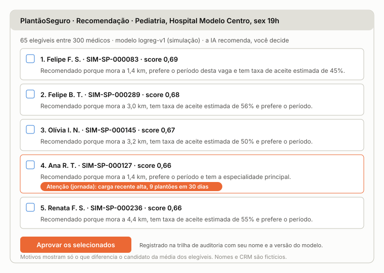
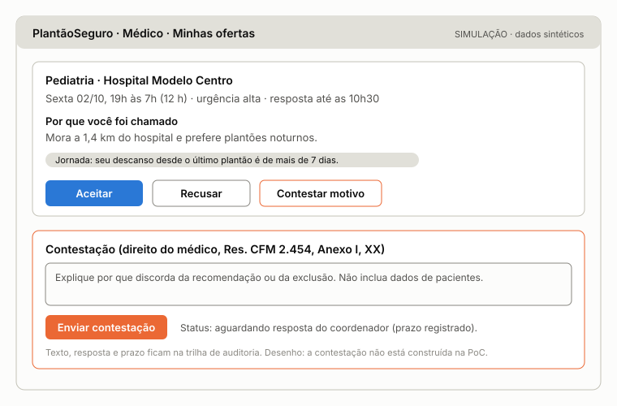

# Kit do entrevistador

PlantãoSeguro · Etapa 3 · versão de 03/11/2026 · entrevistas até 06/11, para entrar na entrega de 07/11

> [!IMPORTANT]
> **O que precisamos de você:** 2 conversas curtas, com um coordenador de escala ou um médico plantonista, e os números anotados na ficha. Leve também a [folha de casos](Casos-revisao-cega.pdf) para os coordenadores. Nada de nome, hospital ou paciente.

## 1. Por que isso importa

O feedback da Etapa 2 apontou que, sem dados reais, não conseguimos demonstrar que os padrões do trabalho representam hospitais e médicos reais. As entrevistas são a parte mais barata de responder a isso, e uma resposta muda o resultado inteiro. Na simulação, o ganho de tempo depende de como o coordenador real já trabalha:

<!-- keep -->
| Se o coordenador real... | Ofertas por vaga hoje | Tempo que o modelo economiza |
| --- | ---: | ---: |
| Chama sem conferir a agenda (premissa atual) | 3,31 | 57% |
| Já chama só quem pode ir, em qualquer ordem | 1,82 | 27% |
| Já escolhe tão bem quanto nossa regra simples (baseline) | 1,41 | 7% |

*Simulação com dados sintéticos, nas 392 vagas do período de teste. Não é evidência de hospital real.*

**A pergunta que decide é: quantos médicos você chama até alguém aceitar?** Se só der tempo de uma, faça essa. Não conte estes números a quem for entrevistar, para não influenciar a resposta.

## 2. Quem entrevistar

- **Quantos:** 3 a 5 coordenadores de escala e 3 a 5 plantonistas, como a Entrega 1 prometeu. Cada integrante tenta 2 conversas e avisa no grupo, para ninguém procurar a mesma pessoa.
- **Perfil ideal:** pronto-socorro de hospital privado, noite ou fim de semana, clínica médica ou pediatria. Quem está perto disso também vale; anote o que for diferente.
- **Duração:** 25 a 40 min com coordenador, 15 a 25 min com plantonista. Pode ser por vídeo ou telefone.

Convite (adapte à vontade):

> Oi, [nome]. Faço pós em IA aplicada a negócios no Mackenzie e, no trabalho final, meu grupo estuda como preencher vagas de plantão com menos ligações e mais transparência. Posso te fazer algumas perguntas por 30 minutos esta semana? É voluntário, não gravo e não anoto nome, hospital nem nada que identifique você. Só preciso de ordens de grandeza, sem abrir nenhum dado do hospital.

## 3. Regras

1. **Voluntário e com o termo lido.** Leia o termo da seção 4 antes da primeira pergunta. A pessoa pode pular perguntas ou parar quando quiser.
2. **Nunca anote** nome, hospital, CRM, telefone, paciente ou caso individual. Se a pessoa citar, deixe fora da ficha. Aqui entram só ordens de grandeza, nunca registros individuais.
3. **Use códigos:** C1, C2... para coordenadores e P1, P2... para plantonistas. Combine no grupo quem usa qual código.
4. **Sem gravação.** As fichas ficam fora do Git, em pasta privada do grupo. Ao repositório público só vão números agregados e frases sem identificação.
5. **Peça número ou faixa** ("entre 3 e 5"). "Não sei" é resposta válida: nunca chute no lugar da pessoa.
6. **Pergunte antes de mostrar.** Faça os blocos de números antes de explicar o produto ou mostrar telas, para não induzir.
7. **Não abra o gabarito** da revisão às cegas. Quem entrevista também não pode saber de onde vem cada lista.

> [!IMPORTANT]
> **Ética em pesquisa: a confirmar com o professor antes da primeira entrevista.** A [Res. CNS 510/2016](https://bvsms.saude.gov.br/bvs/saudelegis/cns/2016/res0510_07_04_2016.html) (art. 1º, parágrafo único) dispensa do sistema CEP/Conep a atividade exclusivamente de ensino, sem finalidade de pesquisa científica, de profissionais em especialização. A mesma norma tira dessa dispensa TCC, monografias e similares (§ 1º) e exige submissão se o resultado for aproveitado em projeto de pesquisa (§ 2º). O [Ofício Circular 17/2022 da Conep](https://www.ufrgs.br/cep/wp-content/uploads/2022/07/Oficio_Circular_0027884544.html) lembra que a instituição pode ter análise própria. Tratamos estas conversas como validação de mercado dentro de uma disciplina, mas essa classificação não cabe ao grupo: quem confirma é o Prof. Fabio, com o Mackenzie. Fontes lidas em 03/11/2026; validar com jurídico. Se o trabalho virar artigo ou TCC, a conversa com o comitê de ética vem antes.

## 4. Termo (leia em voz alta)

> Esta conversa faz parte de um trabalho da disciplina Hands On: Aplicação de IA nos Negócios, da pós-graduação do Mackenzie. Queremos entender como as vagas de plantão são preenchidas hoje. É um levantamento para o trabalho, não uma consulta médica ou jurídica. Participar é voluntário e não há pagamento nem vínculo com hospital ou empresa. Você pode pular qualquer pergunta ou parar quando quiser, sem explicar. Não vou gravar nem anotar seu nome, o hospital, CRM, telefone ou informação de paciente; por favor, não cite nomes. Só números agregados e frases sem identificação podem aparecer no repositório público do trabalho e na apresentação em sala. Se mudar de ideia até 06/11, me avise e suas respostas saem da análise. Posso seguir?

Anote "consentimento: sim" na ficha. Se a resposta for não, agradeça e encerre.

## 5. Roteiro do coordenador de escala (25 a 40 min)

Se o tempo apertar, faça só os blocos B e D.

### A. Contexto (2 min)

<!-- keep -->
| Nº | Pergunta |
| ---: | --- |
| 1 | Que serviço você coordena (pronto-socorro, UTI, enfermaria)? O hospital é privado ou público? |
| 2 | Quantos médicos há na sua lista para chamar? De quais especialidades? |

### B. Como é hoje, em números (10 min)

<!-- keep -->
| Nº | Pergunta |
| ---: | --- |
| 3 | Por mês, quantas vagas surgem fora da escala fixa (falta, troca, atestado)? |
| 4 | Dessas, quantas ficam sem ninguém ou só fecham na última hora? |
| 5 | **Quando surge uma vaga, quantos médicos você chama até alguém aceitar?** Num caso típico e num caso ruim. (a mais importante) |
| 6 | Quanto tempo passa entre saber da vaga e ter o médico confirmado? Típico e pior caso. |
| 7 | Por qual canal você chama (WhatsApp, telefone, grupo, sistema)? Quanto espera a resposta antes de chamar o próximo? Depois de quantas tentativas você escala o problema? |
| 8 | O que você confere antes de chamar? Deixe a pessoa responder e só depois pergunte o que faltou: CRM, especialidade, agenda do médico, distância, descanso desde o último plantão. |
| 9 | Como decide quem chamar primeiro? De cada 10 chamados, quantos vão para os mesmos poucos médicos? |
| 10 | De cada 10 médicos que aceitam, quantos faltam ou cancelam em cima da hora? |
| 11 | Com quanta antecedência as vagas costumam surgir? De cada 10, quantas com 24 horas ou mais? |
| 12 | Quantas horas por semana você gasta preenchendo vagas? |

### C. Custo e valor (5 min)

<!-- keep -->
| Nº | Pergunta |
| ---: | --- |
| 13 | O que acontece quando uma vaga fica descoberta (fecha leito, paga mais, colega dobra)? Qual é o custo, em ordem de grandeza? |
| 14 | Vocês usam empresa ou cooperativa para escalar? Quanto custa, por plantão ou por taxa? |
| 15 | Quem decidiria comprar uma ferramenta assim? Em que faixa por mês faria sentido? |
| 16 | **Depois de 6 meses usando uma ferramenta dessas, o que faria você dizer que deu certo?** Peça um número. |

### D. Revisão às cegas (10 min)

Abra a [folha de casos](Casos-revisao-cega.pdf) e leia as instruções do topo. Em cada caso, anote quantos dos 5 a pessoa chamaria em cada lista e qual lista usaria (A, B ou tanto faz). São 10 casos; se o tempo apertar, faça ao menos os 6 primeiros, na ordem. Não comente as listas e não diga como foram feitas. Ao final, pergunte: **o que mais pesou nas suas escolhas? Faltou alguma informação?**

### E. Reação à tela (5 min): tela 2 do anexo

<!-- keep -->
| Nº | Pergunta |
| ---: | --- |
| 17 | Mostre a tela sem explicar: "por que o primeiro da lista foi recomendado?" Anote se a pessoa entendeu sem ajuda. |
| 18 | De 1 a 5, o motivo está claro? Falta algum alerta? |
| 19 | Você aprovaria uma chamada com base nesta tela? O que precisaria para confiar? |
| 20 | Se a recomendação estiver errada e der problema, quem deve responder por isso? |

## 6. Roteiro do plantonista (15 a 25 min)

Se o tempo apertar, faça só o bloco B.

### A. Contexto (1 min)

<!-- keep -->
| Nº | Pergunta |
| ---: | --- |
| 1 | Qual sua especialidade? Dá plantão em que tipo de serviço e hospital? Há quanto tempo: menos de 5 anos, de 5 a 10 ou mais de 10? |

### B. Como é hoje, em números (8 min)

<!-- keep -->
| Nº | Pergunta |
| ---: | --- |
| 2 | Por semana, quantas ofertas de plantão você recebe? Por qual canal? |
| 3 | **De cada 10 ofertas, quantas você aceita?** |
| 4 | Quanto tempo costuma levar para responder? |
| 5 | Por que recusa? Ordene: agenda, distância, cansaço, valor, outro. |
| 6 | Até que distância aceita ir? Muda à noite? |
| 7 | Prefere noite, dia ou fim de semana? Em que condição aceita fora disso? |
| 8 | Nos últimos 3 meses, qual foi o máximo de horas seguidas que trabalhou? Costuma emendar plantões? |
| 9 | De cada 10 plantões que aceita, quantos acaba cancelando? Por quê? |
| 10 | Em quantos dias costuma receber? O atraso já fez você recusar um plantão? |

### C. Justiça e transparência (5 min)

<!-- keep -->
| Nº | Pergunta |
| ---: | --- |
| 11 | De 1 a 5, as ofertas vão sempre para os mesmos médicos? (1: bem distribuídas; 5: sempre os mesmos) |
| 12 | Gostaria de saber por que recebeu uma oferta? E por que não recebeu? |
| 13 | Que informação **não** deveria ser usada para decidir quem recebe oferta? |
| 14 | Se achar que foi prejudicado, como gostaria de contestar? |

### D. Reação à tela (4 min): tela 4 do anexo

<!-- keep -->
| Nº | Pergunta |
| ---: | --- |
| 15 | Mostre a tela sem explicar: "por que você recebeu esta oferta?" Anote se a pessoa entendeu sem ajuda. |
| 16 | "Como você contestaria?" Anote se achou o caminho sem ajuda. |
| 17 | De 1 a 5, você confia neste motivo? |

## 7. Ficha de registro

Uma ficha por pessoa. Anote as respostas pelo número da pergunta, por exemplo: "5: típico 3 a 5, ruim 10".

<!-- keep -->
| Campo | Anote |
| --- | --- |
| Código | C__ ou P__ |
| Consentimento | sim |
| Serviço e tipo de hospital, sem o nome | |
| Duração | |
| Respostas, por número | |
| Frases úteis, sem identificação | |

Revisão às cegas, só para coordenadores:

<!-- keep -->
| Caso | 1 | 2 | 3 | 4 | 5 | 6 | 7 | 8 | 9 | 10 |
| --- | --- | --- | --- | --- | --- | --- | --- | --- | --- | --- |
| Lista A: chamaria quantos? | | | | | | | | | | |
| Lista B: chamaria quantos? | | | | | | | | | | |
| Usaria: A, B ou tanto faz | | | | | | | | | | |

Entregue as fichas ao Victor até 06/11, já sem nenhuma identificação.

## 8. O que cada resposta muda

Cada resposta entra na comparação com o que o simulador assume hoje, ao longo do ano simulado (2.448 vagas).

<!-- keep -->
| Pergunta do coordenador | O simulador assume | O que a resposta decide |
| --- | --- | --- |
| 3: vagas por mês | 68 por hospital | O volume do caso de negócio |
| 4: descobertas | 4,8% | A linha de base da meta de cobertura |
| 5: médicos chamados | 3,09 ofertas por vaga | Qual linha da tabela da seção 1 vale |
| 6: tempo até confirmar | Mediana de 83 min | A linha de base da meta de tempo |
| 7: espera e tentativas | 60 min para expirar, resposta média de 20 min, até 8 ofertas | Os tempos da simulação de fluxo |
| 8: o que confere | Só CRM e especialidade | Se o filtro de regras é ganho real: ele responde por 72% do ganho simulado |
| 9: quem chama primeiro | Sorteio que favorece quem mora perto e quem já está no hospital; 10% dos médicos recebem 27,7% das ofertas | A concentração de partida |
| 10: faltas | Cerca de 96% comparecem | O peso do comparecimento |
| 11: antecedência | 74,5% publicadas com 24 h ou mais | O teto da meta de antecedência |
| 12 a 15: horas e custos | Nada: o simulador não tem esses valores | O ROI |
| 16: deu certo em 6 meses | Metas da Entrega 1 | Os critérios de sucesso |
| Revisão às cegas | Nada: só pessoas medem isso | A meta de 60% de recomendações aceitas |

<!-- keep -->
| Pergunta do plantonista | O simulador assume | O que a resposta decide |
| --- | --- | --- |
| 3: aceite | 30,8% das ofertas | O nível da chance de aceite |
| 4: tempo de resposta | Média de 20 min | Os tempos da simulação de fluxo |
| 5: motivos de recusa | Agenda, distância, cansaço e outro; valor fica de fora | O que falta no modelo |
| 6: distância | -0,09 por km na chance de aceite | O peso da distância |
| 7: preferência | +0,7 quando o período coincide | O peso da preferência |
| 8: horas seguidas | Limite de 24 h e descanso de 11 h | A regra de jornada |
| 10: prazo de pagamento | Fora do ranking, por regra | Só contexto do problema; não entra no modelo |
| 11 a 14: justiça | Sem premissa | As mitigações de concentração e a contestação |

## 9. Depois das entrevistas

1. O grupo consolida as fichas em `docs/entrevistas/resultados.md`, só com agregados: quantas pessoas responderam, mínimo, mediana e máximo de cada número.
2. A revisão às cegas é calculada com o [gabarito](revisao-cega-gabarito.md), depois que a última entrevista terminar.
3. Os números reais entram no teste de premissas e no documento da Etapa 3, com o tamanho da amostra sempre à vista.

**Limite:** são poucas pessoas, escolhidas por conveniência. O resultado mostra se as premissas são plausíveis e calibra a simulação; não prova o ganho. Quem prova é o piloto em paralelo descrito na Etapa 3.

## Anexo: telas para mostrar

Protótipos em baixa fidelidade, com dados fictícios. Mostre uma de cada vez, só depois dos blocos de números.

<!-- grande -->

<!-- grande -->

