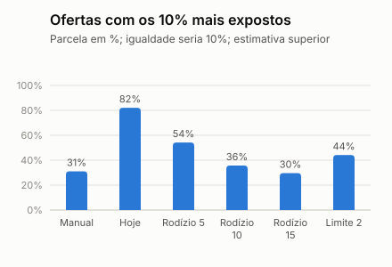

# Experimento contra a concentração das ofertas (simulação)

> **Simulação.** Os dados são sintéticos e a chance de aceite é a do simulador. O experimento mostra quanto cada política troca de concentração por tempo e chance de sucesso dentro do mundo simulado; não é evidência do mundo real. Gerado por `python -m app.cli concentration`.

## Pergunta

O fluxo recomendado põe os 10% de médicos mais recomendados em 50,7% dos lugares do top-5 e, numa estimativa superior, em 82,1% das ofertas que de fato saem, contra 31,1% das ofertas no processo manual simulado ([fluxo](metricas-fluxo.md)). Rodízio e limite de exposição reduzem isso? A que custo?

## Como foi feito

- **392 vagas de teste** (a partir de 2026-08-01, 60 dias), em ordem de publicação, com em média 50 elegíveis por vaga.
- **Exposição** é quantas vezes o médico apareceu no top-5 nos últimos 7 dias, pelo que a própria política recomendou antes.
- **Rodízio entre equivalentes:** entre os elegíveis com chance prevista a até 5, 10 ou 15 pontos da melhor ainda disponível, vai primeiro o menos exposto. Ninguém passa à frente de alguém melhor do que ele por mais que a margem. Os 5 pontos são a margem que a tela do coordenador usa para dizer "chances parecidas".
- **Limite de exposição:** quem já apareceu 2 ou 4 vezes no top-5 na semana vai para o fim da lista; continua elegível.
- **Tempo e ofertas:** a mesma cascata do fluxo recomendado, com 100 repetições por vaga e os mesmos sorteios para todas as políticas.
- **Critério de escolha (do grupo):** a política que mais reduz a parcela das ofertas com os 10% mais expostos, perdendo até 2 pontos de chance de sucesso do top-5.

## Resultado

| Política | Chance de sucesso do top-5 | Tempo médio (min) | Ofertas por vaga | 10% mais expostos: lugares do top-5 | 10% mais expostos: ofertas* | Elegíveis que nunca aparecem | Zona menos exposta** |
| --- | ---: | ---: | ---: | ---: | ---: | ---: | ---: |
| Hoje: só a ordem do modelo | 71,2% | 47 | 1,32 | 50,7% | 82,1% | 47,1% | 0,01 |
| Rodízio entre equivalentes, margem de 5 pontos | 70,8% | 49 | 1,34 | 39,0% | 54,2% | 37,7% | 0,02 |
| **Rodízio entre equivalentes, margem de 10 pontos (recomendada)** | 69,4% | 49 | 1,37 | 28,5% | 35,7% | 26,5% | 0,07 |
| Rodízio entre equivalentes, margem de 15 pontos | 67,8% | 51 | 1,41 | 23,0% | 29,7% | 17,9% | 0,17 |
| Limite de 2 aparições por semana | 68,0% | 49 | 1,36 | 22,9% | 44,1% | 21,0% | 0,14 |
| Limite de 4 aparições por semana | 70,7% | 48 | 1,32 | 38,4% | 69,7% | 40,9% | 0,02 |
| Rodízio de 10 pontos e limite de 4 | 69,3% | 49 | 1,37 | 27,9% | 36,2% | 25,3% | 0,07 |

Vagas sem cobertura: no máximo 0,0% em qualquer política.

\* Estimativa superior: cada vaga é avaliada com a agenda do histórico, e quem a política escalaria não fica ocupado para as seguintes. O processo manual simulado fica em 31,1%.

\*\* Parcela da zona no top-5 dividida pela parcela dela entre os elegíveis; 1,00 seria proporcional. A zona não entra no ranking: é medida só para a auditoria.

## Leitura

- **Política recomendada: rodízio entre equivalentes, margem de 10 pontos.** Os 10% mais expostos passam de 82,1% para 35,7% das ofertas e de 50,7% para 28,5% dos lugares do top-5, e os elegíveis que nunca aparecem vão de 47,1% para 26,5%.
- **O custo:** a chance de sucesso do top-5 muda −1,8 pontos (71,2% para 69,4%), e o tempo médio vai de 47 para 49 min, ainda bem abaixo do processo manual simulado.
- **O limite sozinho é pior:** corta a concentração, mas tira do topo quem tem chance muito maior, e a chance de sucesso cai mais. Somado ao rodízio, acrescenta pouco.
- **O que não resolve: a zona.** A zona menos exposta vai de 0,01 para 0,07. Quem mora longe tem chance de aceite muito menor e quase nunca fica perto da melhor. O rodízio reparte entre parecidos; a exclusão por zona pede outra medida (revisão humana da lista e limite ao peso da distância), que continua aberta.
- **Comparação com o critério C5 da Entrega 3** (35% ou menos das ofertas com os 10% mais ofertados): a política recomendada fica perto dele, numa estimativa superior. A medida que vale é a do piloto, com ofertas reais.

## Limites

- O experimento ordena; não muda quem é elegível. Regras e jornada continuam iguais.
- A chance de aceite é a verdadeira do simulador, e o tempo vem das premissas do gerador.
- A janela de 7 dias, as margens e os limites testados são escolhas do grupo, não valores ótimos.
- A política ainda não está na API; levá-la para lá é o passo 7.2 do roteiro.
