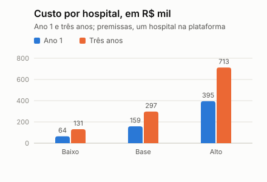

# Custo total, preço e retorno (premissas)

> **Premissas, não previsão.** Os preços de tabela (Supabase, Vercel, Hostinger, Gemini) foram conferidos nas páginas dos fornecedores em 11/11/2026. O resto é premissa nossa, em três cenários, e a hora de trabalho e o parecer jurídico ainda não foram cotados. Nada aqui é parecer jurídico ou contábil, cotação ou proposta comercial. Gerado por `python -m app.cli costs`.

## Perguntas

O feedback da Entrega 3 pediu três coisas: que o custo anual contemplasse implantação, treinamento e parecer jurídico; uma estimativa mais completa do custo total de implantação e operação; e como o preço será estabelecido e como o hospital contrata depois do piloto. Este relatório responde às duas primeiras e ao cálculo do preço; a contratação está em [preço e contratação](../negocio/preco-e-contratacao.md).

## De onde vêm os números

| Item | Valor | Fonte |
| --- | --- | --- |
| Supabase Pro | US$ 25 por mês (backup diário por 7 dias, sem pausa por inatividade); computação Small US$ 15; PITR US$ 100 | [supabase.com/pricing](https://supabase.com/pricing), 11/11/2026 |
| Vercel Pro | US$ 20 por mês por desenvolvedor; o plano gratuito é só para uso não comercial | [vercel.com/pricing](https://vercel.com/pricing), 11/11/2026 |
| Servidor | KVM 2 a R$ 77,99 e KVM 4 a R$ 149,99 por mês, no preço de renovação (o promocional dura só o primeiro período) | [hostinger.com/br/servidor-vps](https://www.hostinger.com/br/servidor-vps), 11/11/2026 |
| Gemini 3.1 Flash-Lite, camada paga | US$ 0.25 por 1 milhão de tokens de entrada e US$ 1.5 de saída; na camada paga o conteúdo "não é usado para melhorar os produtos", na gratuita é | [aistudio.google.com/docs/pricing](https://aistudio.google.com/docs/pricing), 11/11/2026 |
| Consulta de CRM no CFM | R$ 948 por ano para empresa particular | lido pelo grupo em 03/11/2026 (Entrega 3), a reconferir |
| Referência de mercado | R$ 5.740 por mês de "preço inicial" de uma ferramenta de escala de plantões (Escala) | comparador de terceiros ([b2bstack.com.br](https://www.b2bstack.com.br/compare/surglogs-vs-escala)), **não confirmado com o fornecedor** |
| Câmbio | R$ 5,50 por dólar | premissa da Entrega 3 |

Não foi possível confirmar um valor atual para o parecer jurídico: as tabelas de honorários da OAB variam por seccional, e os valores achados são de anos diferentes. Ficou como premissa em faixa, a cotar.

## Itens de custo de um hospital

Hospital de referência: 816 vagas por ano, como na simulação. Valores em reais.

| Item | Tipo | Fonte | Baixo | Base | Alto | Observação |
| --- | --- | --- | ---: | ---: | ---: | --- |
| Banco e login (Supabase) | por ano | pública | 1.650 | 1.650 | 9.240 | Pro: backup diário por 7 dias e sem pausa. Alto soma Small e PITR (7 dias). |
| Servidor da API e do n8n | por ano | pública | 936 | 936 | 3.600 | Hostinger, preço de renovação. Baixo e base: KVM 2. Alto: dois KVM 4 (redundância). |
| Hospedagem da web (Vercel Pro) | por ano | pública | 1.320 | 1.320 | 1.320 | O plano gratuito é só para uso não comercial; um desenvolvedor. |
| Gemini (camada paga) | por ano | pública | 7 | 7 | 22 | Preço por token público; os tokens por chamada são premissa. Alto: 3 vezes mais. |
| Consulta de CRM no CFM | por ano | pública | 0 | 948 | 948 | Valor lido em 03/11/2026 para empresa particular; o hospital talvez já tenha acesso. |
| Domínio, e-mail e monitoramento | por ano | premissa | 600 | 1.800 | 6.000 | Alertas de queda, registro de erros e e-mail de aviso. |
| Operação e suporte | por ano | premissa | 15.600 | 31.200 | 62.400 | Horas por semana: 2, 4 e 8 (plantão de sobreaviso), a R$ 150 por hora. |
| Manutenção do modelo e do monitoramento de vieses | por ano | premissa | 7.200 | 14.400 | 28.800 | Retreino mensal, revisão de contestações e da concentração: 4, 8 e 16 horas por mês. |
| Revisão jurídica anual | por ano | premissa | 3.000 | 8.000 | 20.000 | As normas do CFM mudam (a 2.462 já foi suspensa). Sem cotação ainda. |
| Implantação no hospital | uma vez | premissa | 9.000 | 18.000 | 36.000 | Cadastros, política de jornada, importação de planilhas: 60, 120 e 240 horas. |
| Integração com escala e ponto | uma vez | premissa | 0 | 0 | 24.000 | Fica fora no baixo e no base (fase 3 do roteiro); o alto inclui 160 horas. |
| Treinamento de coordenadores e médicos | uma vez | premissa | 1.700 | 3.900 | 10.000 | Horas do instrutor (8, 16 e 40) mais material. O tempo dos médicos é do hospital. |
| Parecer jurídico e minuta de contrato | uma vez | premissa | 8.000 | 20.000 | 45.000 | LGPD, Res. CFM 2.454 e 2.460, acordo de tratamento de dados. Sem cotação ainda. |
| Relatório de impacto e avaliação de risco algorítmico | uma vez | premissa | 3.600 | 9.000 | 18.000 | 24, 60 e 120 horas, com apoio do jurídico. |
| Revisão de segurança antes de dados reais | uma vez | premissa | 0 | 15.000 | 40.000 | Teste de invasão e revisão de configuração. Baixo: só revisão interna. |
| Passagem para produção | uma vez | premissa | 6.000 | 12.000 | 24.000 | Plano pago do banco, backups, monitoramento e esteira de deploy: 40, 80 e 160 horas. |

Sobre o subtotal entram a contingência (10%, 15% e 20% nos três cenários).

## Custo total

Por hospital, com um só hospital na plataforma:

| | Baixo | Base | Alto |
| --- | ---: | ---: | ---: |
| Recorrente, por ano | R$ 33,3 mil | R$ 69,3 mil | R$ 158,8 mil |
| Implantação e parecer, uma vez | R$ 31,1 mil | R$ 89,6 mil | R$ 236,4 mil |
| **Ano 1** | **R$ 64,5 mil** | **R$ 158,9 mil** | **R$ 395,2 mil** |
| **Três anos** | **R$ 131,2 mil** | **R$ 297,5 mil** | **R$ 712,8 mil** |

Dividindo a plataforma entre mais hospitais (o que é compartilhado, como o banco, o servidor, o parecer e o modelo, se divide; a implantação e o treinamento não), no cenário base:

| Hospitais na plataforma | Recorrente, por ano | Ano 1 | Três anos |
| ---: | ---: | ---: | ---: |
| 1 | R$ 69,3 mil | R$ 158,9 mil | R$ 297,5 mil |
| 3 | R$ 39,2 mil | R$ 91,6 mil | R$ 170,0 mil |
| 10 | R$ 28,7 mil | R$ 68,0 mil | R$ 125,4 mil |

## O preço: piso, teto e se fecha

- **Piso:** o custo anual (o recorrente mais a implantação e o parecer diluídos em 3 anos) dividido por 1 menos o imposto (10%) e a margem (30%).
- **Teto:** 30% do benefício central do hospital: metade das vagas descobertas evitada (5,4% das vagas, na simulação), a R$ 1.500 por vaga descoberta (referência pública do plantão, Fhemig 2024), mais as horas de coordenação poupadas.
- **Fecha** quando o piso cabe no teto. O preço sugerido é o meio da faixa. O custo real de uma vaga descoberta (V) segue desconhecido e só vem do financeiro do hospital, no piloto.

Cenário base, por porte e por número de hospitais na plataforma:

| Porte | Vagas por ano | Benefício central | Teto (30%) | Piso com 1 | Piso com 3 | Piso com 10 | Fecha? |
| --- | ---: | ---: | ---: | ---: | ---: | ---: | --- |
| Pequeno: o hospital da simulação | 816 | R$ 41,2 mil | R$ 12,4 mil | R$ 165,3 mil | R$ 94,4 mil | R$ 69,7 mil | 1: não, 3: não, 10: não |
| Médio: 3 unidades, cerca de 7 vagas por dia | 2.446 | R$ 123,4 mil | R$ 37,0 mil | R$ 165,3 mil | R$ 94,5 mil | R$ 69,7 mil | 1: não, 3: não, 10: não |
| Grande: hospital de referência, 40 vagas por dia | 14.600 | R$ 736,6 mil | R$ 221,0 mil | R$ 165,5 mil | R$ 94,7 mil | R$ 69,9 mil | 1: sim, 3: sim, 10: sim |

Preço sugerido por mês onde fecha (meio da faixa, cenário base):

| Porte | Com 1 hospital | Com 3 | Com 10 |
| --- | ---: | ---: | ---: |
| Pequeno: o hospital da simulação | não fecha | não fecha | não fecha |
| Médio: 3 unidades, cerca de 7 vagas por dia | não fecha | não fecha | não fecha |
| Grande: hospital de referência, 40 vagas por dia | R$ 16,1 mil | R$ 13,2 mil | R$ 12,1 mil |

Volume de vagas por dia a partir do qual o piso cabe no teto (benefício central):

| Cenário de custo | Com 1 hospital | Com 3 | Com 10 |
| --- | ---: | ---: | ---: |
| Baixo | 13,2 | 7,5 | 5,6 |
| Base | 29,9 | 17,1 | 12,6 |
| Alto | 71,7 | 41,0 | 30,2 |

E o custo de uma vaga descoberta (V) que o hospital teria de ter para pagar o piso com 30% do benefício (metade das descobertas evitada, cenário base):

| Porte | Com 1 hospital | Com 3 | Com 10 |
| --- | ---: | ---: | ---: |
| Pequeno: o hospital da simulação | R$ 24,6 mil | R$ 13,9 mil | R$ 10,2 mil |
| Médio: 3 unidades, cerca de 7 vagas por dia | R$ 8,0 mil | R$ 4,4 mil | R$ 3,1 mil |
| Grande: hospital de referência, 40 vagas por dia | R$ 1,0 mil | R$ 432 | R$ 223 |

## O retorno do hospital grande ao preço sugerido (R$ 13,2 mil por mês)

Retorno = (benefício menos preço) dividido pelo preço, nos cenários da Entrega 3 (com 3 hospitais na plataforma, cenário base):

| Vagas descobertas evitadas | V = R$ 1.000 | V = R$ 2.000 |
| --- | ---: | ---: |
| 25% | +117% | +241% |
| 50% | +241% | +491% |
| 100% | +491% | +990% |

## Leitura

- **O custo total é bem maior que os R$ 34 mil da Entrega 3.** Aquele número era só o recorrente de infraestrutura e operação e avisava que faltavam o parecer jurídico e a implantação. Com tudo, um hospital sozinho custa R$ 69,3 mil por ano no cenário base, R$ 158,9 mil no primeiro ano e R$ 297,5 mil em três anos, numa faixa de R$ 64,5 mil a R$ 395,2 mil no primeiro ano.
- **A tecnologia é a parte barata.** Banco, servidor, hospedagem e Gemini somam R$ 3,9 mil por ano: o custo é de gente (suporte, manutenção do modelo, implantação, treinamento) e de conformidade (parecer, relatório de impacto, segurança).
- **O custo quase não depende do porte do hospital; o benefício, sim.** Por isso o piso é praticamente o mesmo nos três portes, e o que decide se o preço fecha é o volume de plantões.
- **O preço não fecha para um hospital pequeno nem médio sozinho.** No pequeno, o benefício central é de R$ 41,2 mil por ano e, mesmo evitando todas as vagas descobertas, seria de R$ 74,2 mil, contra um custo anualizado de R$ 99,2 mil. O produto só faz sentido financeiro onde há muitos plantões por dia, ou dividido entre muitos hospitais.
- **Sozinho, o piso cabe no teto a partir de cerca de 30 vagas por dia** (cenário base); com 3 hospitais dividindo a plataforma, 17; com 10, 13. O custo de entregar a um hospital cai quando a plataforma, o parecer e o modelo são divididos, e é por isso que a venda tende a ser para redes e grupos, e não para hospitais isolados.
- **Para o hospital grande, fecha com folga:** com 3 hospitais na plataforma, o preço sugerido é de cerca de R$ 13,2 mil por mês (R$ 158,0 mil por ano), contra uma referência de mercado de R$ 5,7 mil por mês de "preço inicial" de outra ferramenta de escala (não confirmada com o fornecedor). O retorno do hospital depende de V e da parcela evitada, e o piloto é que mede os dois.
- **Isto muda a resposta do documento da Entrega 3,** que dizia que o projeto se paga ao evitar 17 vagas por ano com V de R$ 2.000: com o custo completo, a conta só fecha em hospitais de volume alto.

## Limites

- É calculadora de premissas: horas, parecer, segurança, margem, imposto e parcela do benefício são nossos e movem o resultado. Os três cenários mostram o quanto.
- O custo de hora (R$ 150) é de mercado, e não o do grupo, que é de estudantes; serve para mostrar o custo de um serviço de verdade.
- O benefício vem da simulação (5,4% de vagas descobertas no processo manual) e de um valor de plantão público. O coordenador real pode já cobrir bem, e o ganho encolhe.
- Não há tributo, financiamento nem preço por hospital público (que contrata por licitação ou dispensa): o segmento inicial é o hospital privado e terceirizado.
- Falta cotar: o parecer jurídico, o teste de segurança e o suporte, com fornecedores reais; e confirmar com o financeiro de um hospital o V e o custo do que ele paga hoje.
