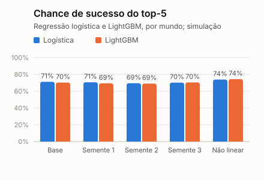

# Regressão logística contra LightGBM (simulação)

> **Simulação.** Os dados são sintéticos e o modelo aprende o simulador que os gerou (circularidade). O que vale é a comparação entre os modelos nas mesmas condições, e não o valor absoluto. Gerado na CI por `python -m app.cli lightgbm` (lightgbm 4.5.0), que roda só lá: o LightGBM não faz parte das dependências da API.

## Pergunta

A Etapa 2 prometeu comparar a regressão logística com o LightGBM, e a Entrega 3 deixou isso como não feito. O LightGBM ganha? E o que acontece se o simulador tiver uma regra que a regressão logística não representa?

## Como foi feito

- **Mesmo teste temporal** do restante do projeto: treino com as ofertas anteriores a 2026-08-01 (6259 na base) e avaliação depois dessa data (1296 ofertas), com as mesmas sete variáveis do ranking.
- **LightGBM:** 15 folhas, taxa de 0,05, no máximo 500 rodadas e parada cedo numa validação com os 20% mais recentes do treino; depois, treino de novo com todo o passado.
- **Três medidas:** AUC e erro de probabilidade (Brier) nas ofertas de teste, e a chance média de sucesso verdadeira do top-5 (contrafactual, só em simulação), pareada por vaga.
- **Mundos:** a base, três outras sementes e um mundo com **regra não linear**: a distância pesa mais a partir de 15 km, e a preferência de período muda quanto ela pesa. A regressão logística não representa nenhuma das duas coisas.
- **Critério de troca, escrito antes do resultado:** o LightGBM só substituiria a regressão se ganhasse pelo menos 1 ponto de chance de sucesso do top-5, com pelo menos 3 erros-padrão, **na base e no mundo não linear**.

## Resultado

| Mundo | AUC: baseline | AUC: logística | AUC: LightGBM | Brier: logística | Brier: LightGBM | Top-5: oráculo | Top-5: logística | Top-5: LightGBM | LightGBM menos logística (erro-padrão) | Veredito |
| --- | ---: | ---: | ---: | ---: | ---: | ---: | ---: | ---: | ---: | --- |
| Base | 0,702 | 0,762 | 0,765 | 0,164 | 0,164 | 75,8% | 71,2% | 70,3% | −1,0 (±0,16) | empata |
| Outra semente (1) | 0,717 | 0,778 | 0,777 | 0,164 | 0,165 | 75,9% | 70,7% | 69,3% | −1,3 (±0,16) | perde |
| Outra semente (2) | 0,712 | 0,774 | 0,781 | 0,162 | 0,159 | 74,6% | 69,5% | 69,1% | −0,4 (±0,16) | empata |
| Outra semente (3) | 0,702 | 0,779 | 0,790 | 0,169 | 0,165 | 74,4% | 70,2% | 70,4% | +0,2 (±0,13) | empata |
| Regra não linear | 0,697 | 0,780 | 0,784 | 0,181 | 0,176 | 80,4% | 73,8% | 74,4% | +0,6 (±0,15) | empata |

## Leitura

- **Na base, o LightGBM empata** (−1,0 ponto de chance de sucesso do top-5; AUC 0,765 contra 0,762). O simulador é quase linear na escala logística, e é isso que a regressão aprende; um modelo mais flexível não tem muito o que acrescentar.
- **No mundo com regra não linear, o LightGBM empata** (+0,6 ponto; AUC 0,784 contra 0,780). Os dois ficam longe do oráculo (−6,6 e −6,0 pontos), que enxerga a confiabilidade latente do médico, algo que nenhum dos modelos vê.
- **Entre os 5 mundos, a diferença do LightGBM para a regressão vai de −1,3 a +0,6 ponto(s).** Ele não passa consistentemente à frente nem na base nem onde a regra deixa de ser linear.
- **Decisão: a regressão logística continua.** O LightGBM não cumpre o critério nos dois mundos. Além do desempenho, a regressão tem a leitura por peso, que a tela do coordenador mostra como "por que este nome".
- **O que o LightGBM usa na base** (ganho por variável): `availability_overlap_hours` (50%), `distance_km` (22%), `acceptance_rate_90d` (11%), `night_shift_preference_match` (6%). As mesmas variáveis que a regressão pesa mais.

## Limites

- É o mesmo simulador dos dois lados: o modelo aprende o mundo que o gerou. A comparação diz como cada modelo se sai nesse mundo e em uma variação dele, e não no hospital.
- O mundo não linear foi escolhido pelo grupo para ter o que o LightGBM representa e a regressão não; os termos extras (−0,30 por km acima de 15 e +0,06 por km vezes a preferência) são arbitrários, e outra forma de não linearidade poderia dar outro resultado.
- Hiperparâmetros fixos, sem busca; uma busca pode melhorar o LightGBM e não o piorará.
- O LightGBM roda só na CI. Se vier a entrar no produto, a explicação por variável poderia vir das contribuições do próprio LightGBM, mas isso é trabalho novo.
