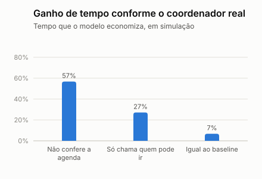
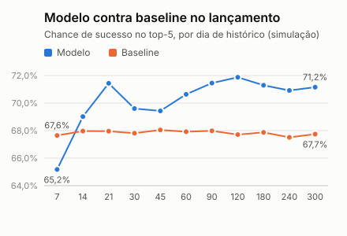

# Teste de premissas e simulação de lançamento (simulação)

> **Simulação.** Os dados são sintéticos. Este teste não substitui dado real: refaz o mundo simulado com outras premissas e mostra quais conclusões dependem de quais delas. Sem entrevistas (decisão de 06/11), é o que mostra o peso de cada premissa declarada.

## O que resiste e o que não resiste

Em cada um dos 17 cenários, os dados são gerados de novo com uma premissa alterada, o modelo é treinado de novo e a avaliação se repete nas vagas de teste.

| Conclusão | Resultado | Leitura |
| --- | --- | --- |
| O modelo supera o baseline na chance de sucesso do top-5 | 17 de 17 cenários, de +2,1 a +6,4 pontos | Resiste |
| O modelo supera o baseline no AUC | 17 de 17 cenários | Resiste |
| O fluxo recomendado reduz ao menos 50% o tempo do processo manual | 14 de 17 cenários; redução de 42% a 63% | Depende das premissas |
| O modelo reduz o tempo contra quem já chama só quem pode ir | De 16% a 46% | Ganho real, mas menor que contra o processo manual |
| O modelo reduz o tempo contra o baseline | De 3% a 14% | Ganho pequeno: o baseline já captura boa parte |
| A recomendação concentra mais ofertas que o processo manual | 17 de 17 cenários | O problema não some com outras premissas: precisa de mitigação |

A meta de 50% não se sustenta em: Outra semente (3), Preferência pesa o dobro, Agenda pesa um quarto.

## Quanto o ganho depende do coordenador real

O simulador assume que o coordenador chama sem conferir a agenda. Se o real já trabalha melhor, a economia de tempo encolhe, com tudo mais igual:

<!-- keep -->
| Se o coordenador real... | Ofertas por vaga hoje | Tempo que o modelo economiza |
| --- | ---: | ---: |
| Chama sem conferir a agenda (premissa atual) | 3,31 | 57% |
| Já chama só quem pode ir, em qualquer ordem | 1,82 | 27% |
| Já escolhe tão bem quanto o baseline | 1,41 | 7% |

É a premissa que mais pesa, e só dado real a resolve: quantos médicos o coordenador chama até alguém aceitar. Sem entrevistas, ela fica declarada como premissa do grupo.

## Cenários

Cada par segue a ordem do título da coluna. A última coluna é a parcela que vai para os 10% de médicos mais chamados: das ofertas feitas, no manual, e dos lugares do top-5, no modelo.

| Cenário | Aceite (manual) | Ofertas por vaga (manual) | Sem cobertura (manual) | AUC modelo / baseline | Top-5 modelo / baseline | Tempo manual / modelo (min) | Redução | 10% mais chamados manual / modelo |
| --- | ---: | ---: | ---: | ---: | ---: | ---: | ---: | ---: |
| Base | 30,8% | 3,31 | 5,4% | 0,762 / 0,702 | 71,2% / 67,7% | 110 / 47 | 57% | 31% / 51% |
| Outra semente (1) | 29,7% | 3,14 | 6,2% | 0,778 / 0,717 | 70,7% / 67,4% | 99 / 47 | 52% | 30% / 50% |
| Outra semente (2) | 30,9% | 3,25 | 4,2% | 0,774 / 0,712 | 69,5% / 65,7% | 109 / 49 | 55% | 32% / 50% |
| Outra semente (3) | 30,4% | 3,02 | 5,7% | 0,779 / 0,702 | 70,2% / 67,5% | 96 / 49 | 49% | 29% / 53% |
| Distância pesa metade | 37,5% | 2,72 | 2,6% | 0,765 / 0,674 | 73,7% / 69,8% | 95 / 46 | 51% | 32% / 48% |
| Distância pesa o dobro | 21,3% | 4,13 | 17,6% | 0,828 / 0,770 | 67,7% / 63,6% | 118 / 49 | 59% | 31% / 51% |
| Preferência pesa metade | 28,2% | 3,42 | 8,2% | 0,764 / 0,704 | 65,0% / 62,1% | 106 / 52 | 52% | 32% / 52% |
| Preferência pesa o dobro | 39,1% | 2,36 | 2,0% | 0,792 / 0,716 | 81,9% / 76,8% | 80 / 41 | 48% | 33% / 48% |
| Confiabilidade pesa metade | 28,9% | 3,39 | 8,4% | 0,771 / 0,689 | 68,8% / 65,3% | 107 / 49 | 54% | 32% / 51% |
| Confiabilidade pesa o dobro | 37,3% | 2,60 | 2,6% | 0,763 / 0,688 | 78,1% / 71,7% | 87 / 43 | 51% | 33% / 57% |
| Aceite geral menor | 21,2% | 4,03 | 15,1% | 0,786 / 0,715 | 57,8% / 53,4% | 119 / 58 | 51% | 30% / 49% |
| Aceite geral maior | 42,0% | 2,53 | 1,5% | 0,767 / 0,698 | 82,0% / 79,0% | 92 / 41 | 55% | 31% / 47% |
| Agenda pesa um quarto | 43,8% | 2,35 | 1,0% | 0,652 / 0,628 | 71,6% / 67,9% | 80 / 47 | 42% | 32% / 51% |
| Sem viés histórico | 30,1% | 3,07 | 4,3% | 0,794 / 0,742 | 71,8% / 67,8% | 102 / 47 | 54% | 23% / 49% |
| Oferta expira em 30 min | 30,8% | 3,31 | 5,4% | 0,762 / 0,702 | 71,2% / 67,7% | 83 / 40 | 52% | 31% / 51% |
| Oferta expira em 120 min | 30,8% | 3,31 | 5,4% | 0,762 / 0,702 | 71,2% / 67,7% | 147 / 55 | 63% | 31% / 51% |
| Calibrado com dados públicos | 30,9% | 3,16 | 5,5% | 0,773 / 0,688 | 69,7% / 67,6% | 104 / 47 | 55% | 31% / 51% |

## Comparação com dados públicos

Fonte: [Demografia Médica no Brasil 2025](https://bvsms.saude.gov.br/bvs/publicacoes/demografia_medica_brasil_2025.pdf), tabelas 3, 7 e 8, lida em 03/11/2026. São totais nacionais de dezembro de 2024, sem nenhum registro individual, e contam títulos de especialista, não plantonistas nem hospitais privados.

<!-- keep -->
| Dado | Premissa | Amostra gerada | Estudo | Leitura |
| --- | ---: | ---: | ---: | --- |
| Pediatras entre as duas especialidades | 45,0% | 50,7% | 44,7% | A premissa acerta; a amostra de 300 médicos saiu acima dela por sorteio |
| Mulheres na pediatria | 50,0% | 46,1% | 76,8% | O simulador erra: há bem mais mulheres na pediatria |
| Mulheres na clínica médica | 50,0% | 50,0% | 55,5% | Perto da premissa |
| Mais jovens (simulador: 25 a 34; estudo: até 35 anos) | 25,0% | 23,0% | 21,9% | Perto da premissa; os recortes não são idênticos |
| Com 55 anos ou mais | 15,0% | 14,0% | 26,8% | O simulador erra: há quase o dobro de médicos nessa faixa |

No cenário "Calibrado com dados públicos", essas parcelas seguem o estudo, com o meio das faixas etárias dividido em partes iguais (premissa do grupo). O modelo continua à frente do baseline (+2,1 pontos no top-5, contra +3,5 na base) e a redução contra o manual fica em 55%. Era esperado: gênero não entra na fórmula de aceite, e a idade só muda a exposição histórica. Por isso os agregados públicos corrigem a composição da população, não o comportamento. O estudo quase não traz números sobre plantão: o comportamento precisa de outras fontes publicadas ou de um piloto. Os erros de gênero e idade pesam na auditoria de equidade, não no ranking, que não usa essas variáveis.

## Simulação de lançamento

Quanto histórico o modelo precisa para superar o baseline? No dia D depois do início, o modelo é treinado só com ofertas cujo plantão já terminou, porque antes disso não se sabe se o médico compareceu, e é testado nas vagas dos 60 dias seguintes.

| Dia | Ofertas com resultado | Sucessos | AUC modelo / baseline | Top-5 modelo / baseline | Diferença (pontos) | Erro padrão |
| ---: | ---: | ---: | ---: | ---: | ---: | ---: |
| 7 | 114 | 33 | 0,612 / 0,700 | 65,2% / 67,6% | -2,5 | 0,3 |
| 14 | 252 | 81 | 0,749 / 0,698 | 69,0% / 68,0% | +1,1 | 0,2 |
| 21 | 363 | 125 | 0,759 / 0,703 | 71,4% / 68,0% | +3,5 | 0,2 |
| 30 | 555 | 180 | 0,754 / 0,696 | 69,6% / 67,8% | +1,8 | 0,2 |
| 45 | 815 | 270 | 0,757 / 0,692 | 69,4% / 68,0% | +1,4 | 0,2 |
| 60 | 1114 | 373 | 0,747 / 0,691 | 70,6% / 67,9% | +2,7 | 0,2 |
| 90 | 1788 | 550 | 0,762 / 0,703 | 71,5% / 68,0% | +3,5 | 0,2 |
| 120 | 2395 | 731 | 0,766 / 0,701 | 71,9% / 67,7% | +4,2 | 0,2 |
| 180 | 3635 | 1102 | 0,760 / 0,701 | 71,3% / 67,9% | +3,4 | 0,2 |
| 240 | 4837 | 1464 | 0,774 / 0,681 | 70,9% / 67,5% | +3,4 | 0,2 |
| 300 | 6119 | 1841 | 0,757 / 0,692 | 71,2% / 67,7% | +3,4 | 0,2 |

O modelo fica à frente do baseline a partir do dia 14, com 252 ofertas de resultado conhecido, e não perde mais até o fim. Antes disso, perde: no dia 7, com 114 ofertas, fica 2,5 pontos atrás.

Por isso o lançamento começa pelo baseline, e o modelo só entra quando superar o baseline em teste temporal com dados do próprio hospital. O volume aqui é o de 3 hospitais simulados, com cerca de um terço das ofertas em cada um: um hospital sozinho levaria cerca de três vezes mais tempo para juntar o mesmo histórico.

## Limites

- O teste muda os **valores** das premissas, não a **forma** do comportamento: em todos os cenários, o aceite segue a mesma fórmula, com as mesmas variáveis. Um motivo real de recusa que o simulador não tem não aparece aqui. Quem mede isso são a revisão às cegas e o piloto em paralelo.
- A chance de aceite dos elegíveis é a verdadeira do simulador; no mundo real, o modelo a estima com erro.
- Os tempos usam 100 repetições por vaga e as premissas de tempo do gerador, que não têm fonte externa.
- A avaliação principal treina com ofertas enviadas antes do corte, e 75 de 6259 (1,2%) têm o plantão depois dele, quando o resultado ainda não se saberia. Refeita só com resultados conhecidos, o AUC vai de 0,7623 para 0,7624 e o top-5, de 71,23% para 71,26%. A diferença é desprezível, e a simulação de lançamento acima já usa a regra mais rigorosa.
