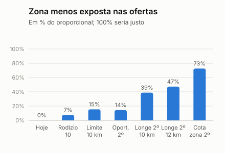

# Experimento contra a exclusão por zona (simulação)

> **Simulação.** Os dados são sintéticos e a chance de aceite é a do simulador, em que a distância pesa muito. O experimento mostra quanto cada medida troca de equidade entre regiões por chance de sucesso e tempo dentro do mundo simulado; não é evidência do mundo real. Gerado por `python -m app.cli zone`.

## Perguntas

O feedback da Entrega 3 perguntou: (1) o rodízio reduz mesmo a concentração entre médicos? (2) Ele resolve a desigualdade entre regiões? O [experimento da concentração](metricas-concentracao.md) já mostrou que a zona quase não muda (leste e oeste de 0,01 para 0,07). Aqui se testa o que atacaria isso e a que preço.

## Como foi feito

- **392 vagas de teste**, as mesmas do experimento da concentração, em ordem de publicação, com em média 50 elegíveis por vaga e 100 repetições da cascata por vaga, com os mesmos sorteios para todas as políticas.
- **Todas partem do rodízio de 10 pontos** (o que está na API), menos a de hoje.
- **Limite ao peso da distância:** o score passa a tratar qualquer distância acima de 10 km como 10 km. Muda a ordem do modelo.
- **Lugar de oportunidade:** o 2º ou o 3º lugar vai para quem tem menos aparições no top-5 na semana, entre os que estão a até 30 pontos de chance prevista da melhor. Não olha a zona nem a distância.
- **Lugar para quem mora longe:** igual ao anterior, mas só entre quem mora a 10 km ou mais (ou 12 km). Usa a distância, que já é variável do ranking, e não a zona.
- **Cota por zona (só referência):** o lugar vai para a zona menos presente no top-5 até ali. Usa a zona para decidir, o que o projeto não faz, e mostra o teto do que se ganharia.
- **Duas medidas por zona** (1,00 seria proporcional): a participação no top-5 e a das ofertas que de fato saem (a cascata faz em média 1,4 ofertas por vaga, então estar em 5º quase nunca significa receber uma).
- **Critérios de adoção, escritos antes do resultado:** a zona menos exposta chega a 0,50 no top-5 e a chance de sucesso cai no máximo 2 pontos além do rodízio de hoje. As referências por zona não podem ser adotadas.
- **Alerta de revisão humana:** conta as semanas em que alguma zona fica abaixo de 0,50 no top-5.

## Resultado

| Política | Chance de sucesso do top-5 | Contra o rodízio de hoje (erro-padrão) | Tempo médio (min) | 10% mais expostos: ofertas* | Zona menos exposta: top-5 | Zona menos exposta: ofertas | Semanas com alerta |
| --- | ---: | ---: | ---: | ---: | ---: | ---: | ---: |
| Hoje: só a ordem do modelo | 71,2% | +1,8 (±0,17) | 47 | 82,1% | 0,01 | 0,00 | 9 de 9 |
| Rodízio de 10 pontos (o que está na API) | 69,4% | +0,0 (±0,00) | 49 | 35,7% | 0,07 | 0,07 | 9 de 9 |
| Rodízio e limite do peso da distância em 10 km | 68,5% | −0,9 (±0,14) | 50 | 36,2% | 0,20 | 0,15 | 9 de 9 |
| Rodízio e lugar de oportunidade no 3º | 68,3% | −1,1 (±0,17) | 50 | 35,2% | 0,18 | 0,09 | 9 de 9 |
| Rodízio e lugar de oportunidade no 2º | 68,6% | −0,9 (±0,15) | 50 | 35,6% | 0,15 | 0,14 | 9 de 9 |
| Rodízio e 3º lugar para quem mora a 12 km ou mais | 65,5% | −4,0 (±0,19) | 50 | 35,1% | 0,49 | 0,18 | 6 de 9 |
| Rodízio e 2º lugar para quem mora a 10 km ou mais | 66,2% | −3,3 (±0,19) | 52 | 32,4% | 0,44 | 0,39 | 6 de 9 |
| Rodízio e 2º lugar para quem mora a 12 km ou mais | 65,5% | −4,0 (±0,19) | 52 | 31,8% | 0,49 | 0,47 | 6 de 9 |
| Referência: cota por zona no 3º lugar (usa a zona; não é adotável) | 66,3% | −3,1 (±0,19) | 50 | 34,4% | 0,81 | 0,22 | 0 de 9 |
| Referência: cota por zona no 2º lugar (usa a zona; não é adotável) | 66,3% | −3,1 (±0,19) | 52 | 34,6% | 0,81 | 0,73 | 0 de 9 |

\* Estimativa superior, como no experimento da concentração. O tempo do processo manual simulado é de cerca de 110 min.

### Por zona, nas ofertas que saem (1,00 = proporcional)

| Política | Centro | Leste | Norte | Oeste | Sul |
| --- | ---: | ---: | ---: | ---: | ---: |
| Hoje: só a ordem do modelo | 0,85 | 0,00 | 1,73 | 0,00 | 1,82 |
| Rodízio de 10 pontos (o que está na API) | 0,93 | 0,08 | 1,63 | 0,07 | 1,66 |
| Rodízio e lugar de oportunidade no 2º | 0,95 | 0,14 | 1,44 | 0,21 | 1,67 |
| Rodízio e 2º lugar para quem mora a 10 km ou mais | 0,92 | 0,39 | 1,32 | 0,62 | 1,45 |
| Rodízio e 2º lugar para quem mora a 12 km ou mais | 0,87 | 0,47 | 1,38 | 0,65 | 1,44 |
| Referência: cota por zona no 2º lugar (usa a zona; não é adotável) | 0,80 | 0,77 | 1,34 | 0,73 | 1,38 |

## O que resiste em outros mundos

A mesma comparação, refeita com outras sementes e com o peso da distância no aceite pela metade e pelo dobro. Cada linha traz a parcela das ofertas dos 10% mais expostos, a participação da zona menos exposta (top-5) e a chance de sucesso.

| Mundo | Hoje: 10% mais expostos | Hoje: zona | Rodízio: 10% mais expostos | Rodízio: zona | Longe no 2º (10 km): zona | Longe no 2º: sucesso | Cota por zona: zona | Cota: sucesso |
| --- | ---: | ---: | ---: | ---: | ---: | ---: | ---: | ---: |
| Base | 82,1% | 0,01 | 35,7% | 0,07 | 0,44 | 66,2% | 0,81 | 66,3% |
| Outra semente (1) | 78,0% | 0,02 | 40,7% | 0,11 | 0,52 | 65,6% | 0,78 | 66,4% |
| Outra semente (2) | 84,0% | 0,03 | 36,8% | 0,09 | 0,53 | 65,0% | 0,72 | 65,6% |
| Outra semente (3) | 82,2% | 0,04 | 36,2% | 0,19 | 0,57 | 65,2% | 0,68 | 65,7% |
| Distância pesa metade | 74,6% | 0,00 | 30,2% | 0,16 | 0,52 | 70,1% | 0,87 | 70,3% |
| Distância pesa o dobro | 85,2% | 0,00 | 49,9% | 0,00 | 0,04 | 64,7% | 0,30 | 63,4% |

## Leitura

- **Pergunta 1, sim.** O rodízio reduz a concentração entre pessoas em todos os 6 mundos testados: os 10% mais expostos recebem de 74,6% a 85,2% das ofertas só pelo modelo e de 30,2% a 49,9% com o rodízio. O custo na base é de −1,8 pontos de chance de sucesso do top-5.
- **Pergunta 2, não.** Com o rodízio, a zona menos exposta recebe 0,07 do que receberia se fosse proporcional, e o alerta de revisão humana dispararia em 9 das 9 semanas.
- **Sem olhar a distância nem a zona, não resolve.** O lugar de oportunidade no 2º leva a zona menos exposta a 0,14: quem está há mais tempo sem aparecer não é, em geral, quem mora longe.
- **Limitar o peso da distância ajuda pouco.** Com o teto de 10 km, a zona menos exposta vai a 0,15 nas ofertas, por −0,9 pontos de chance de sucesso: o modelo continua achando que quem mora longe aceita menos, e acha com razão no simulador.
- **Olhando a distância, resolve em parte e custa.** Reservar o 2º lugar a quem mora a 10 km ou mais leva a zona menos exposta a 0,39 nas ofertas, com −3,3 pontos de chance de sucesso e 2 min a mais por vaga.
- **O teto, usando a zona:** a cota por zona no 2º lugar leva a zona menos exposta a 0,73, por −3,1 pontos. Fica como referência, porque decidir por zona é outra escolha, de política e de ética, e não só de engenharia.
- **A posição do lugar importa mais que o alcance.** No 3º lugar a mesma regra quase não muda as ofertas, porque a cascata raramente chega até ele.
- **Pelos critérios combinados, nenhuma política é adotável por padrão:** as que chegam perto de 0,50 na zona menos exposta custam mais de 2 pontos de chance de sucesso. O preço da equidade regional é real e é uma escolha do hospital (da Comissão de IA), a ser feita com ofertas reais no piloto. O que este experimento entrega é o preço de cada escolha.

## Limites

- A distância pesa no aceite porque o simulador diz que pesa (39,9% de aceite até 5 km contra 17,4% a partir de 20 km). Parte da diferença entre regiões é preferência real de quem mora longe, e não injustiça; por isso a meta é igualdade de chance de ser chamado quando é viável, e não de resultado.
- Os limites de distância (10 e 12 km), o alcance de 30 pontos e o piso de alerta são escolhas do grupo. Para o lugar de oportunidade e para a cota, alcances de 20 e 40 pontos foram testados na exploração e deram resultado praticamente igual.
- A cascata simulada só liga os que recusam; quem está em 2º recebe oferta se o 1º recusar. No mundo real, a recusa tem outros motivos (cansaço, agenda) que o simulador não representa por completo.
- A zona não entra no ranking do modelo, só na auditoria e nas referências deste experimento. As medidas adotáveis usam a distância, que já é variável do ranking.
- Nada aqui muda a API: o rodízio de 10 pontos é o que está no ar.
